<!--
author: Matthew Blacklock
email: matthew.blacklock@northumbria.ac.uk
version: 1.0.0
language: en
mode: Presentation
icon: ../../../logo.png
import: https://raw.githubusercontent.com/MINT-the-GAP/lia-board-mode/main/README.md
        ../../../common/templates.md
comment: Importing a CAD file into ABAQUS and adjusting the curve display.
-->

# Importing a CAD file into ABAQUS

**General ABAQUS tutorial · Independent study or supported practice**

**You need:** ABAQUS/CAE with CAD import available and a writable work directory.

**Note:** Importing a CAD file into ABAQUS is not possible in the Learning Edition. You will need to use a campus-based PC to perform this task. You can also connect to a campus PC remotely: @[course(Accessing ABAQUS outside campus)](../OffCampusAccess/OffCampusAccess.md).

It is common to have a pre-drawn part created using CAD software (Solidworks, CATIA, Autodesk etc.). ABAQUS is able to read files generated using CAD software and allows them to be used in your FE model. The file formats we will use are .IGES and .STP. These are neutral CAD formats that can be used by many different CAD and CAE programs. They have the benefit of being able to be used with a wide range of software and are not version specific.

@[course(General tutorial library)](../README.md) · @[course(All ABAQUS tutorials)](../../README.md)

@tutorialNavigation(../../../common/images/TutorialNavigation.png)

## 1. Select the CAD file

To import a CAD file into ABAQUS:

Download the following file to your work directory:

[SPRING.stp](files/SPRING.stp)

Within ABAQUS go to **File → Import → Part...**

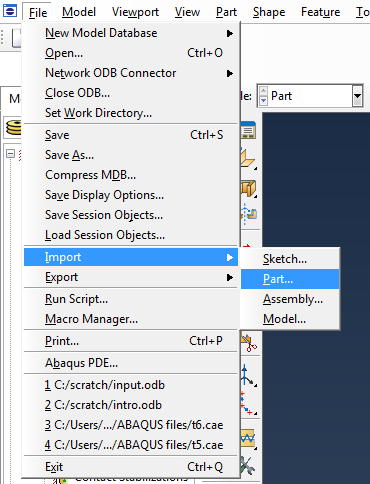

{{1}}
********************

Change the file type to STEP (*.STP):

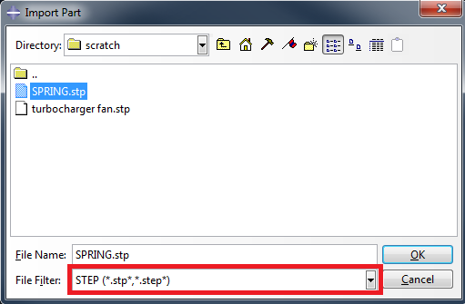

********************

## 2. Import the part

Click on the **SPRING.stp** file we downloaded and click **OK**. The *Create Part from STEP file* window appears with three tabs (*Name - Repair*, *Part Attributes* and *Scale*):

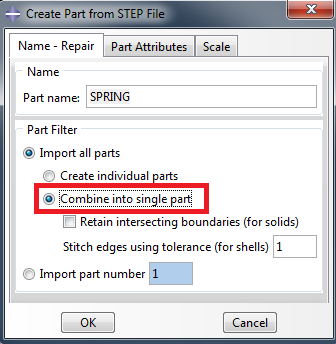

Within *Name - Repair*, click on **Combine into single part**.

{{1}}
********************

The other two tabs allow us to choose the modelling space and analysis type (we want **3D** and **Deformable**), and any scaling we want to apply (we don't):

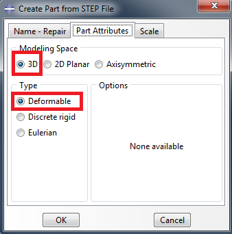

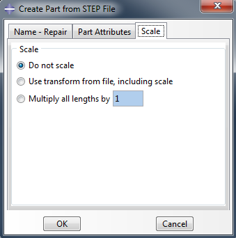

********************

{{2}}
********************

Click **OK**. The imported part will appear:

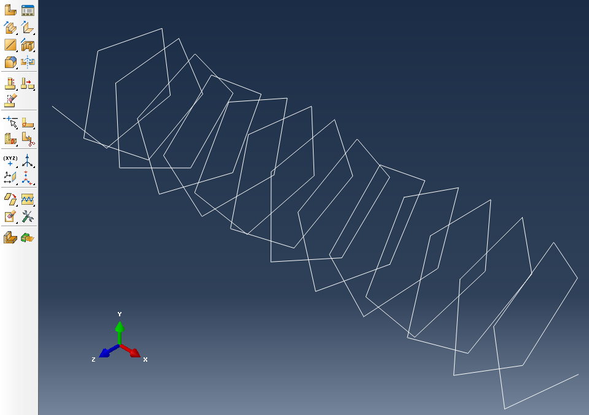

********************

## 3. Improve the curve display

You will notice the spring appears to be very jagged, i.e. made up of straight lines. This is an artifact of the display settings. To improve the rendering go to **View → Part Display Options**:

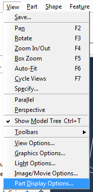

{{1}}
********************

Here, we want to change *Curve Refinement* from *Coarse* to **Extra Fine**:

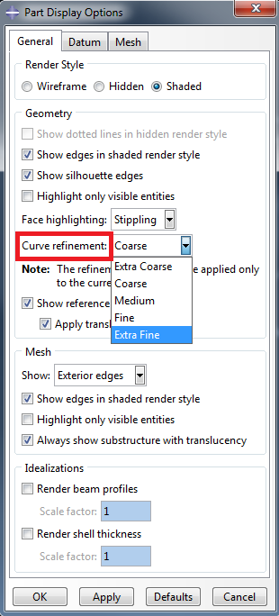

********************

{{2}}
********************

You will notice a much smoother part:

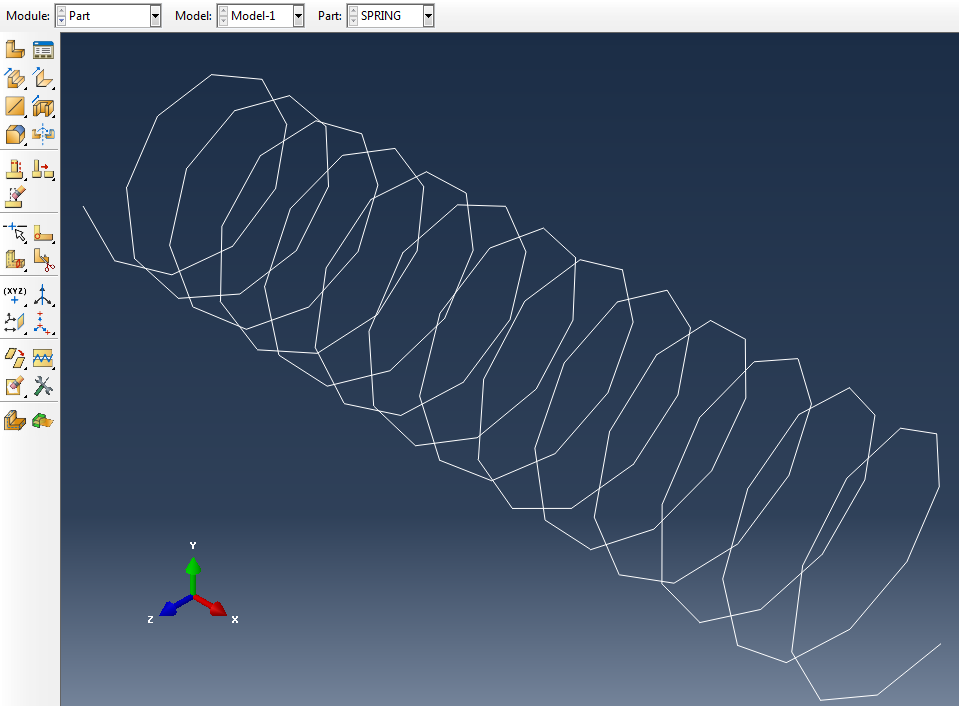

This changes how the geometry is displayed; it does not refine the finite element mesh.

********************

## 4. Continue with the ABAQUS model

Your part is now imported! From this point on it can be treated like any other ABAQUS part. To finish the model, you will need to create the material properties, assign a section, assemble the part, create a step, add loads and boundary conditions, mesh and submit a job for analysis.

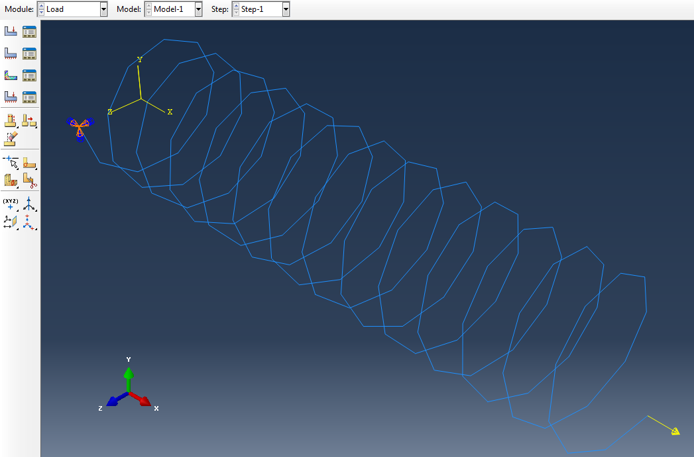

{{1}}
********************

You can then view the results in the visualisation window as normal.

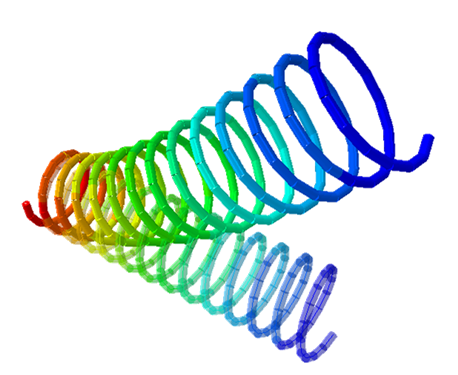

These screenshots illustrate the later modelling stages. Use the material properties, section dimensions, loads and boundary conditions specified in your own problem.

********************

{{2}}
********************

**Completion check**

- [ ] I imported the STEP geometry as a 3D deformable part without scaling it.
- [ ] I combined the geometry into a single part.
- [ ] I adjusted the curve display and understand that this does not change the mesh.
- [ ] I saved my CAE model in my work directory.

@[course(Week 5 lesson and optional spring problem)](../../../week05/week05.md) · @[course(General tutorial library)](../README.md) · @[course(All ABAQUS tutorials)](../../README.md)

********************
