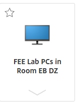
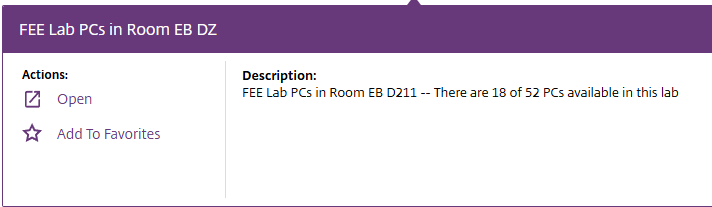
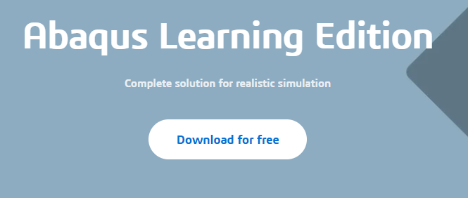

<!--
author: Matthew Blacklock
email: matthew.blacklock@northumbria.ac.uk
version: 1.0.1
language: en
mode: Presentation
icon: ../../../logo.png
import: https://raw.githubusercontent.com/MINT-the-GAP/lia-board-mode/main/README.md
        ../../../common/templates.md
comment: Access ABAQUS outside campus using MyAccess or ABAQUS Learning Edition.
-->

# Accessing ABAQUS outside campus

There are two ways to work in ABAQUS on your own computer:

- **Remote access:** connect to a physical PC on campus through MyAccess.
- **ABAQUS Learning Edition:** install the free, limited edition on your own Windows computer.

Choose an option from the sidebar.

@tutorialNavigation(../../../common/images/TutorialNavigation.png)

## Remote access to a campus PC

You can use a physical PC on campus remotely to work in ABAQUS. This works on Windows and Mac based operating systems.

This is an **out-of-hours service**. Most rooms are only listed **after 5 pm on weekdays and at weekends**.

Open [myaccess.northumbria.ac.uk](https://myaccess.northumbria.ac.uk) and sign in with your University account.

**1. Select DESKTOPS**

Click **DESKTOPS** in the menu at the top of the page.

{{1}}
********************

**2. Choose an IT room**

Select **FEE Lab PCs in Room EB DZ**. This is **The Zone**. **SAN 201** should also work.

********************

{{2}}
********************
**3. Check availability and open the connection**

The room's description shows how many PCs are available. If there are PCs free, click **Open** to connect to a campus PC.

The availability shown in the screenshot is an example. Check the current number on the page. If no PCs are available, try another suitable room or return later.
********************

{{3}}
********************
**4. Open ABAQUS**

Once connected, the campus PC's **remote desktop** will appear. Open ABAQUS in the normal way, just as you would when using the PC on campus.

For help, follow @[course(Opening ABAQUS and setting the work directory)](../OpeningABAQUS/OpeningABAQUS.md).

@[course(General tutorial library)](../README.md) · @[course(All ABAQUS tutorials)](../../README.md)
********************

## ABAQUS Learning Edition

You can download **ABAQUS Learning Edition for free** and install it on your own **Windows computer**.

[Open the ABAQUS Learning Edition download page](https://www.3ds.com/edu/education/students/solutions/abaqus-le) and select **Download for free**. You will need to sign up for a free account and install the software.

**This edition is not supported by the University.**

Its limits include:

- A maximum of **1000 nodes** for structural models.
- **No CAD file import.**

Check that your intended model fits these limits. Use a campus PC or the remote-access option when you need the University installation.

@[course(General tutorial library)](../README.md) · @[course(All ABAQUS tutorials)](../../README.md)
