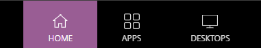

<!--
author: Matthew Blacklock
email: matthew.blacklock@northumbria.ac.uk
version: 1.0.0
language: en
mode: Presentation
icon: ../../../logo.png
import: https://raw.githubusercontent.com/MINT-the-GAP/lia-board-mode/main/README.md
        ../../../common/templates.md
comment: Access a physical campus PC remotely through Northumbria MyAccess.
-->

# Remote access to a campus PC

You can use a physical PC on campus remotely to work in ABAQUS.

This is an **out-of-hours service**. Most rooms are only listed **after 5 pm on weekdays and at weekends**.

Open [myaccess.northumbria.ac.uk](https://myaccess.northumbria.ac.uk) and sign in with your University account.

**1. Select DESKTOPS**

Click **DESKTOPS** in the menu at the top of the page.

{{1}}
********************
**2. Choose an IT room**

Select **FEE Lab PCs in Room EB DZ**. This is **The Zone**. **SAN 201** should also work.

********************

{{2}}
********************
**3. Check availability and open the connection**

The room's description shows how many PCs are available. If there are PCs free, click **Open** to connect to a campus PC.

The availability shown in the screenshot is an example. Check the current number on the page. If no PCs are available, try another suitable room or return later.
********************

{{3}}
********************
**4. Open ABAQUS**

Once connected, the campus PC's **remote desktop** will appear. Open ABAQUS in the normal way, just as you would when using the PC on campus.

For help, follow @[course(Opening ABAQUS and setting the work directory)](../OpeningABAQUS/OpeningABAQUS.md).

@[course(General tutorial library)](../README.md) · @[course(All ABAQUS tutorials)](../../README.md)
********************
