<!--
author: Matthew Blacklock
email: matthew.blacklock@northumbria.ac.uk
version: 1.0.0
language: en
mode: Presentation
icon: ../../../logo.png
import: https://raw.githubusercontent.com/MINT-the-GAP/lia-board-mode/main/README.md
        ../../../common/templates.md
comment: Topic 2 - beam elements in ABAQUS.
-->


# Beam elements in ABAQUS

**Learning Outcome 2.4.** Analyse ABAQUS error messages and input files for beam element structures with concentrated and distributed loads.

**You need:** the input-file and CAE skills from the truss tutorials. Use the same cantilever to compare input-file and CAE models. Mesh refinement and element-formulation comparisons are covered in the next tutorial.

@[course(Topic 2 tutorial library)](../README.md) · @[course(Week 5 lesson)](../../../week05/week05.md)

@tutorialNavigation

## 1. Model setup

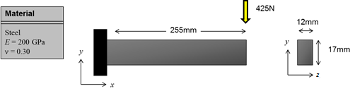

The problem we are going to model comprises a single cantilever beam with a concentrated transverse load at the free end. The beam is fixed at the left-hand side. There is a load acting at the free end of -425N in the y-direction. The Young’s modulus is E = 200GPa. The beam has a rectangular cross-section with a width of 12mm and height of 17mm. The aim is to calculate the vertical displacement at the free end.

{{1}}
********************

The first step is to sketch out the finite element equivalent of the problem. This determines the number of nodes and elements we will use and the location and type of boundary conditions and loads.

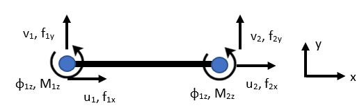

We require one element and two nodes to begin with. Each node has three active degrees of freedom, $u$, $v$ and $\phi_z$ (rotation about the $z$-axis).

********************

{{2}}
********************

**Boundary conditions**

The beam is fixed at node 1, therefore we set $u_1 = v_1 = \phi_{z1} = 0$. This forces the displacement and rotation of node 1 to be zero.

The displacement and rotation at node 2 ($u_2$, $v_2$ and $\phi_{z2}$) are unknown.

********************

{{3}}
********************

**Loads**

There is an applied load acting at node 2 of -425N in the y-direction. We set, $f_{2y} = -425\text{ N}$.

********************

## 2. Input file and corresponding CAE implementation

To set up a finite element model in ABAQUS, we need to define the following things:

- Nodes
- Elements
- Section properties including materials
- Analysis type
- Boundary conditions
- Loads, and
- Outputs (stress, displacement etc.)

Last time, we went through the input file and ABAQUS CAE to setup a model using truss elements. Here we will do the same thing for beam elements.

## 3. Nodes

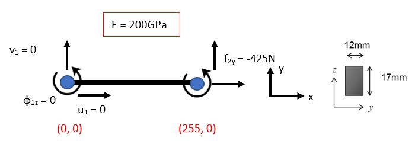

The input file section to define the nodes is as follows for this problem:

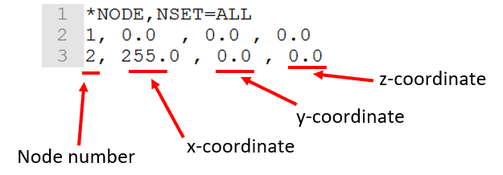

```text
*NODE, NSET=ALL
1, 0., 0., 0.
2, 255., 0., 0.
```

I have added the z-coordinate here, but for a 2D problem, this is optional.

## 4. Elements and CAE geometry

Our elements follow the same format as the previous tutorials, however, now we are using beam elements instead of trusses. Our element is given as:

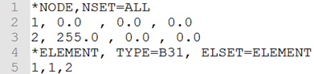

```text
*ELEMENT, TYPE=B21, ELSET=ELEMENT
1, 1, 2
```

The input-file screenshots show `TYPE=B31`, a three-dimensional linear beam. Since this problem is 2D, you could also use a 2D Planar beam element `TYPE=B21`: B denotes a beam, 2 denotes a (2D) planar element and 1 denotes a linear element.

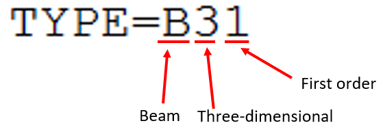

{{1}}
********************

Beam elements can be either two-dimensional or three-dimensional. This is similar to trusses. The final digit identifies the element formulation/order. In this tutorial, we will run the planar model with linear B21 and cubic B23 elements and compare the calculated deflection. Three-dimensional equivalents are B31 and B33.

Q. What is the element type for a 2D, third order beam element?

<!-- data-solution-button="3" -->
[[B23]]

********************

{{2}}
********************

Now we will create the same model in ABAQUS CAE. First, we define the nodes and elements.

Open ABAQUS CAE and create a new Standard/Explicit Model.

Create a new part and select **2D Planar** from *Modelling Space*, then **Wire** from *Base Feature*. This creates a two-dimensional model with a wire part. A wire can be a truss or beam. Press **Continue…**

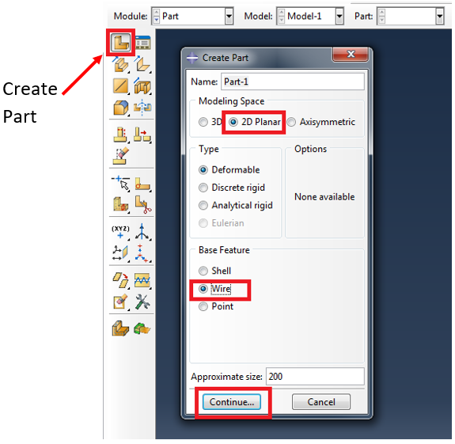

A sketch grid will be presented. Now, we want to draw the structure. This will be one straight line.

As with the truss tutorial, click **Create Lines: Connected** from the menu. You can then enter the coordinates of the points (hit enter to create each one) or click on the correct location to place a point. Once you have drawn the line, click the red X button to stop drawing lines then click Done. Enter **(0, 0)** and **(255, 0)** to create the line.

We have now created the part, but not the nodes and elements. This is done in the *Mesh* module.

********************

## 5. Mesh and element type

Select **Mesh** from the dropdown module list and then click **Seed Part**. A menu titled *Global Seeds* will appear:

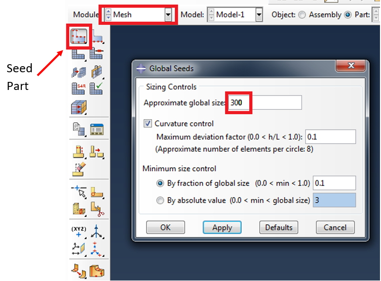

We only need one element to start with, so we should set the *Approximate global size* to **255**. This is equal to the length of the line. The *Approximate global size* is the size of each element within the model. If we wanted to split each line into several elements, we could write a smaller number in this box.

Next, click **Mesh Part** from the menu and click **Yes** at the bottom. The model should turn blue/green and in the message window it will say *“1 elements have been generated on part: Part-1”*.

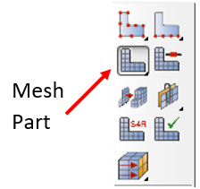

{{1}}
********************

Next, we want to check the element type. Select **Assign Element Type** and select the line. You can do this by dragging a box around the line using the mouse and holding left click or by clicking the line.

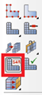

Once the line is selected, it will turn red. Click **Done** and the following menu appears:

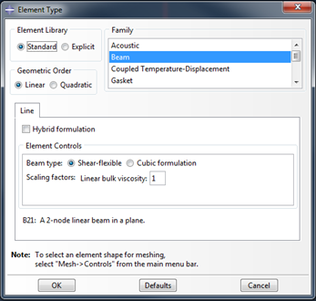

By default, *Beam* is the default element type for a wire model. You can see in this example we have a two-dimensional line with linear shape functions (B21). Leave this as is for now.

********************

## 6. Section and material keywords

Defining a beam section in ABAQUS is different to a truss. In the stiffness matrix for a truss, we need to enter *E*, and *A* each truss. For a beam, we need to enter *E*, and *I* (second moment of area).

For a truss, we used `*SOLID SECTION`. For a beam, we use `*BEAM SECTION`:

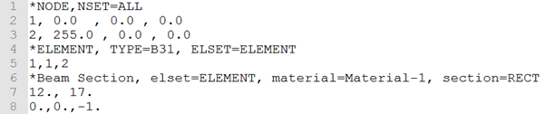

```text
*BEAM SECTION, ELSET=ELEMENT, MATERIAL=MATERIAL-1, SECTION=RECT
12., 17.
0., 0., -1.
```

The keyword `*BEAM SECTION` is followed by the element set to apply this section to (ELSET) and the material. After this there is the parameter *section=RECT*. This is telling ABAQUS that our section is rectangular. ABAQUS is capable of modelling many different section types. 

For a rectangular section, the data line requires two parameters. These are the width and height of the section. In our example, we have entered **12**, **17**. ABAQUS automatically calculates the values for the second moment of area from these values.

The third line (line 8 in the input-file screenshot) gives the approximate first beam-section axis, $n_1$. For this planar model, use **0, 0, -1**. This defines the cross-section orientation; the minus sign is not a prescribed rotation or a load direction.

{{1}}
********************

Create the material as before:

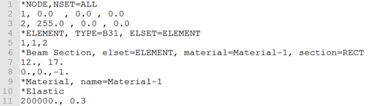

```text
*MATERIAL, NAME=MATERIAL-1
*ELASTIC
200000., 0.3
```

********************

## 7. Material in CAE

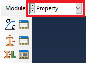

In this module, we create our material, create a section and then assign the section to our part. We must also assign the beam orientation axis as with the input file.

{{1}}
********************

First, select **Create Material** from the menu. A window will appear:

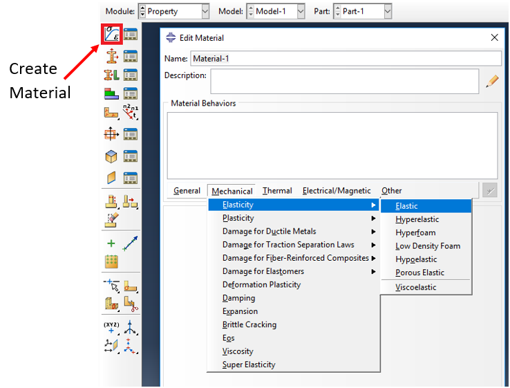

You can rename the material if you want, then select **Mechanical** from the horizontal menu, followed by **Elasticity** and then **Elastic**.

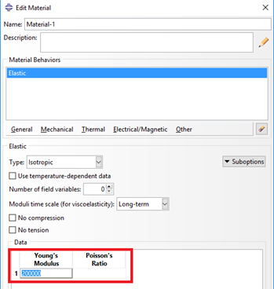

Enter **200000** for the Young’s modulus. (We are working in units of N and mm, so 200GPa = 200,000N/mm2 = 200,000MPa).

Enter **0.3** for Poisson’s ratio and click **OK**.

********************

## 8. Beam profile and section assignment

Next, we want to create a section. Click **Create Section**, choose **Beam** from the *Category* list and keep the *Type* as **Beam**. Press **Continue…**

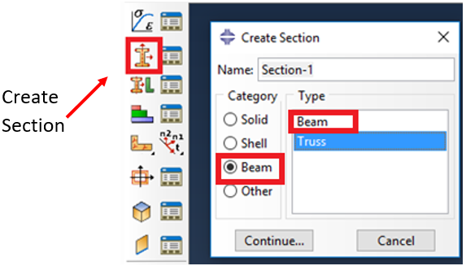

The *Edit Beam Section* window will appear. Here we can assign a material to our section (the one we created will be selected by default) and specify the beam shape:

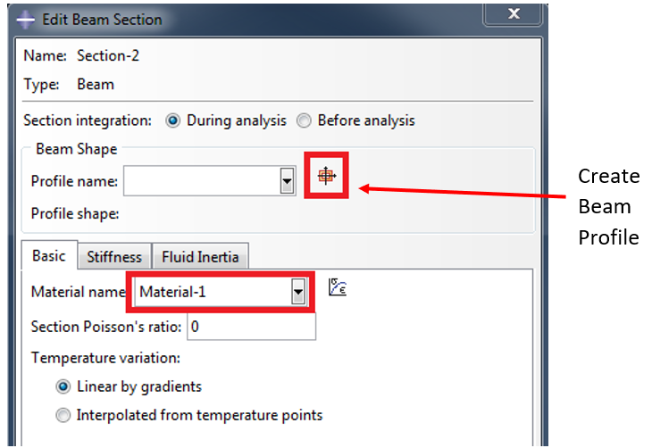

{{1}}
********************

We must create a beam profile (cross-section). Click the **Create Beam Profile** icon. The *Create Profile* window will appear and display a list of the different types. These are the same as those that can be entered in the input file:

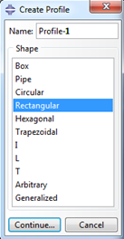

Select **Rectangular** and press **Continue…**

The *Edit Profile* window appears and displays our rectangular section. Two parameters are required, a and b. This is the same as our input file. Enter the values and click **OK**. Click **OK** on the *Edit Beam Section* window.

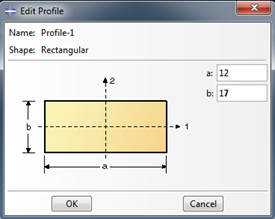

Question. If our section is Circular, what is the required parameter?

<!-- data-solution-button="3" -->
[[Radius]]

********************

{{2}}
********************

Next we assign the section to our part. Click **Assign Section** and select the line in our model, then click **Done** at the bottom of the screen. If you have done this correctly, the line will turn red and the *Edit Section Assignment* window will open:

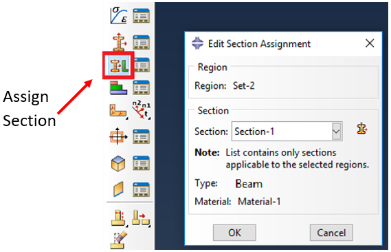

Now we want to select the section from the dropdown menu (again, the section we just created will be selected by default), then click **OK**.

********************

{{3}}
********************

The material and section have now been assigned to our model. If you want to view, edit or delete existing materials, profiles, sections or assignments you can use the relevant manager to the right of the create icons:

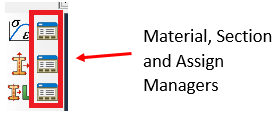

********************

## 9. Beam orientation

The final step to set up a beam section is to assign the *Beam Orientation*. To do this click **Assign Beam Orientation**:

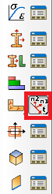

{{1}}
********************

Then, select the line and click **Done**. The prompt at the bottom asks for an approximate $n_1$ direction, with a default of **0, 0, -1**. Leave this as is and hit **Enter**. The local beam coordinate system will display:

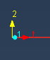

Click **OK** to confirm. Section assignment is complete.

********************

## 10. Assemble parts

As with our truss problem, we only need a single instance of our part. Click **Instance Part**, the following window appears:

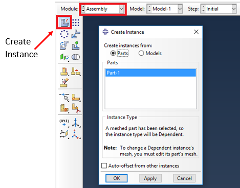

There will be a list of all the parts you have created (we only have one for this model). You must be careful here not to create additional instances by accident. Clicking Apply will create an instance and keep the window open, whereas clicking OK will also create an instance and close the window. A common mistake is to click Apply, then OK. This creates two instances.

Click **OK** to create an instance.

{{1}}
********************

Note: If you do create too many instances by accident, you can delete the ones you do not need. To do this find the instances in the left-hand menu tree, right click and select delete:

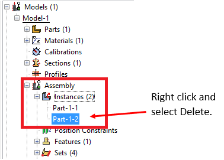

********************

## 11. Analysis type

As with our previous examples, we will be using the `*STEP` and `*STATIC` keywords to define our analysis type:

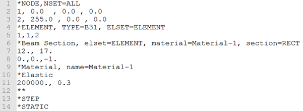

```text
*STEP
*STATIC
```

{{1}}
********************

To create the step in ABAQUS CAE, go to the **Step** module and select **Create Step**. Select **Static, General**. Click **Continue…**

A new *Edit Step* window appears. Again, we will use the default values. Click **OK**.

********************

## 12. Boundary conditions

Next up are the boundary conditions. In our problem, we need to set $u_1 = v_1 = \phi_{z1} = 0$. The $\phi_z$ degree of freedom is number 6 in ABAQUS.

The three boundary conditions at node 1 are defined in the input file as:

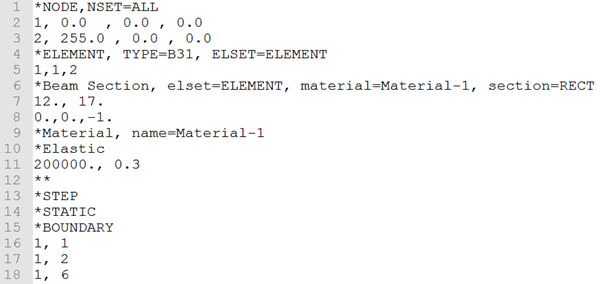

```text
*BOUNDARY
1, 1, 2
1, 6, 6
```

{{1}}
********************

Q. What is degree of freedom number 3 in ABAQUS?

<!-- data-solution-button="3" -->
[(X)] Translation in the z-direction.
[( )] Rotation about the z-axis.
[( )] Translation in the x-direction.

Q. What is degree of freedom number 4 in ABAQUS?

<!-- data-solution-button="3" -->
[(X)] Rotation about the x-axis.
[( )] Rotation about the y-axis.
[( )] Rotation about the z-axis.

Q. What is degree of freedom number 5 in ABAQUS?

<!-- data-solution-button="3" -->
[( )] Rotation about the x-axis.
[(X)] Rotation about the y-axis.
[( )] Rotation about the z-axis.

********************

{{2}}
********************

In ABAQUS CAE go to the **Loads** module and select **Create Boundary Condition**:

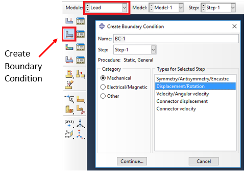

We want to select **Displacement/Rotation** as the boundary condition type. Click **Continue…**

Select the left hand point and click **Done**. The *Edit Boundary Condition* box will appear:

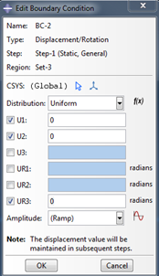

For a 2D problem, three degrees of freedom are listed: U1, U2 and UR3.

********************

{{3}}
********************

For this boundary condition, we want to set **U1**, **U2** and **UR3** to **zero**. Click **OK**. 

If you chose a **3D** model, U3, UR1 and UR2 are also active. A fixed end must restrain all six rigid-body motions. 

If done correctly, you should see orange (displacement) and blue (rotation) markers at the first node, representing the boundary conditions:

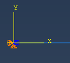

********************

## 13. Loads

Now we are going to assign the load in the y-direction ($f_{2y} = -425\text{ N}$). In the input file, this is given as:

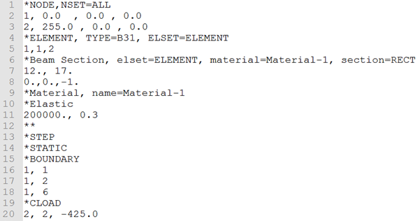

```text
*CLOAD
2, 2, -425.
```

{{1}}
********************

In ABAQUS CAE, click **Create Load**:

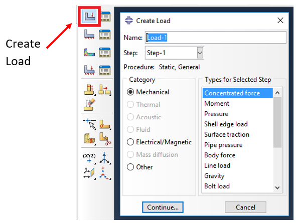

Select **Concentrated force** and click **Continue…**

Click on node 2 (it will turn red) and then click **Done**. The *Edit Load* window will appear. Enter **-425** for *CF2* and click **OK**.

********************

## 14. Outputs, jobs and results

Outputs

The last thing to do is tell ABAQUS what results/outputs we would like calculated. For the input file, we follow the same process as the previous examples; your finished input file should look like this:

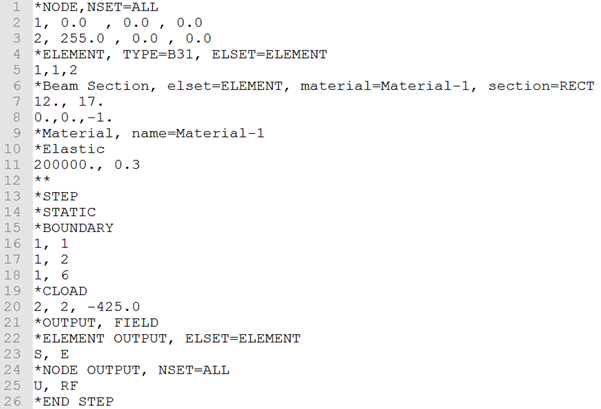

We have now setup our model! Save the file as a .inp.

{{1}}
********************

In ABAQUS CAE, standard outputs (including RF, U, S and E) are requested automatically, so we don’t have to do anything extra.

You can save your ABAQUS CAE model by choosing **File** -> **Save**. The file type for an ABAQUS model created using CAE is .cae. By default this will save in your work directory.

********************

{{2}}
********************

Submit both jobs for analysis and when completed compare the results for both. They should be identical.

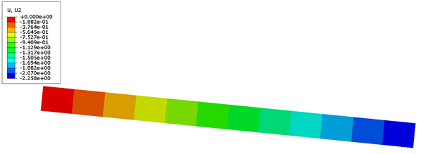

********************

{{3}}
********************

Check the displacement at node 2.

Q. What is the horizontal (x) displacement at node 2?

<!-- data-solution-button="3" -->
[[0]]

Q. What is the vertical (y) displacement at node 2?

<details>
<summary><strong>Reveal source reference result</strong></summary>

Approximately **−2.258 mm** for the single linear-element model in the source tutorial.

</details>

********************

## Completion check

- [ ] I created matching input-file and CAE models.
- [ ] I checked the job messages and compared the free-end displacements.
- [ ] I saved my input files and CAE model.

The numerical values above are reference results from the original tutorial, not a new ABAQUS verification.

@[course(Next: Mesh convergence)](../MeshConvergence/MeshConvergence.md) · @[course(Return to Week 5)](../../../week05/week05.md)
