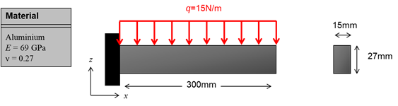
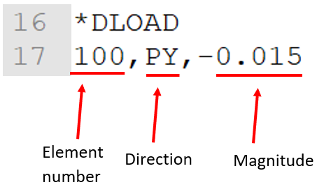
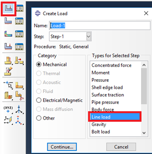
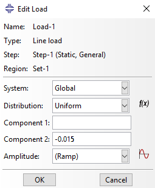
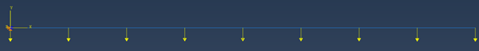

<!--
author: Matthew Blacklock
email: matthew.blacklock@northumbria.ac.uk
version: 1.0.0
language: en
mode: Presentation
icon: ../../../logo.png
import: https://raw.githubusercontent.com/MINT-the-GAP/lia-board-mode/main/README.md
        ../../../common/templates.md
comment: Topic 2 - distributed beam loads in ABAQUS.
-->


# Distributed loads in ABAQUS

**Learning Outcome 2.4.** Analyse ABAQUS error messages and input files for beam element structures with concentrated and distributed loads.

**You need:** the [beam-elements tutorial](../BeamElements/BeamElements.md). Apply the same modelling workflow to the problem shown on the next page.

@[course(Topic 2 tutorial library)](../README.md) · @[course(Week 5 lesson)](../../../week05/week05.md)

@tutorialNavigation

## 1. Model setup



The previous tutorial dealt with applying a concentrated load to a node. Distributed loads are applied across an entire element. This tutorial describes how to apply a distributed load in CAE and an input file.

Use the dimensions and material in the diagram: **300 mm** long, a **15 mm × 27 mm** rectangular section, **E = 69 GPa**, Poisson’s ratio **0.27**, and a downward load of **15 N/m**. Use a planar wire model and fix the left end.

## 2. Input file usage

For a concentrated load we used `*CLOAD`. For a distributed load, the keyword is `*DLOAD`. The syntax is as follows:



```text
*DLOAD
100, PY, -0.015
```

The first parameter on the data line is the element number or element set name (as opposed to node number for `*CLOAD`). The second parameter is the direction. This is different to `*CLOAD` where we enter the degree of freedom. For `*DLOAD` we need to enter either PX (load in x), PY or PZ. Finally, we enter the magnitude of the load. Note, I have entered -0.015. This is because the coordinate system I am working in is mm, N and MPa. I have, therefore converted -15N/m to -0.015N/mm. The load is negative in the y-direction.

**Element label:** the screenshot uses element **100**. Use the label or element set in your own model. To load several elements, apply the load to their element set so the full span is loaded. Replace the previous concentrated load; do not leave both loads active.

## 3. ABAQUS CAE usage

In ABAQUS CAE, we apply a distributed load using *Line load* in the loads menu:



{{1}}
********************

After pressing **Continue…**, we select the line and click **Done**. The *Edit Load* menu appears, and we can enter the components (x and y for a 2D model):



Enter **−0.015 N/mm** for **Component 2**, with Component 1 zero.

********************

{{2}}
********************

Applied correctly, the model should look like this:



********************

## 4. Check and save

Run the job, check its status and messages, and compare the input-file and CAE models using the same mesh and element type. Save both models.

**Quick check**

What is the total downward-load magnitude on the 300 mm beam, in N?

<!-- data-solution-button="3" -->
[[4.5]]

@[course(Return to Week 5)](../../../week05/week05.md) · @[course(Topic 2 tutorial library)](../README.md)
