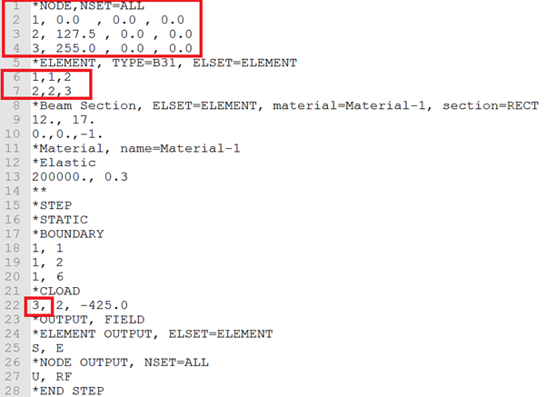
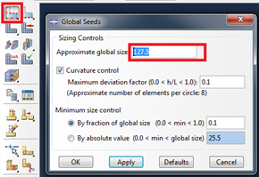
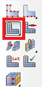
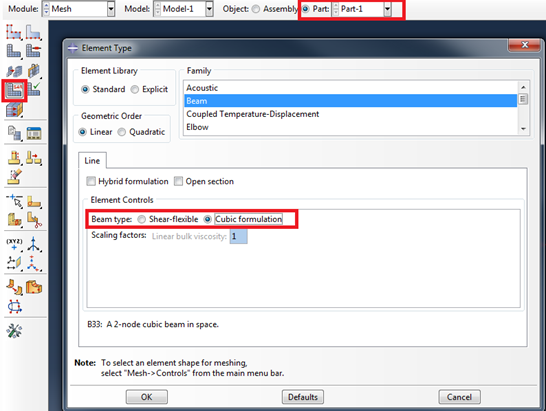
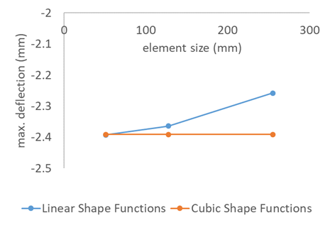

<!--
author: Matthew Blacklock
email: matthew.blacklock@northumbria.ac.uk
version: 1.0.0
language: en
mode: Presentation
icon: ../../../logo.png
import: https://raw.githubusercontent.com/MINT-the-GAP/lia-board-mode/main/README.md
        ../../../common/templates.md
comment: Topic 2 - mesh convergence and beam element formulations.
-->


# Mesh convergence in ABAQUS

**You need:** the saved cantilever input-file and CAE models from @[course(Beam elements in ABAQUS)](../BeamElements/BeamElements.md). This tutorial continues the same 255 mm beam, with a 12 mm × 17 mm section, $E=200$ GPa and a −425 N load at the free end.

Save separate copies of your models before changing the mesh. Record the free-end vertical displacement as you refine the mesh, then compare linear and cubic beam formulations.

@[course(Topic 2 tutorial library)](../README.md) · @[course(Week 5 lesson)](../../../week05/week05.md)

@tutorialNavigation

## 1. Mesh convergence

I now want to introduce the concept of mesh convergence. For trusses, a single element is enough to calculate axial displacement. For the deflection of beams, it may be necessary to have more than one element.

Mesh convergence is the process of decreasing the element size (thus increasing the number of elements) until the desired output no longer changes significantly.

In our example, we are looking at the vertical deflection.

To check if our mesh has converged, we are first going to increase the number of elements and note the deflection.

{{1}}
********************

In the input file, split the model into several nodes and elements. Remember, you must change the location of the force. Here is a three-node, two-element example:



```text
*NODE, NSET=ALL
1, 0., 0., 0.
2, 127.5, 0., 0.
3, 255., 0., 0.
*ELEMENT, TYPE=B21, ELSET=ELEMENT
1, 1, 2
2, 2, 3
** In the load block, move the force to the new free-end node:
*CLOAD
3, 2, -425.
```

********************

{{2}}
********************

In ABAQUS CAE, go to the **Mesh** module and click on **Part**:


Now, we want to reduce the value of the global seed. To get two elements, the global seed should be set to half the length (255/2 = **127.5**):



Click **OK** and then remesh the part:



You should see the message *“2 elements have been generated on part: Part-1”*. Re-run the job and check the deflection.

********************

{{3}}
********************

Q. What is the vertical (y) displacement at the **free end**? In the two-element input file shown, the loaded free end is now **node 3**.

<details>
<summary><strong>Reveal source reference result</strong></summary>

Approximately **−2.364 mm** for the two-element linear model in the source tutorial.

</details>

You should be able to see a difference between the two values. By decreasing the element size, the deflection will eventually settle at a constant value. At this point, our mesh has converged.

********************

## 2. Linear and cubic beam formulations

For this comparison, we choose linear or cubic beam formulations.

In the input file, simply change the element type from B21/B31 to B23/B33 and re-run the job.

{{1}}
********************

In ABAQUS CAE, go to the **Mesh** module, click the **Assign Element Type** icon, then select your part. The *Element Type* menu will appear:



Choose **Cubic Formulation** from the *Element Controls* section and the beam type will change to B23/B33. Re-run the job and check the deflection.

********************

{{2}}
********************

Do this for one, two and five elements with linear and cubic shape functions.

You should see the following results:



As you can see, when cubic shape functions are used, the model is converged with a single element. When linear shape functions are used, several elements are required for convergence. B21/B31 also include transverse shear flexibility, whereas B23/B33 neglect it. A small difference between converged results can therefore reflect the formulation as well as mesh size.

It is essential that you check for convergence when running FE models.

********************

## Completion check

- [ ] I recorded the free-end displacement for one, two and five elements with linear and cubic formulations.
- [ ] I kept the geometry, material, supports and physical loading the same when refining the mesh.
- [ ] I checked the job messages and saved my models and results.

@[course(Next: Distributed loads)](../DistributedLoads/DistributedLoads.md) · @[course(Return to Week 5)](../../../week05/week05.md)
