<!--
author: Matthew Blacklock
email: matthew.blacklock@northumbria.ac.uk
version: 1.0.0
language: en
mode: Presentation
icon: ../../../logo.png
import: https://raw.githubusercontent.com/MINT-the-GAP/lia-board-mode/main/README.md
        ../../../common/templates.md
comment: Topic 3 - Partition a 2D model to aid meshing.
-->

# Partition a 2D model to aid meshing

**Learning Outcome 3.4.** Determine the appropriate meshing strategy for a 2D analysis in ABAQUS, taking into account the limitations of the elements in terms of shape functions and numerical integration.

**You need:** the saved 15 × 15 mm quarter model from the symmetry tutorial, including its material, thickness, load and symmetry conditions.

@[course(Topic 3 tutorial library)](../README.md) · @[course(Week 10 lesson)](../../../week10/week10.md)

@tutorialNavigation

## 1. Model setup

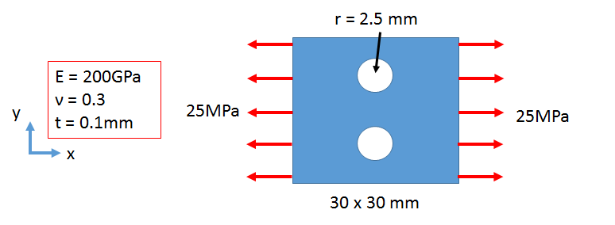<!-- style="display: block; margin: auto;" -->

Continue with the same quarter plate: side 15 mm, semicircular cut-out centred at (0,7.5) with radius 2.5 mm.

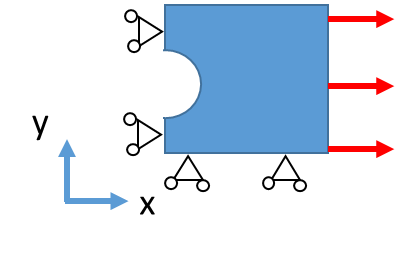<!-- style="display: block; margin: auto;" -->

{{1}}
********************

Check the existing section, loading and constraints before changing the mesh:

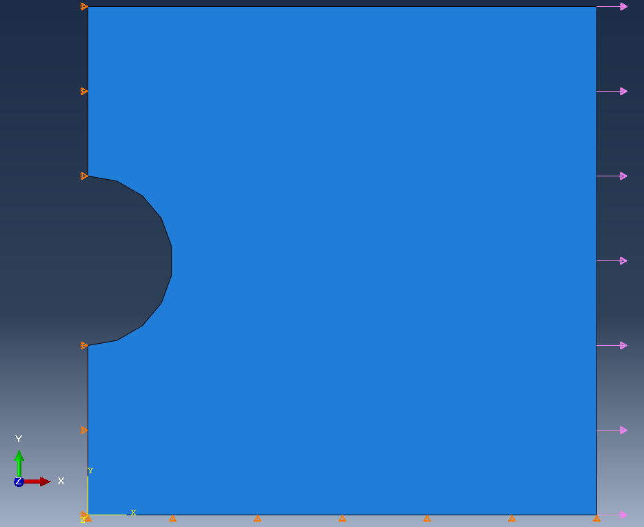<!-- style="display: block; margin: auto;" -->

********************

## 2. Why improve the mesh?

An approximate global size of **15 mm** gives a very coarse mesh. The original coarse result illustrates the poor representation of the curved boundary and stress gradient:

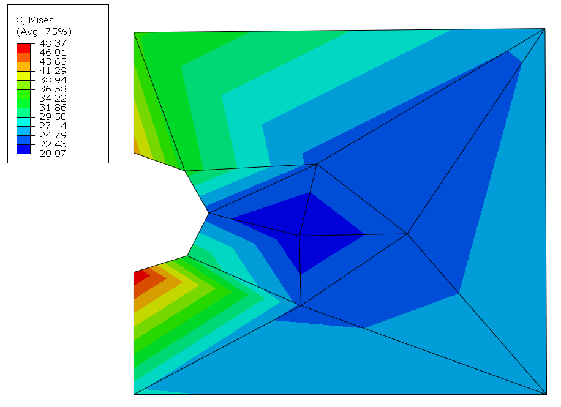<!-- style="display: block; margin: auto;" -->

{{1}}
********************

The hole introduces a stress concentration. A coarse/distorted mesh may not resolve it: stresses are evaluated at integration points, and the displacement interpolation must represent a rapidly changing field.

Refining globally gives more gradual stress variation:

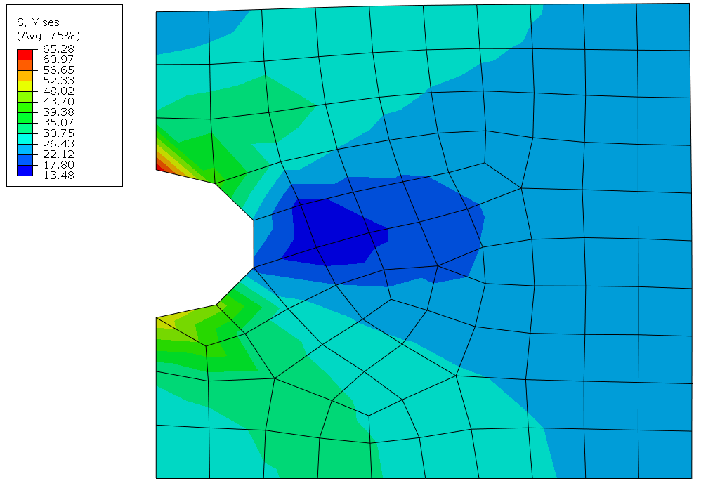<!-- style="display: block; margin: auto;" -->

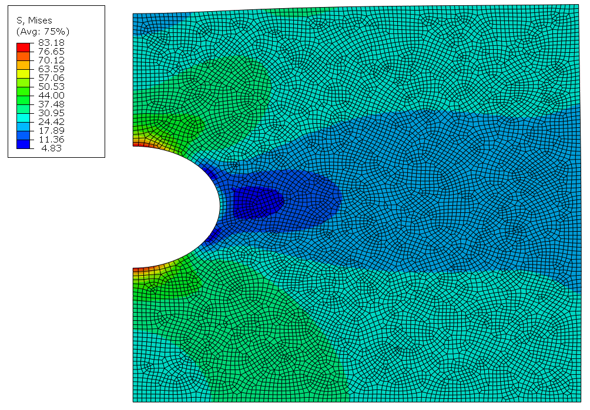<!-- style="display: block; margin: auto;" -->

********************

{{2}}
********************

The highest gradients occur near the hole. Refining the whole plate spends many elements away from that region. Partitioning allows a finer ordered mesh around the hole and a coarser transition elsewhere:

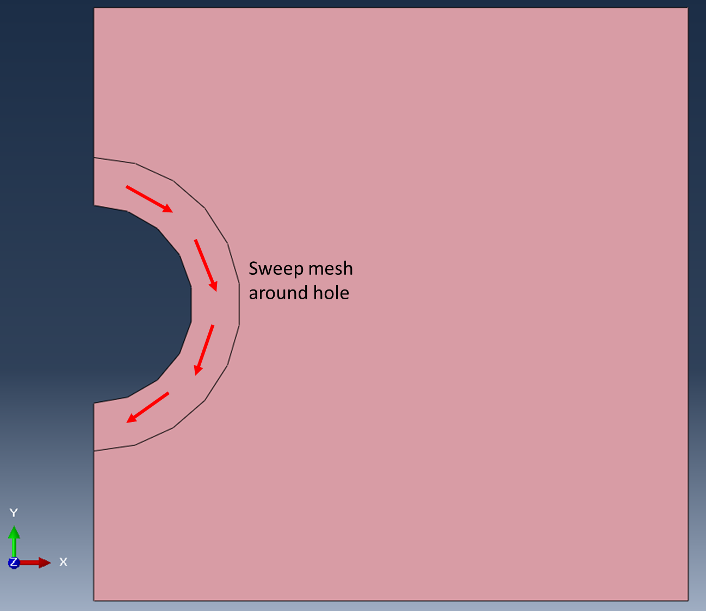<!-- style="display: block; margin: auto;" -->

********************

## 3. Partition the face

In **Mesh**, choose **Partition Face: Sketch**:

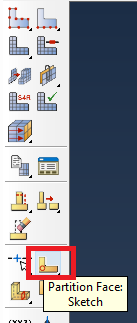<!-- style="display: block; margin: auto;" -->

{{1}}
********************

Draw a concentric circle centred at **(0,7.5)** with radius **3.5 mm**, slightly larger than the 2.5 mm hole radius:

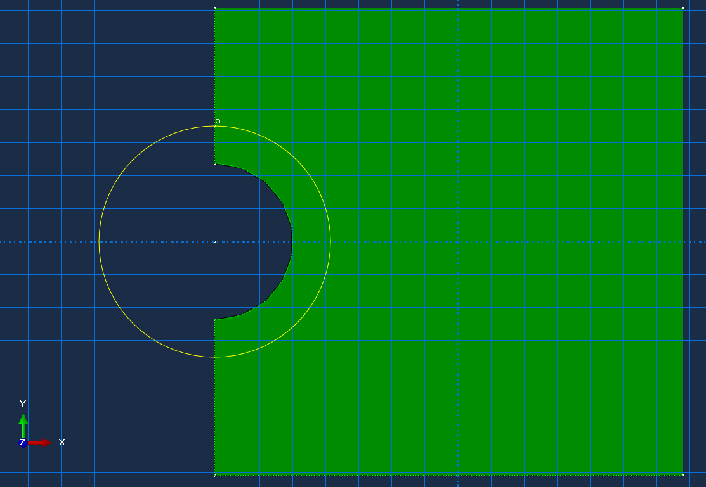<!-- style="display: block; margin: auto;" -->

This is a partition inside an existing face, not another hole to cut out.

********************

{{2}}
********************

Click **Done**. If necessary choose **Feature → Regenerate**. Your partition should appear:

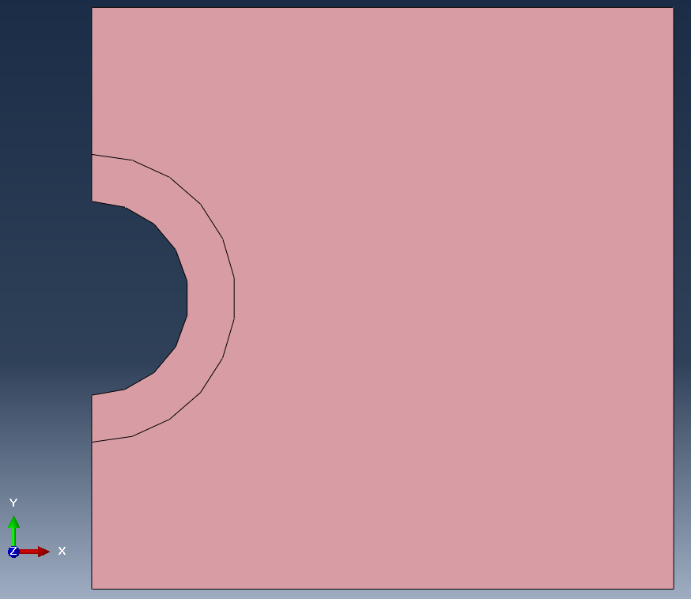<!-- style="display: block; margin: auto;" -->

********************

## 4. Apply matching local seeds

For the swept ring, use matching counts on opposite sides. Choose **Seed Edges** and select the two short straight edges between the hole and partition arcs:

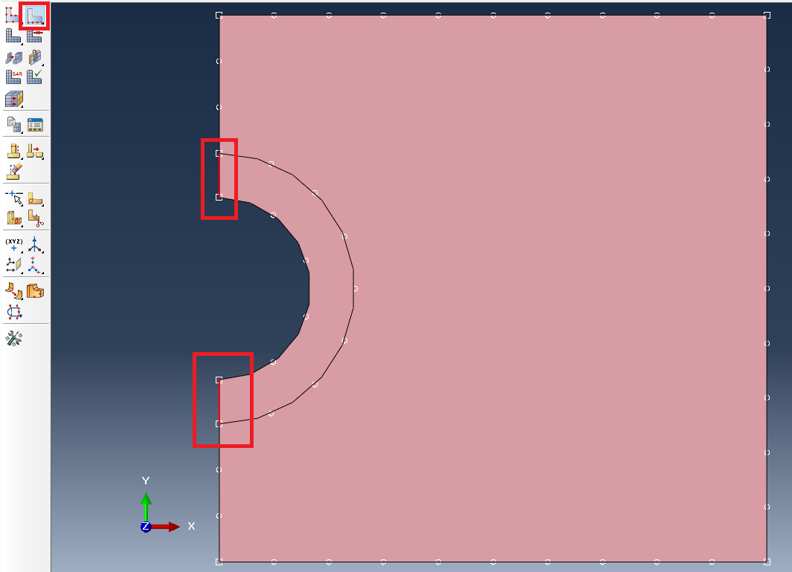<!-- style="display: block; margin: auto;" -->

{{1}}
********************

Click **Done**. In **Local Seeds**, choose **By Number** and **5 elements** on each straight edge:

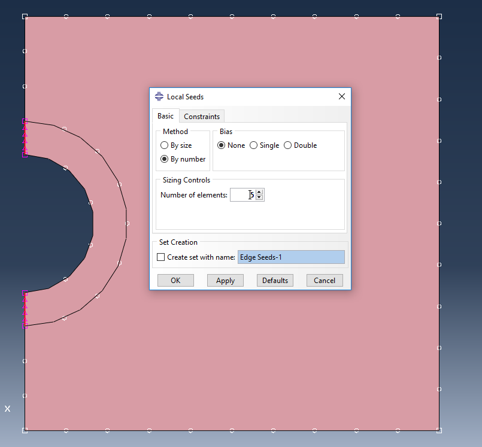<!-- style="display: block; margin: auto;" -->

********************

{{2}}
********************

Repeat for the inner and outer semicircular arcs, choosing **30 elements on each arc**:

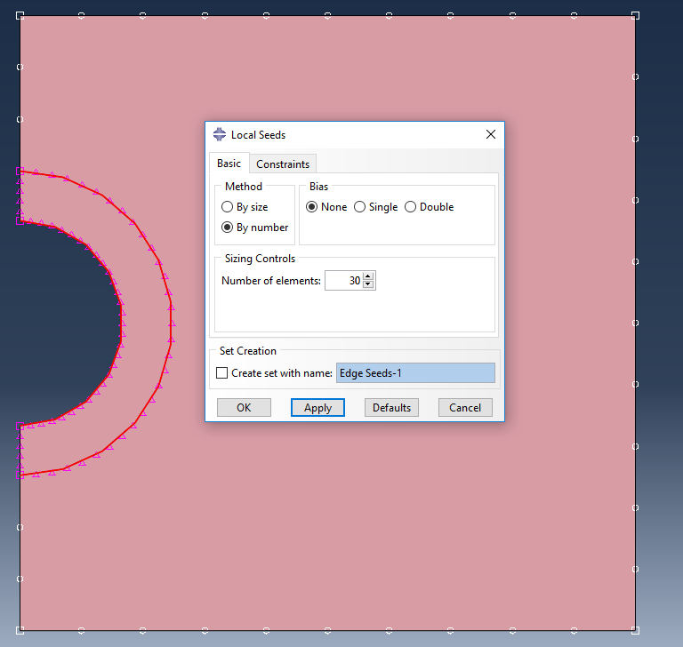<!-- style="display: block; margin: auto;" -->

The matching counts support an ordered quadrilateral mesh. For this partition the intended ring has 5 × 30 elements.

********************

## 5. Mesh the partition and remaining face

Hold the **Mesh Part** tool to expose the other options and select **Mesh Region**:

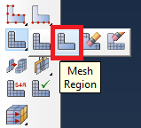<!-- style="display: block; margin: auto;" -->

For the ring face, check **Mesh Controls** uses **Quad** and **Sweep**. Mesh the selected partition and confirm **Yes**.

{{1}}
********************

The partition should mesh like this:

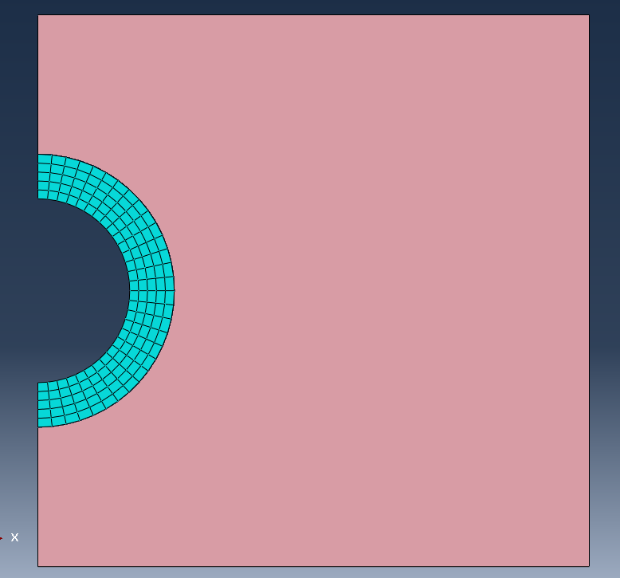<!-- style="display: block; margin: auto;" -->

********************

{{2}}
********************

Mesh the rest of the part:

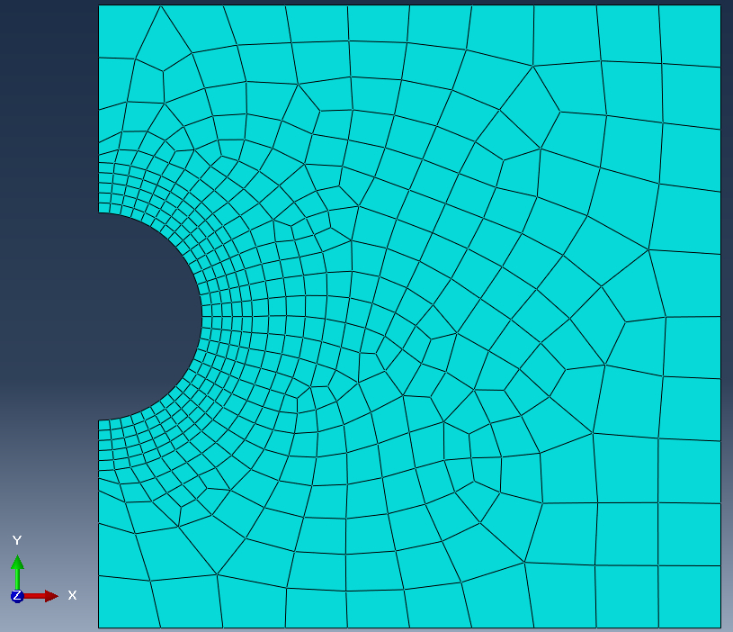<!-- style="display: block; margin: auto;" -->

Keep the outer region coarser where appropriate, while checking element shape and compatibility at the transition. Its mesh still affects the solution; it is not irrelevant to accuracy. Check the assigned plane-stress element code and keep it consistent when comparing refinements.

********************

## 6. Run and inspect the stress distribution

Run the job and extract stresses around the hole:

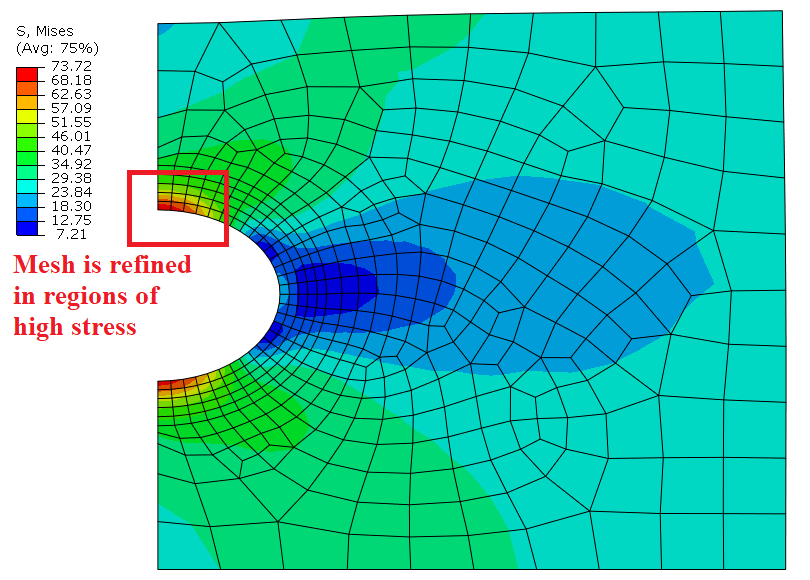<!-- style="display: block; margin: auto;" -->

Compare with your coarse/global meshes using the same stress measure and averaging/output position. The source contours illustrate the strategy, not a prescribed numerical convergence target.

Save the model and explain how partitioning concentrated resolution near the hole without unnecessarily refining the entire plate.

## Continue

Save your working files.

@[course(Previous: Apply symmetry boundary conditions)](../SymmetryBCs/SymmetryBCs.md) · @[course(Topic 3 tutorial library)](../README.md) · @[course(Return to Week 10)](../../../week10/week10.md)
