<!--
author: Matthew Blacklock
email: matthew.blacklock@northumbria.ac.uk
version: 1.0.0
language: en
mode: Presentation
icon: ../../../logo.png
import: https://raw.githubusercontent.com/MINT-the-GAP/lia-board-mode/main/README.md
        ../../../common/templates.md
comment: Topic 3 - Create a plane-stress model in ABAQUS CAE.
-->

# Create a plane-stress model in ABAQUS CAE

**Learning Outcome 3.4.** Determine the appropriate meshing strategy for a 2D analysis in ABAQUS, taking into account the limitations of the elements in terms of shape functions and numerical integration.

**You need:** the previous plane-stress input-file tutorial and the General CAE/job/results skills. Reproduce the same model before changing the mesh.

@[course(Topic 3 tutorial library)](../README.md) · @[course(Week 10 lesson)](../../../week10/week10.md)

@tutorialNavigation

## 1. Model setup

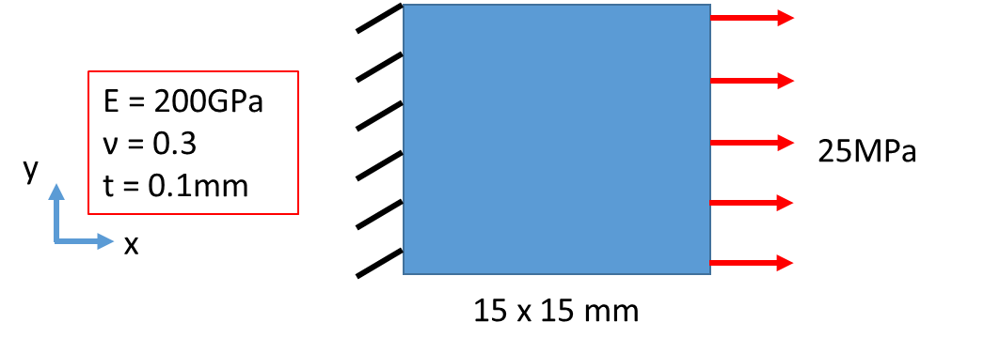<!-- style="display: block; margin: auto;" -->

Model the same **15 × 15 mm** plate, thickness **0.1 mm**, fixed at the left edge and loaded by **25 MPa tensile traction** at the right edge. Use $E=200$ GPa ($200\,000$ MPa) and $\nu=0.3$.

{{1}}
********************

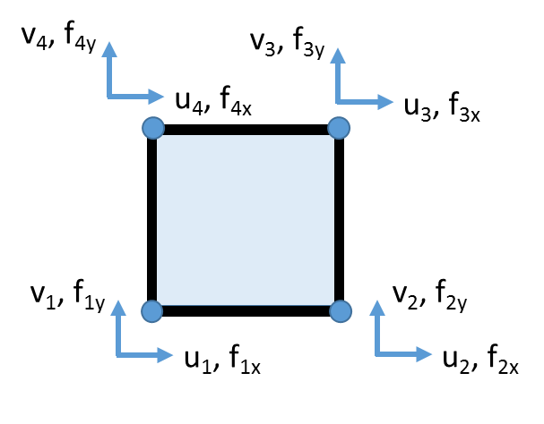<!-- style="display: block; margin: auto;" -->

Begin with one element and four nodes, each with two displacement DOFs. Fix $u_1=v_1=u_4=v_4=0$; the right-edge displacements remain unknown.

********************

## 2. Create the part and material

Starting with a new model, create a new part and choose **2D Planar** and **Shell**:

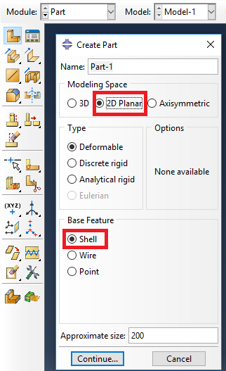<!-- style="display: block; margin: auto;" -->

Here Shell describes the planar face geometry being created; the assigned analysis elements will be plane-stress continuum elements.

{{1}}
********************

Draw a square with width and height **15 mm**:

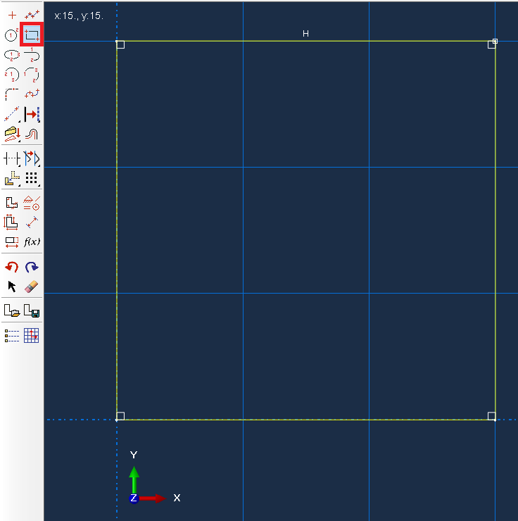<!-- style="display: block; margin: auto;" -->

In the **Property** module, create the elastic material with E=200000 MPa and Poisson's ratio 0.3.

********************

## 3. Create and assign the section

Create a section and choose **Solid → Homogeneous**:

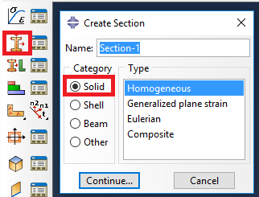<!-- style="display: block; margin: auto;" -->

{{1}}
********************

In **Edit Section**, select the material, enable **Plane stress/strain thickness**, and enter **0.1**:

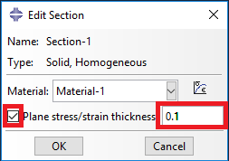<!-- style="display: block; margin: auto;" -->

Assign the section to the whole plate. Create the assembly instance and a **Static, General** step as in the introductory tutorials.

********************

## 4. Boundary condition and load

In the **Load** module, create a displacement boundary condition. Select the left-hand edge and fix **U1=0, U2=0**:

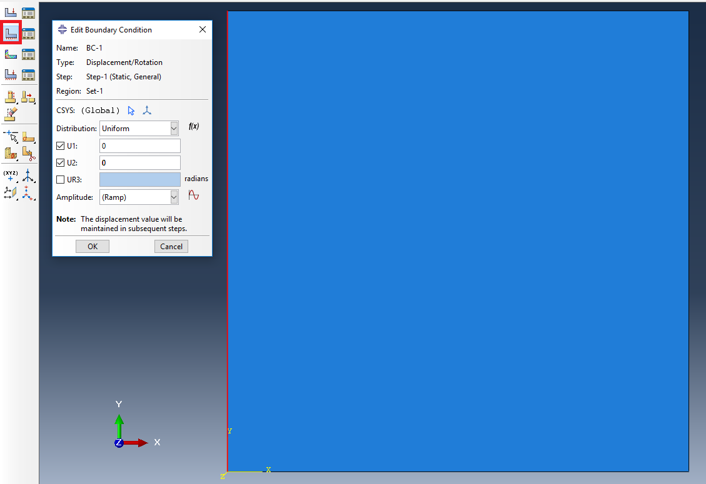<!-- style="display: block; margin: auto;" -->

{{1}}
********************

Create a load and choose **Pressure**:

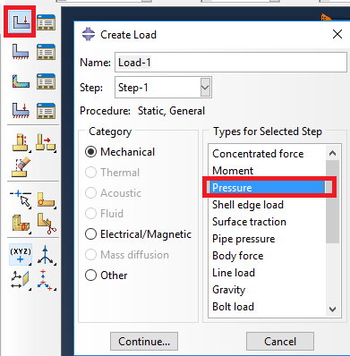<!-- style="display: block; margin: auto;" -->

Select the right-hand edge and enter **−25**. Positive pressure acts inward, so negative pressure gives the required outward tensile traction. This has the same resultant as the two 18.75 N nodal loads in the input-file model.

********************

{{2}}
********************

Your boundary condition and applied load should look like this:

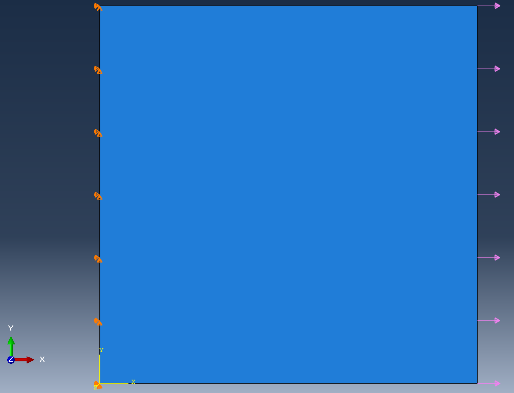<!-- style="display: block; margin: auto;" -->

********************

## 5. Seed and select the element type

In **Mesh**, set the approximate global seed size to **15 mm or larger** to obtain the initial single-element mesh:

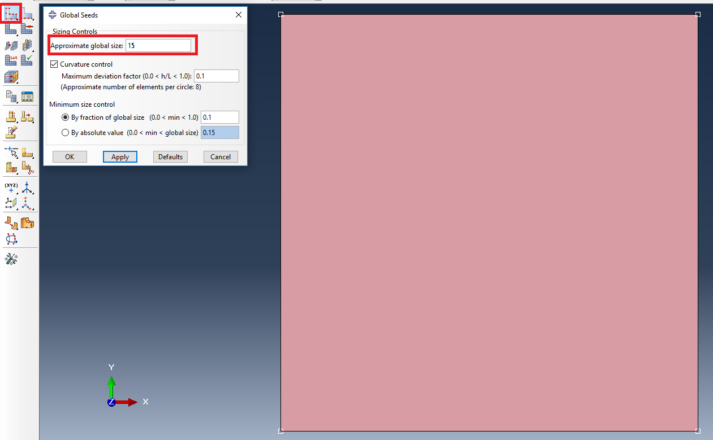<!-- style="display: block; margin: auto;" -->

{{1}}
********************

A seed size smaller than 15 produces more elements, for example:

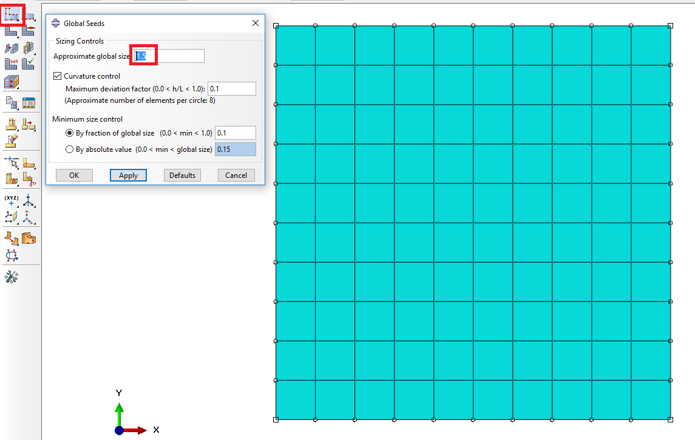<!-- style="display: block; margin: auto;" -->

Return to the one-element seed for the direct input-file comparison.

********************

{{2}}
********************

Choose **Assign → Element Type**. Select **Plane Stress**. Untick **Reduced integration** for the fully integrated element. Check that the code reads **CPS4**:

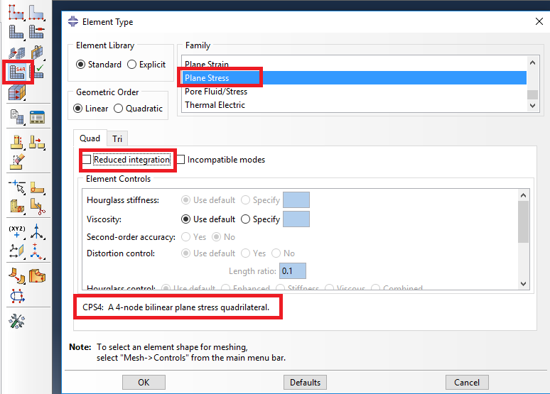<!-- style="display: block; margin: auto;" -->

********************

## 6. Mesh, run and inspect

Mesh the part and confirm **Yes** at the prompt:

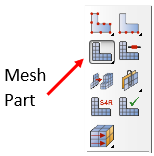<!-- style="display: block; margin: auto;" -->

Create and run the job. Check that it completes without errors.

{{1}}
********************

Compare **S, Mises at element integration points** with the input-file model. CPS4 has four integration points; CPS4R has one. The single-CPS4 source result is approximately **24.5 MPa**.

Keep the stress measure and output position the same when comparing. Save the CAE model; the next tutorial changes the geometry and boundary conditions.

********************

## Continue

Save your working files.

@[course(Previous: Create a plane-stress model using an input file)](../PlaneStressInput/PlaneStressInput.md) · @[course(Next: Apply symmetry boundary conditions)](../SymmetryBCs/SymmetryBCs.md)

@[course(Topic 3 tutorial library)](../README.md) · @[course(Return to Week 10)](../../../week10/week10.md)
