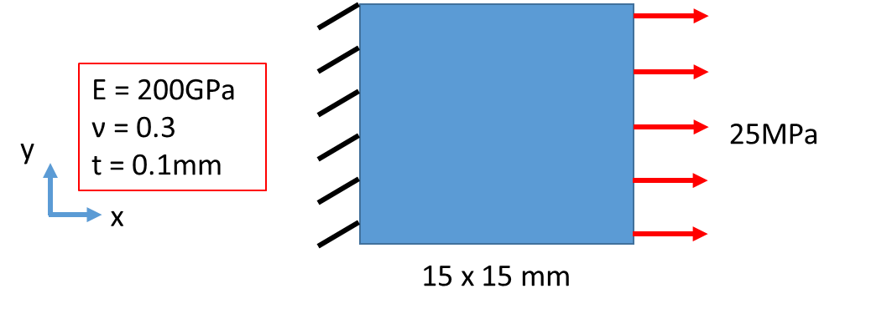
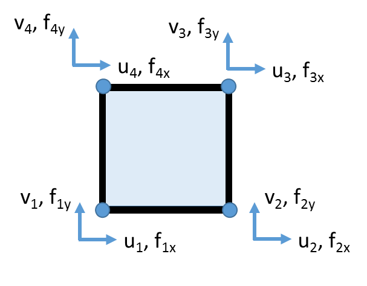
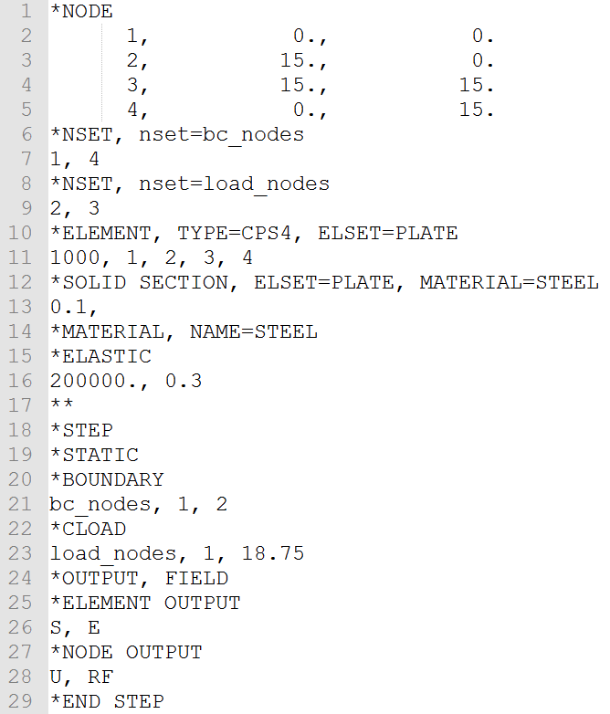

<!--
author: Matthew Blacklock
email: matthew.blacklock@northumbria.ac.uk
version: 1.0.0
language: en
mode: Presentation
icon: ../../../logo.png
import: https://raw.githubusercontent.com/MINT-the-GAP/lia-board-mode/main/README.md
        ../../../common/templates.md
comment: Topic 3 - Create a plane-stress model using an input file.
-->

# Create a plane-stress model using an input file

**Learning Outcome 3.4.** Determine the appropriate meshing strategy for a 2D analysis in ABAQUS, taking into account the limitations of the elements in terms of shape functions and numerical integration.

**You need:** the introductory input-file, job and results tutorials. Work in an N–mm–MPa unit system.

@[course(Topic 3 tutorial library)](../README.md) · @[course(Week 10 lesson)](../../../week10/week10.md)

@tutorialNavigation

## 1. Model setup

<!-- style="width: 80%; max-width: 55rem; display: block; margin: auto;" -->

The problem comprises a single flat, thin plate fixed at the left-hand side and loaded axially at the right-hand side. Young's modulus is **200 GPa**, Poisson's ratio is $\nu=0.3$, the in-plane dimensions are **15 × 15 mm**, and the thickness is **0.1 mm**. The tensile traction is **25 MPa**. The aim is to calculate stress within the plate.

Use $E=200\,000\text{ N/mm}^2$ in the input file.

{{1}}
********************

First sketch the finite element equivalent: nodes, elements, boundary conditions and loads.

<!-- style="width: 60%; max-width: 55rem; display: block; margin: auto;" -->

Begin with one four-node element to compare the input-file and CAE workflows. Each node has two active displacement DOFs, $u$ and $v$. This initial mesh is not a general claim of mesh convergence.

********************

{{2}}
********************

The left edge is fixed: $u_1=v_1=u_4=v_4=0$. The right-edge displacements are unknown.

Convert the right-edge traction into equivalent nodal forces:

$$F=\sigma A=25\times15\times0.1=37.5\text{ N},\qquad f_{2x}=f_{3x}=18.75\text{ N}.$$

********************

## 2. Nodes and node sets

Starting with a blank text document, define the nodes in counterclockwise order:

```text
*NODE
1, 0., 0.
2, 15., 0.
3, 15., 15.
4, 0., 15.
```

{{1}}
********************

Two nodes share the boundary condition and two share the load. Define sets so each can be applied once:

```text
*NSET, NSET=bc_nodes
1, 4
*NSET, NSET=load_nodes
2, 3
```

Use these exact set names in the boundary and load definitions.

********************

## 3. Element and section

Define the single element and its element set:

```text
*ELEMENT, TYPE=CPS4, ELSET=PLATE
1000, 1, 2, 3, 4
```

**CPS4** is a four-node bilinear plane-stress continuum element with full integration. **CPS4R** uses reduced integration with hourglass control. Both have four nodes.

{{1}}
********************

The plane-stress stiffness uses the thickness and material relationship:

$$\mathbf{k}^{(e)}=t\int_A\mathbf{B}^{T}\mathbf{D}\mathbf{B}\,dA,\qquad
\mathbf{D}=\frac{E}{1-\nu^2}\begin{bmatrix}1&\nu&0\\\nu&1&0\\0&0&(1-\nu)/2\end{bmatrix}.$$

Supply $t$, $E$ and $\nu$ using a solid section and material definition:

```text
*SOLID SECTION, ELSET=PLATE, MATERIAL=STEEL
0.1,
*MATERIAL, NAME=STEEL
*ELASTIC
200000., 0.3
```

********************

## 4. Step and boundary conditions

Start a static analysis step. Step-related keywords are followed by `*END STEP`, allowing different steps to use different loading conditions.

```text
*STEP
*STATIC
*BOUNDARY
bc_nodes, 1, 2
```

The boundary line specifies the node set, first DOF and last DOF: all active DOFs from 1 to 2 inclusive are fixed.

{{1}}
********************

The same condition could be written on two lines:

```text
*BOUNDARY
bc_nodes, 1
bc_nodes, 2
```

Plane-stress nodes in this model have no rotational DOFs to restrain.

********************

## 5. Loads, outputs and complete file

Apply the right-edge nodal loads using the defined `load_nodes` set:

```text
*CLOAD
load_nodes, 1, 18.75
```

Request stresses, strains, displacements and reactions:

```text
*OUTPUT, FIELD
*ELEMENT OUTPUT
S, E
*NODE OUTPUT
U, RF
*END STEP
```

{{1}}
********************

Compare your file with this complete version:

```text
*NODE
      1,           0.,           0.
      2,          15.,           0.
      3,          15.,          15.
      4,           0.,          15.
*NSET, nset=bc_nodes
1, 4
*NSET, nset=load_nodes
2, 3
*ELEMENT, TYPE=CPS4, ELSET=PLATE
1000, 1, 2, 3, 4
*SOLID SECTION, ELSET=PLATE, MATERIAL=STEEL
0.1,
*MATERIAL, NAME=STEEL
*ELASTIC
200000., 0.3
**
*STEP
*STATIC
*BOUNDARY
bc_nodes, 1, 2
*CLOAD
load_nodes, 1, 18.75
*OUTPUT, FIELD
*ELEMENT OUTPUT
S, E
*NODE OUTPUT
U, RF
*END STEP
```

<!-- style="width: 48%; max-width: 55rem; display: block; margin: auto;" -->

********************

## 6. Run and inspect integration-point results

Save the file with the `.inp` extension, submit it in ABAQUS and check the job status/messages.

In Visualization, use **Tools → Query → Probe Values**. Select **S, Mises**, probe **element integration-point values**, and check the output position. Nodal extrapolation/averaging can give different values.

{{1}}
********************

**How many integration points are used in this CPS4 element?**

<!-- data-solution-button="3" -->
[[4]]
****************************************
CPS4 has two points per reference direction: four integration points in total. CPS4R has one central point; it does not have fewer nodes.
****************************************

********************

{{2}}
********************

**Maximum integration-point von Mises stress (MPa):**

<!-- data-solution-button="3" -->
[[24.48]]
<script>
const raw = "@input".trim(); const value = Number(raw);
raw.length > 0 && Number.isFinite(value) && Math.abs(value - 24.47976635) <= 0.05
</script>
****************************************
The source result is approximately 24.48 MPa (N/mm²) for this single CPS4 element. Compare the same stress measure and output position, not a different component or a nodal contour maximum.
****************************************

If you change CPS4 to CPS4R, save it as a separate comparison file and observe the change in integration-point count. A one-element reduced-integration mesh is not a general accuracy recommendation.

********************

## Continue

Save your working files.

@[course(Next: Create a plane-stress model in ABAQUS CAE)](../PlaneStressCAE/PlaneStressCAE.md)

@[course(Topic 3 tutorial library)](../README.md) · @[course(Return to Week 10)](../../../week10/week10.md)
