<!--
author: Matthew Blacklock
email: matthew.blacklock@northumbria.ac.uk
version: 1.0.0
language: en
mode: Presentation
icon: ../../../logo.png
import: https://raw.githubusercontent.com/MINT-the-GAP/lia-board-mode/main/README.md
        ../../../common/templates.md
comment: Topic 3 - Apply symmetry boundary conditions.
-->

# Apply symmetry boundary conditions

**Learning Outcome 3.4.** Determine the appropriate meshing strategy for a 2D analysis in ABAQUS, taking into account the limitations of the elements in terms of shape functions and numerical integration.

**You need:** the previous CAE tutorial. Create a new model for this example; it is not the clamped single-element plate.

@[course(Topic 3 tutorial library)](../README.md) · @[course(Week 10 lesson)](../../../week10/week10.md)

@tutorialNavigation

## 1. Model setup and symmetry

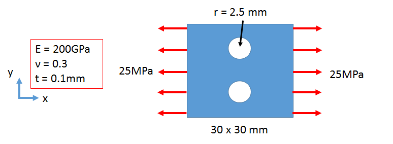<!-- style="display: block; margin: auto;" -->

The modified plate is **30 × 30 mm**, with equal **25 MPa outward tensile tractions** on the left and right edges and no clamped edge. It has two holes of radius **2.5 mm**, on the vertical centreline at $y=\pm7.5$ mm. Use $E=200$ GPa, $\nu=0.3$ and thickness **0.1 mm**.

Use the 15 × 15 mm quarter model shown in the walkthrough screenshots.

{{1}}
********************

Symmetry requires both:

- symmetric geometry;
- symmetric loading and boundary conditions.

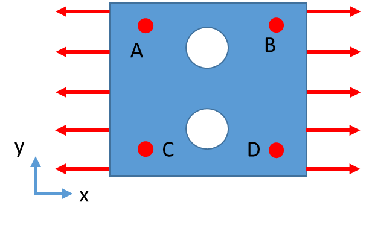<!-- style="display: block; margin: auto;" -->

Corresponding points have matching stress/displacement patterns with the appropriate component signs; displacement vectors are reflected, not identical in every component.

********************

{{2}}
********************

Only one quarter of the plate needs to be modelled:

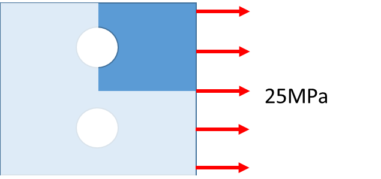<!-- style="display: block; margin: auto;" -->

Apply symmetry conditions along the cuts:

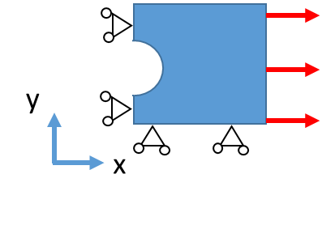<!-- style="display: block; margin: auto;" -->

On the vertical cut, set **U1=0**; on the horizontal cut, set **U2=0**. Leave tangential displacement free. The right outer edge carries the original 25 MPa tensile traction; do not halve the traction magnitude.

********************

## 2. Sketch the quarter and hole

Create a **2D Planar, Shell** part as before. Draw a square from **(0,0) to (15,15)**. Draw a circle centred at **(0,7.5)** with a perimeter point at **(0,10)** (radius **2.5 mm**):

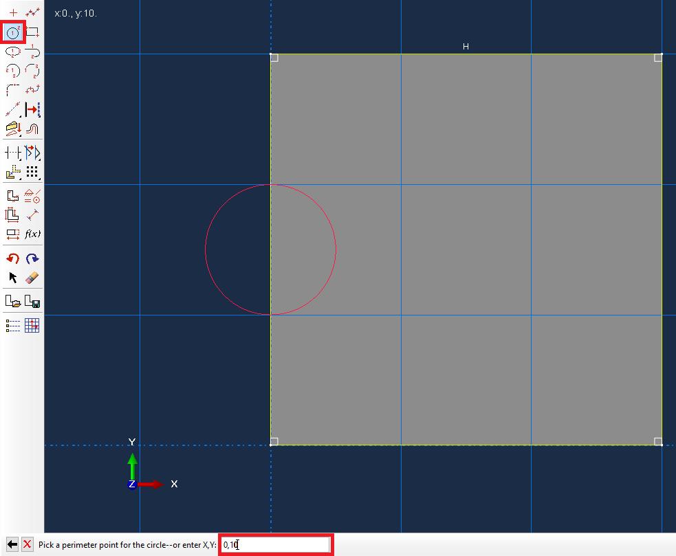<!-- style="display: block; margin: auto;" -->

The full plate has side 30 mm, so each quarter has side 15 mm. Quartering the area halves each in-plane dimension.

{{1}}
********************

If you click **Done** before trimming the sketch, ABAQUS reports a self-intersection:

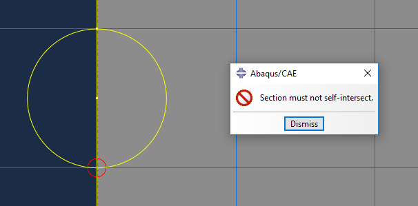<!-- style="display: block; margin: auto;" -->

Use **Auto-trim** to remove the unwanted lines:

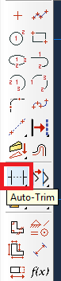<!-- style="display: block; margin: auto;" -->

********************

{{2}}
********************

Remove the circle's left half and the straight vertical segment inside the hole. The remaining boundary must form one closed region:

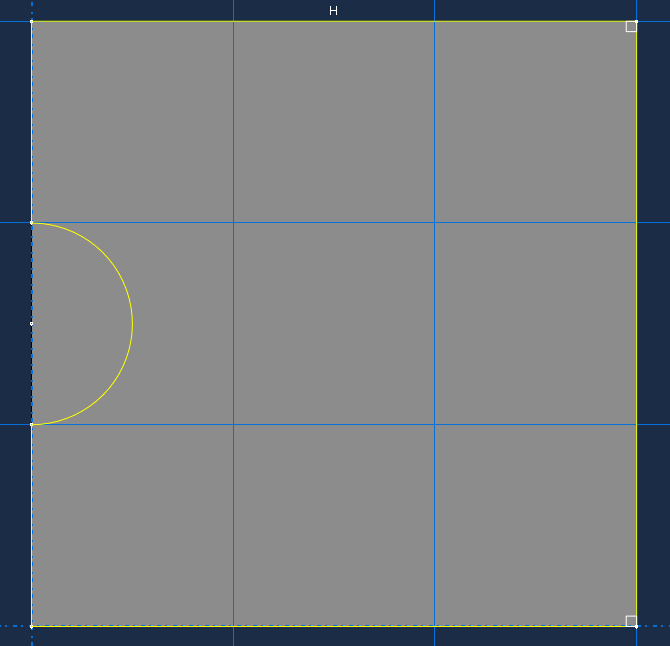<!-- style="display: block; margin: auto;" -->

********************

## 3. Regenerate and assign model properties

After leaving the sketch, the source workflow may display this warning:

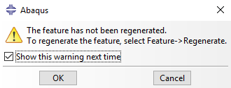<!-- style="display: block; margin: auto;" -->

{{1}}
********************

Choose **Feature → Regenerate**:

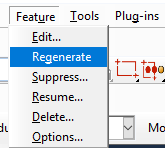<!-- style="display: block; margin: auto;" -->

The part updates:

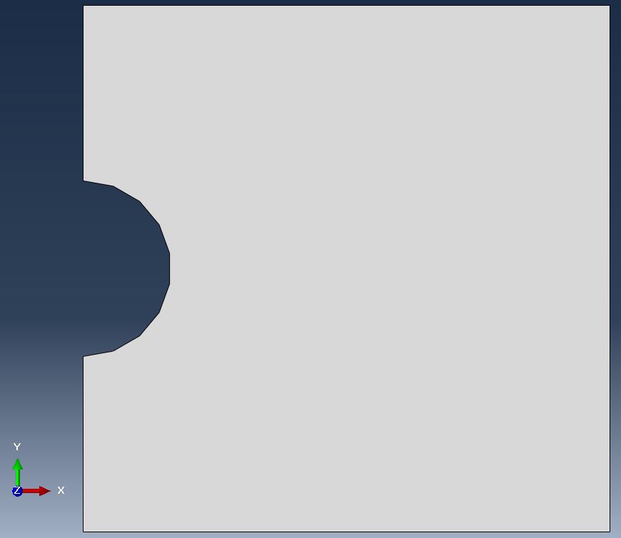<!-- style="display: block; margin: auto;" -->

********************

{{2}}
********************

Create/assign the same elastic material and homogeneous solid section as before: **E=200000 MPa**, **ν=0.3**, **thickness 0.1 mm**. Create the assembly and Static, General step. Apply **−25 MPa pressure** to the right outer edge for outward tension. Leave the hole edge and top edge traction-free.

********************

## 4. Apply the symmetry boundary conditions

Apply **U1=0** to **both straight segments of the left cut** above and below the hole. Do not constrain the curved hole boundary:

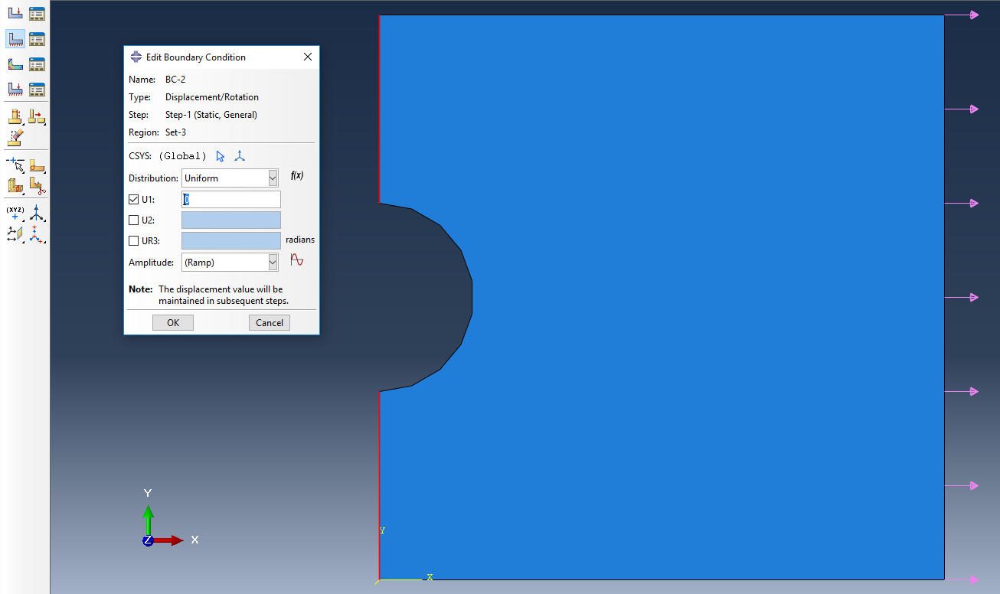<!-- style="display: block; margin: auto;" -->

{{1}}
********************

Apply **U2=0** to the bottom horizontal cut:

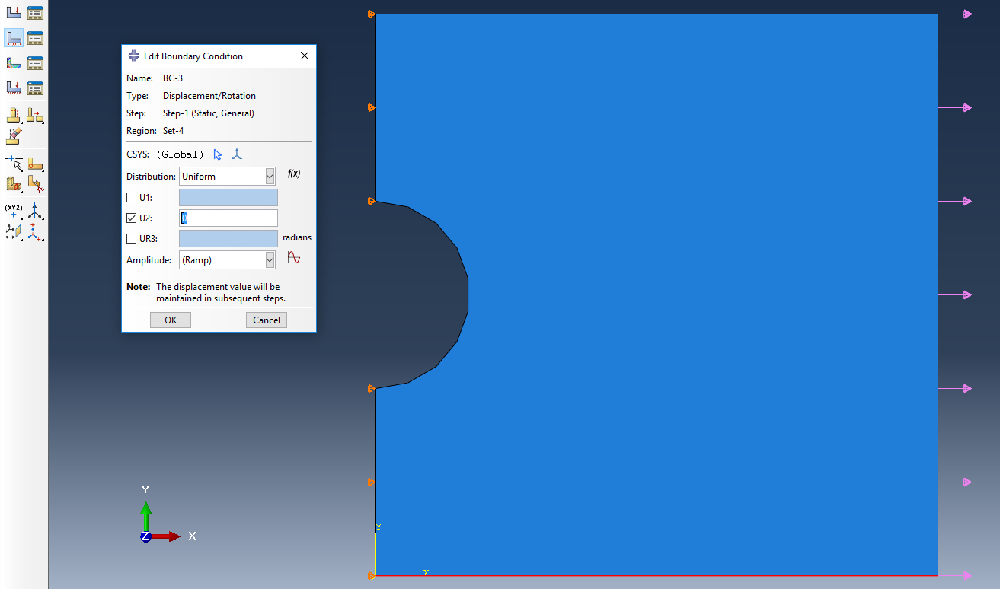<!-- style="display: block; margin: auto;" -->

********************

{{2}}
********************

Your model should look like this:

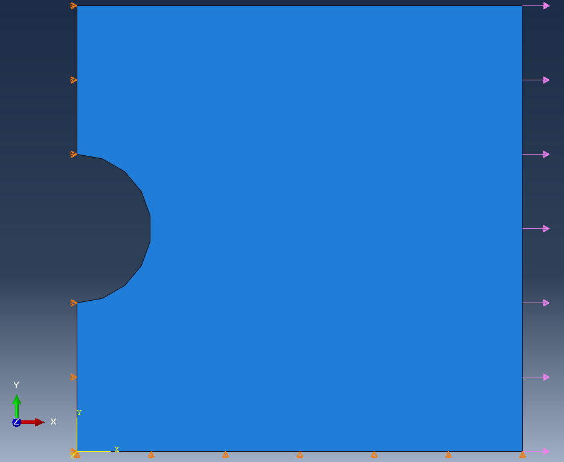<!-- style="display: block; margin: auto;" -->

Save the CAE model. The next tutorial partitions and meshes this same geometry.

********************

## Continue

Save your working files.

@[course(Previous: Create a plane-stress model in ABAQUS CAE)](../PlaneStressCAE/PlaneStressCAE.md) · @[course(Next: Partition a 2D model to aid meshing)](../Partitioning/Partitioning.md)

@[course(Topic 3 tutorial library)](../README.md) · @[course(Return to Week 10)](../../../week10/week10.md)
