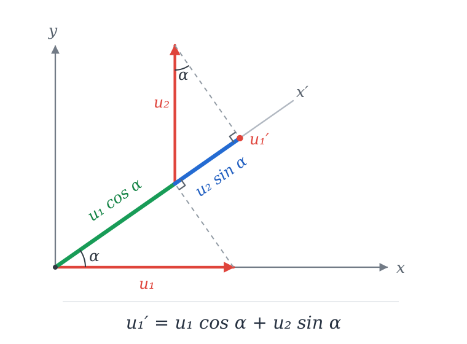
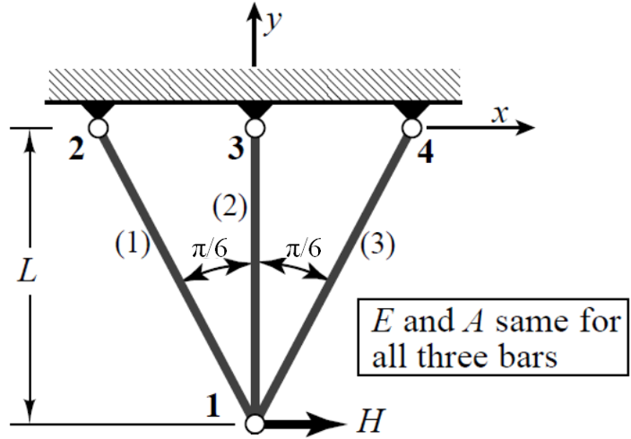
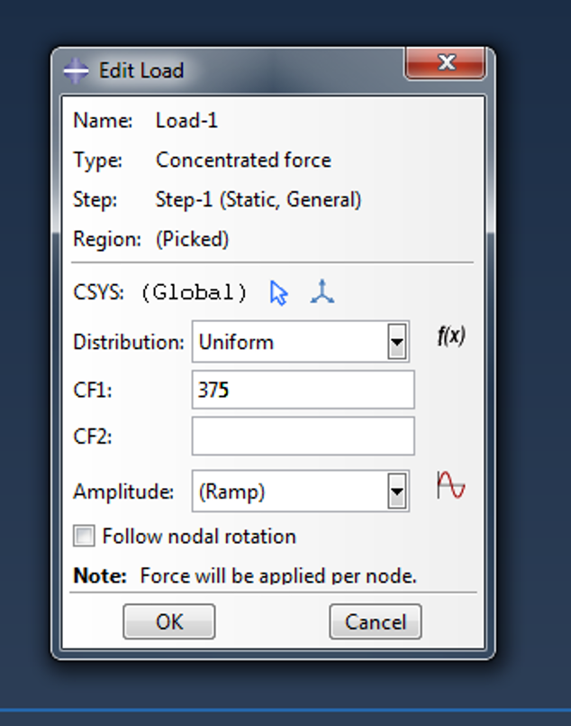
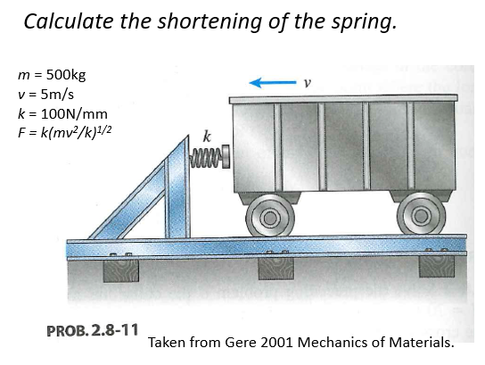
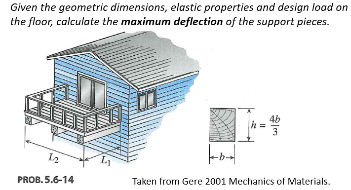
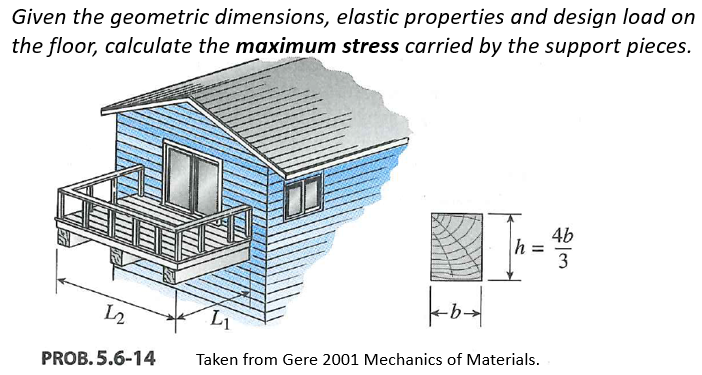
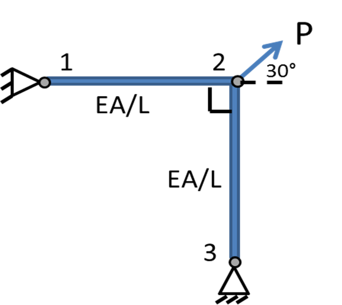
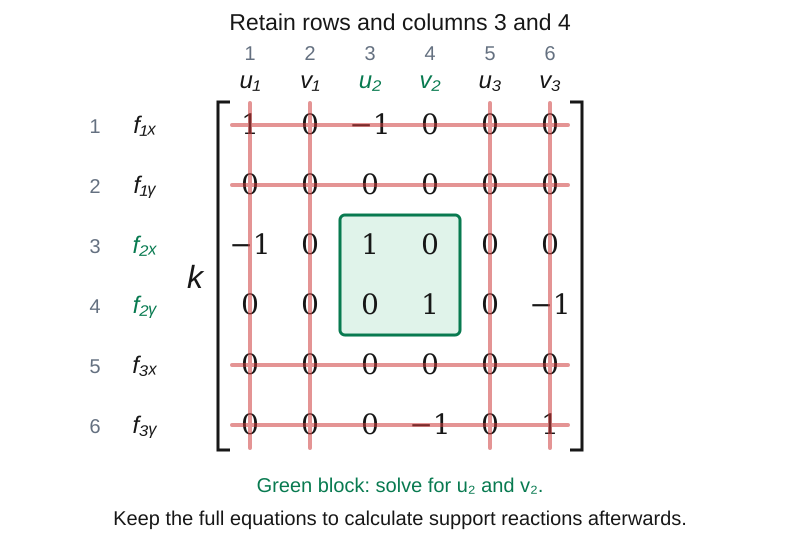
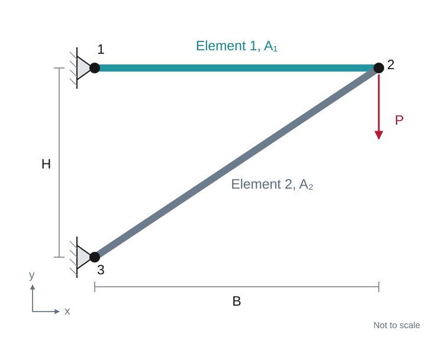
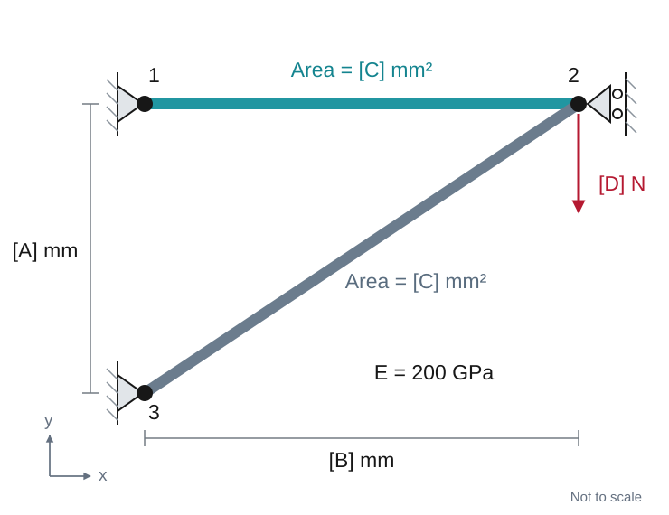

<!--
author: Matthew Blacklock
email: matthew.blacklock@northumbria.ac.uk
version: 1.0.1
mode: Presentation
import: https://raw.githubusercontent.com/MINT-the-GAP/lia-board-mode/main/README.md
        https://raw.githubusercontent.com/MINT-the-GAP/lia-annotation/main/README.md
        ../common/templates.md
comment: KB5034 Week 3 - Topic 1: axial stress and 2D truss elements.
-->

# Week 3: 2D Truss Elements

@moduleTitle

**Topic 1: Axial Stress & Truss Elements**

---

@[course(Return to Week 2)](../week02/week02.md)

---

## Topic Learning Outcomes

By the end of this week, students will be able to:

<br>

**1.4.** **Assemble** the stiffness matrix for simple 2D truss structures with appropriate boundary conditions.

<br>

**1.5.** **Model** a 2D truss structure using the finite element method and compare your results against hand calculations.

<br>

**1.6.** **Determine** when modelling with truss elements is appropriate for real engineering structures based on the limitations of the element.


## A. INDEPENDENT STUDY: Before class

**PREPARATION STARTS HERE**

Watch the four videos on the assembly of 2D truss structures in order, then complete the ABAQUS CAE tutorial.

Complete the quick checks before moving on. Bring your notes, hand calculations and model files to class.

You are encouraged to take your own notes. However, partially filled out notes can be found [here](files/Week%203%20Online%20Videos.pdf). You can fill in the blanks while watching the videos.

## Video 1: Introduction to 2D Trusses

**Learning Outcome 1.4.** Assemble the stiffness matrix for simple 2D truss structures with appropriate boundary conditions.

You are encouraged to take your own notes. However, partially filled out notes can be found [here](files/Week%203%20Online%20Videos.pdf). You can fill in the blanks while watching the videos.

@Panopto(9e292adf-d3d4-45b6-9de7-b4db0130f659)

{{1}}
********************
**Quick check**

How many translational degrees of freedom does a two-node 2D truss element have in total?

<!-- data-solution-button="3" -->
[( )] 2
[(X)] 4
[( )] 6

[[?]] Each node can translate in the global $x$ and $y$ directions.
********************

## Video 2: Transformation Matrix

@Panopto(b176e183-a688-45c2-a1f8-b4db0130f629)

{{1}}
********************
<details>
<summary><strong>Reveal explanation: vector projection - $u_1'=u_1\cos\alpha+u_2\sin\alpha$</strong></summary>

At node 1, $u_1$ is the global **horizontal** displacement and $u_2$ is the global **vertical** displacement, using the video's notation. Both belong to the **same node**. The local component $u_1'$ measures displacement along the rotated $x'$ axis, which lies along the element.

To find $u_1'$, project each global component onto $x'$ and add its contribution.

<!-- style="width: 760px; max-width: 100%;" -->

**1. Project the horizontal displacement $u_1$**

Draw a line from the tip of the horizontal red arrow **perpendicular to $x'$**. The dashed line and square corner show this projection.

The horizontal arrow is the hypotenuse of a right-angled triangle. The **green length along $x'$** is adjacent to the angle $\alpha$, so

$$\text{horizontal contribution to }u_1'=u_1\cos\alpha.$$

**2. Project the vertical displacement $u_2$**

The vertical red arrow has been shifted to start at the end of the green segment so that the two projected contributions can be shown end-to-end. Shifting an arrow without changing its length or direction does not change its projection.

Draw a perpendicular from its tip to $x'$. The **blue length along $x'$** is the vertical displacement's contribution.

In this right-angled triangle, the blue length is opposite the angle $\alpha$ marked at the top, so it is $u_2\sin\alpha$. Equivalently, the angle between the vertical arrow and $x'$ is $90^\circ-\alpha$, giving

$$\text{vertical contribution to }u_1'=u_2\cos(90^\circ-\alpha)=u_2\sin\alpha.$$

**3. Add the projected contributions**

The green and blue lengths both lie along $x'$. For the positive displacements shown, both contribute in the positive $x'$ direction:

$$\boxed{u_1'=u_1\cos\alpha+u_2\sin\alpha.}$$

This is the component along the element, rather than the total displacement magnitude. Use signed values of $u_1$, $u_2$, $\cos\alpha$ and $\sin\alpha$; the same equation then also handles negative displacements and other element orientations.

</details>

********************

{{2}}
********************
**Quick check**

Why do we need a transformation matrix for an inclined 2D truss element?

<!-- data-solution-button="3" -->
[(X)] To relate displacement and force components in the element's local axes to those in the global axes.
[( )] To change the material's Young's modulus.
[( )] To add rotational degrees of freedom to a truss element.
********************

## Video 3: Transformation to Global System

@Panopto(db008595-6957-44a0-b248-b4db0130f603)

{{1}}
********************
**Quick check**

Three nodes each have two translational degrees of freedom. Before applying boundary conditions, what size is the global stiffness matrix?

<!-- data-solution-button="3" -->
[( )] $3\times3$
[( )] $4\times4$
[(X)] $6\times6$

[[?]] Count the total number of global displacement DOFs.
********************

## Video 4: Summary of the Finite Element Method

@Panopto(697729dd-10fd-4a77-85a6-b4db0130f5df)

{{1}}
********************
**Quick check**

At a node shared by two elements, what happens to their stiffness contributions in the global matrix?

<!-- data-solution-button="3" -->
[(X)] Contributions associated with the same global DOFs are added.
[( )] The contribution from the second element replaces the first.
[( )] The node receives a separate pair of global DOFs for each element.
********************

## ABAQUS: Introduction to CAE and 2D Truss Elements

<br>

**Learning Outcome 1.5.** Model a 2D truss structure using the finite element method and compare your results against hand calculations.

<br>

Work through the standalone tutorial:

@[course(Introduction to ABAQUS CAE: 2D truss elements)](../abaqus/Topic1/Truss2DCAE/Truss2DCAE.md)

Create the same two-element structure using an input file and ABAQUS CAE. Compare their displacement results with a hand calculation, and save both model files.

## Before class completion check

<br>

- [ ] **Quiz:** Complete the Blackboard Test for 2D Truss Elements in the Week 3 folder on the eLP. This counts towards your assessment.
- [ ] **Bring to class:** your notes, input and cae file, and any questions from the videos or tutorials.

**Note:** The 1D Truss Elements ABAQUS problem is also due before class this week. See the Week 2 folder on the eLP.

## B. IN CLASS: 2D truss elements

---

**SUPPORTED CLASS STUDY STARTS HERE**

We will check the pre-work, discuss when a truss model is appropriate, and assemble and solve a simple 2D structure by hand and using ABAQUS.

## Recap: linear behaviour and boundary conditions

**Q1. In a linear elastic model with unchanged supports, doubling the applied load does what to the displacement?**

<!-- data-solution-button="3" -->
[( )] Halves it.
[(X)] Doubles it.
[( )] Leaves it unchanged.

{{1}}
********************
**Q2. Which displacement DOFs are restrained in this structure?**



<!-- data-solution-button="3" -->
[(X)] Both translations at nodes 2, 3 and 4.
[( )] Both translations at node 1 only.
[( )] The vertical translation at every node.

[[?]] Distinguish a supported node from a node carrying an applied load.
********************

{{2}}
********************
**Q3. What size is the global stiffness matrix for this four-node 2D truss problem before applying boundary conditions?**

<!-- data-solution-button="3" -->
[( )] $4\times4$
[(X)] $8\times8$
[( )] $12\times12$

After applying the supports, how many unknown displacement DOFs remain? [[2]]
********************

## Recap: loads and input files

**Q4. Enter the line below `*CLOAD` to apply the following force at node 2. Do not include spaces.**

<!-- style="zoom: 0.8;" -->

<!-- data-solution-button="3" -->
[[2,1,375]]

{{1}}
********************
**Q5. What changes if the same force acts in the negative global y-direction?**

<!-- data-solution-button="3" -->
[[2,2,-375]]
[[?]]The DOF number specifies direction: **1 = x**, **2 = y**. The sign of the magnitude specifies a positive or negative force.
********************

## Modelling with truss elements: spring bumper

**Learning Outcome 1.6.** Determine when modelling with truss elements is appropriate for real engineering structures based on the limitations of the element.



Can you use a truss element to represent the spring's axial stiffness? How would you set up the model? Draw a sketch.

{{1}}
********************
<details>
<summary><strong>Reveal discussion points</strong></summary>

A single truss element can represent an equivalent axial spring if we choose its properties so that

$$k=\frac{EA}{L}$$

Restrain one end and allow the other to move along the spring axis. 

This represents the spring's force–displacement relation. The moving cart is represented by a force. Use the peak force given by the equation in the image to represent the cart’s effect on the spring.

</details>
********************

## Modelling with truss elements: balcony deflection



Can you use truss elements to calculate the maximum deflection of these support pieces? How would you set up the FE model?

{{1}}
********************
<details>
<summary><strong>Reveal discussion points</strong></summary>

The floor loads act transversely to the support pieces and produce bending. Truss elements carry axial force and cannot represent that bending stiffness.

Use beam elements to represent the support pieces, with appropriate cross-section properties, connections and supports. Represent the floor loading through a distributed load transferred to the beams.

</details>
********************

## Modelling with truss elements: balcony stress



Does asking for **maximum stress** change whether truss elements are suitable?

{{1}}
********************
<details>
<summary><strong>Reveal discussion points</strong></summary>

The loading still produces bending. A truss model gives axial stress and would miss the bending contribution to the maximum stress.

A beam model provides a beam-theory stress estimate. For bending,

$$\sigma=\frac{My}{I},$$

with the maximum bending stress at the extreme, where $|y|$ is greatest. The stress estimate relies on the beam's assumed cross-section behaviour. A beam cross-section is not a solid mesh through which we can probe the detailed stress field.

To investigate the detailed stress distribution in the actual geometry, including local effects near connections or load application points, use **plane-stress elements** where a thin, planar idealisation is appropriate, or **3D solid elements** for a three-dimensional stress field.

Choose the element type from both the physical behaviour and the level of stress detail required.

</details>
********************

## Truss model assumptions

For the linear truss models used here:

- Members carry axial tension or compression.
- Idealised pin joints transmit forces and allow relative member rotation.
- External loads act at nodes.
- Displacements are small and material behaviour is linear elastic.

{{1}}
********************
**Quick check: Which behaviour requires an element with bending stiffness?**

<!-- data-solution-button="3" -->
[( )] Axial extension of a pin-jointed bar.
[(X)] Deflection of a beam under transverse loading.
[( )] Axial shortening of a bar under compression.

A truss element has no rotational DOFs or bending stiffness. Compression alone does not make it a beam model, but member bending or buckling requires additional modelling considerations.
********************

## Global stiffness matrix of a 2D truss: angle of an element

<svg viewBox="0 0 1200 620"
     width="95%"
     style="display:block; margin:auto; background:white;"
     role="img"
     aria-label="Four examples for drawing element angles: horizontal nodes 1 to 2, horizontal nodes 2 to 1, inclined nodes 2 to 3, and inclined nodes 3 to 2."
     xmlns="http://www.w3.org/2000/svg">
  <g stroke="#171717" stroke-width="5" stroke-linecap="round">
    <line x1="150" y1="180" x2="470" y2="180"/>
    <line x1="150" y1="490" x2="470" y2="490"/>
    <line x1="790" y1="230" x2="1067.128" y2="70"/>
    <line x1="790" y1="540" x2="1067.128" y2="380"/>
  </g>
  <g fill="#171717">
    <circle cx="150" cy="180" r="10"/>
    <circle cx="470" cy="180" r="10"/>
    <circle cx="150" cy="490" r="10"/>
    <circle cx="470" cy="490" r="10"/>
    <circle cx="790" cy="230" r="10"/>
    <circle cx="1067.128" cy="70" r="10"/>
    <circle cx="790" cy="540" r="10"/>
    <circle cx="1067.128" cy="380" r="10"/>
  </g>
  <g fill="#171717" font-family="Arial, Helvetica, sans-serif"
     font-size="36" text-anchor="middle">
    <text x="150" y="240">1</text>
    <text x="470" y="240">2</text>
    <text x="150" y="550">2</text>
    <text x="470" y="550">1</text>
    <text x="790" y="285">2</text>
    <text x="1117" y="85">3</text>
    <text x="790" y="595">3</text>
    <text x="1117" y="395">2</text>
  </g>
</svg>

{{1}}
********************
**What is the angle of each element?**

Use the direction from the lower-numbered node to the higher-numbered node and measure anticlockwise from the positive x-axis.

Enter each angle as a number without the degree symbol.

<!--
data-solution-button="3"
data-type="none"
-->
| Element | Angle in degrees |
|:---|:---:|
| Top left | [[0]] |
| Bottom left | [[180]] |
| Top right | [[30]] |
| Bottom right | [[210]] |
********************

## Element orientation and global stiffness

**Learning Outcome 1.4.** Assemble the stiffness matrix for simple 2D truss structures with appropriate boundary conditions.

For an element connecting nodes $i$ and $j$, choose the direction **from $i$ to $j$**.

Using the global displacement order $[u_i,v_i,u_j,v_j]^T$, the element stiffness matrix in global coordinates is

$$
\mathbf K_e=\frac{EA}{L}
\begin{bmatrix}
\cos^2\alpha&\cos\alpha\sin\alpha&-\cos^2\alpha&-\cos\alpha\sin\alpha\\
\cos\alpha\sin\alpha&\sin^2\alpha&-\cos\alpha\sin\alpha&-\sin^2\alpha\\
-\cos^2\alpha&-\cos\alpha\sin\alpha&\cos^2\alpha&\cos\alpha\sin\alpha\\
-\cos\alpha\sin\alpha&-\sin^2\alpha&\cos\alpha\sin\alpha&\sin^2\alpha
\end{bmatrix}.
$$

To save time and space, use $c=\cos\alpha$ and $s=\sin\alpha$. The same matrix becomes

$$
\mathbf K_e=\frac{EA}{L}
\begin{bmatrix}
c^2&cs&-c^2&-cs\\
cs&s^2&-cs&-s^2\\
-c^2&-cs&c^2&cs\\
-cs&-s^2&cs&s^2
\end{bmatrix}.
$$

Both nodes have x- and y-displacement DOFs, even though the element only resists extension along its axis.

## Global element matrix: special cases

Write the global stiffness matrix for an element at **0°, 90° and 45°**. Use $k=EA/L$ and the displacement order $[u_i,v_i,u_j,v_j]^T$.

Which terms vanish? Which displacement directions are coupled?

$$
\mathbf K_e=k
\begin{bmatrix}
c^2&cs&-c^2&-cs\\
cs&s^2&-cs&-s^2\\
-c^2&-cs&c^2&cs\\
-cs&-s^2&cs&s^2
\end{bmatrix},\qquad c=\cos\alpha,\quad s=\sin\alpha.
$$

{{1}}
********************
<br>
**Horizontal element: $\alpha=0^\circ$, $c=$[[1]], $s=$[[0]]**

Complete every entry inside the brackets.

<div class="truss-matrix-equation">

<div class="truss-matrix-factor">

$$\mathbf K_e=k$$

</div>

<div class="truss-matrix-brackets">

<!--
data-solution-button="3"
data-type="none"
class="truss-matrix-quiz"
-->
| | | | |
|:---:|:---:|:---:|:---:|
| [[1]] | [[0]] | [[-1]] | [[0]] |
| [[0]] | [[0]] | [[0]] | [[0]] |
| [[-1]] | [[0]] | [[1]] | [[0]] |
| [[0]] | [[0]] | [[0]] | [[0]] |

</div>

</div>
********************

{{2}}
********************
<br>
**Vertical element: $\alpha=90^\circ$, $c=$[[0]], $s=$[[1]]**

Complete every entry inside the brackets.

<div class="truss-matrix-equation">

<div class="truss-matrix-factor">

$$\mathbf K_e=k$$

</div>

<div class="truss-matrix-brackets">

<!--
data-solution-button="3"
data-type="none"
class="truss-matrix-quiz"
-->
| | | | |
|:---:|:---:|:---:|:---:|
| [[0]] | [[0]] | [[0]] | [[0]] |
| [[0]] | [[1]] | [[0]] | [[-1]] |
| [[0]] | [[0]] | [[0]] | [[0]] |
| [[0]] | [[-1]] | [[0]] | [[1]] |

</div>

</div>
********************

{{3}}
********************
<br>
**Inclined element: $\alpha=45^\circ$**

What are $c=\cos45^\circ$ and $s=\sin45^\circ$? Keep the values exact.
********************

{{4}}
********************
$$c=s=\frac{1}{\sqrt2}.$$

Complete every entry inside the brackets, with the factor $k/2$ taken outside.

<div class="truss-matrix-equation">

<div class="truss-matrix-factor">

$$\mathbf K_e=\frac{k}{2}$$

</div>

<div class="truss-matrix-brackets">

<!--
data-solution-button="3"
data-type="none"
class="truss-matrix-quiz"
-->
| | | | |
|:---:|:---:|:---:|:---:|
| [[1]] | [[1]] | [[-1]] | [[-1]] |
| [[1]] | [[1]] | [[-1]] | [[-1]] |
| [[-1]] | [[-1]] | [[1]] | [[1]] |
| [[-1]] | [[-1]] | [[1]] | [[1]] |

</div>

</div>

********************

{{5}}
********************
<br>
<details>
<summary><strong>Reveal why the matrices have these patterns</strong></summary>

**0°:** $s=\sin0^\circ=0$, so every $cs$ and $s^2$ term vanishes. $c=\cos0^\circ=1$, so every $c^2$ term is 1. The horizontal element resists relative x-displacement and has no stiffness against relative y-displacement in this linear formulation.

**90°:** $c=\cos90^\circ=0$, so every $cs$ and $c^2$ term vanishes. $s=\sin90^\circ=1$, so every $s^2$ term is 1. The vertical element resists relative y-displacement.

**45°:** $c^2=s^2=cs=1/2$. Taking $k/2$ outside leaves entries of 1 and -1. The $cs$ terms couple x- and y-displacements and forces.

Each matrix is symmetric. The negative terms connect displacements at opposite ends of the element, so translating both ends together causes no extension or axial force.

</details>
********************

{{6}}
********************
**Quick check:** An element runs downwards from node $i$ to node $j$ at $-45^\circ$. What is the sign of $cs$?

<!-- data-solution-button="3" -->
[( )] Positive.
[(X)] Negative.
[( )] Zero.
********************

## Assembly of a 2D truss structure

<div class="assembly-layout">

<div class="assembly-diagram">



</div>

<div class="assembly-steps">
<br><br>
**Determine both displacement components at node 2.**

Steps:
1. Sketch and number all displacement DOFs before applying boundary conditions.
2. Determine the direction of each element and determine $c$ and $s$.
3. Write each element stiffness matrix in global coordinates.
4. Assemble the global stiffness matrix.
5. Apply the loads and boundary conditions and solve for $u_2$ and $v_2$.

</div>

</div>

{{1}}
********************
<details>
<summary><strong>Reveal the assembly reference</strong></summary>

Element 1 connects nodes **1 to 2** and is horizontal: $\alpha=0^\circ$, and $c=1$, $s=0$. As previously shown, its stiffness matrix is given by:

$$
\mathbf K_e^{(1)}=k
\begin{bmatrix}
1&0&-1&0\\
0&0&0&0\\
-1&0&1&0\\
0&0&0&0
\end{bmatrix},
\qquad \text{DOF order: }[u_1,v_1,u_2,v_2]^T.
$$

Element 2 connects nodes **2 to 3** and points downwards: $\alpha=270^\circ$, $c=0$, $s=-1$. Its stiffness matrix is the same as the 90° case because $s^2=1$ and $cs=0$:

$$
\mathbf K_e^{(2)}=k
\begin{bmatrix}
0&0&0&0\\
0&1&0&-1\\
0&0&0&0\\
0&-1&0&1
\end{bmatrix},
\qquad \text{DOF order: }[u_2,v_2,u_3,v_3]^T.
$$

Adding the two element contributions gives

$$
\begin{bmatrix}f_{1x}\\f_{1y}\\f_{2x}\\f_{2y}\\f_{3x}\\f_{3y}\end{bmatrix}
=k\begin{bmatrix}
1&0&-1&0&0&0\\
0&0&0&0&0&0\\
-1&0&1&0&0&0\\
0&0&0&1&0&-1\\
0&0&0&0&0&0\\
0&0&0&-1&0&1
\end{bmatrix}
\begin{bmatrix}u_1\\v_1\\u_2\\v_2\\u_3\\v_3\end{bmatrix}.
$$

The two elements share $u_2$ and $v_2$. Here the horizontal element contributes stiffness to $u_2$ and the vertical element contributes stiffness to $v_2$.

</details>

********************

{{2}}
********************
<details>
<summary><strong>Reveal the boundary conditions and solution</strong></summary>

The boundary conditions and loads are given by:

$$u_1=v_1=u_3=v_3=0,\qquad f_{2x}=P\cos30^\circ,\qquad f_{2y}=P\sin30^\circ.$$

Substitute the known zero displacements and applied loads into the full system:

$$
\begin{bmatrix}
f_{1x}\\
f_{1y}\\
P\cos30^\circ\\
P\sin30^\circ\\
f_{3x}\\
f_{3y}
\end{bmatrix}
=k\begin{bmatrix}
1&0&-1&0&0&0\\
0&0&0&0&0&0\\
-1&0&1&0&0&0\\
0&0&0&1&0&-1\\
0&0&0&0&0&0\\
0&0&0&-1&0&1
\end{bmatrix}
\begin{bmatrix}
0\\0\\u_2\\v_2\\0\\0
\end{bmatrix}.
$$

Apply the zero-displacement boundary conditions, then solve the two remaining equations for $u_2$ and $v_2$.

**Columns 1, 2, 5 and 6** multiply the prescribed zero displacements $u_1$, $v_1$, $u_3$ and $v_3$, so their contributions vanish.

**Rows 1, 2, 5 and 6** contain the unknown support reactions $f_{1x}$, $f_{1y}$, $f_{3x}$ and $f_{3y}$. Set these equations aside while solving for the displacements, then use them to calculate the reactions afterwards.


<!-- style="display: block; width: 800px; max-width: 100%; margin-inline: auto;" -->

The highlighted **rows and columns 3 and 4** give the reduced system for the unknown displacements $u_2$ and $v_2$ and the known applied loads $f_{2x}$ and $f_{2y}$.

The free DOF equations reduce to

$$
k\begin{bmatrix}1&0\\0&1\end{bmatrix}
\begin{bmatrix}u_2\\v_2\end{bmatrix}
=\begin{bmatrix}P\cos30^\circ\\P\sin30^\circ\end{bmatrix}.
$$

Therefore,

$$\frac{EA}{L}u_2=P\cos30^\circ,\qquad \frac{EA}{L}v_2=P\sin30^\circ,$$

which rearrange to

$$u_2=\frac{PL}{EA}\cos30^\circ,\qquad v_2=\frac{PL}{EA}\sin30^\circ.$$

Both displacement components are positive. The reaction components are

$$f_{1x}=-P\cos30^\circ,\quad f_{1y}=0,\quad f_{3x}=0,\quad f_{3y}=-P\sin30^\circ.$$

The reactions balance the load in each direction. The zero rows in the original matrix correspond to restrained DOFs with zero reaction in this particular model.

</details>

********************

{{3}}
********************

**Quick check:**

**Why is the reduced stiffness matrix diagonal for this example?**

$$
k\begin{bmatrix}1&0\\0&1\end{bmatrix}
\begin{bmatrix}u_2\\v_2\end{bmatrix}
=\begin{bmatrix}P\cos30^\circ\\P\sin30^\circ\end{bmatrix}.
$$

In other words, why are the two off-diagonal entries zero?

<!-- data-solution-button="3" -->
[(X)] The horizontal and vertical members resist separate displacement directions at node 2, so the coupling terms vanish.
[( )] Every 2D truss structure has a diagonal reduced stiffness matrix.
[( )] Applying boundary conditions always removes coupling between x and y.

********************

{{4}}
********************
The reduced stiffness matrix is diagonal for this particular example. With inclined members, it generally has nonzero off-diagonal terms.
********************

## Analytical problem: 2D truss displacement

*This problem is due Wednesday 21st October by 23:59. Submit through the eLP.*

<div class="assembly-layout">

<div class="assembly-diagram">



</div>

<div class="assembly-steps">
<br><br>

**Determine the signed vertical displacement $v_2$ of node 2.**

Use the numerical values supplied in your assessment question on Blackboard. Give your answer in **mm**; note that upwards is defined as positive in the y-direction.

The steps are the same as the previous worked example.

Keep both $u_2$ and $v_2$ as unknowns when solving. Report **$v_2$** as the requested answer.

</div>

</div>

{{1}}
********************
<details>
<summary><strong>Reveal reference: element geometry and stiffness matrix</strong></summary>

For an element directed from node $i$ to node $j$,

$$
L=\sqrt{(x_j-x_i)^2+(y_j-y_i)^2},\qquad
\cos\alpha=\frac{x_j-x_i}{L},\qquad
\sin\alpha=\frac{y_j-y_i}{L}.
$$

Using the displacement order $[u_i,v_i,u_j,v_j]^T$,

$$
\mathbf K_e=\frac{EA}{L}
\begin{bmatrix}
c^2&cs&-c^2&-cs\\
cs&s^2&-cs&-s^2\\
-c^2&-cs&c^2&cs\\
-cs&-s^2&cs&s^2
\end{bmatrix}.
$$

Use one consistent global DOF order when assembling the element contributions.

</details>
********************

## ABAQUS problem: 2D truss elements

*This problem is due Wednesday 21st October by 23:59. Submit through the eLP.*

**Model the structure in ABAQUS using 2D truss elements.**

Open the *2D Truss Elements ABAQUS problem* in the Week 3 folder on the eLP and use your assigned values for [A], [B], [C] and [D].

<div class="assembly-layout">

<div class="assembly-diagram">



</div>

<div class="assembly-steps">
<br><br><br><br>

Keep your input (.inp) and message (.msg) files from your working directory, and submit the answer requested on the eLP.

**Note: this problem is different to the analytical problem. There is a roller support at node 2.**

</div>

</div>

{{1}}
********************
**This model differs from the analytical problem:**

- Both members have the **same cross-sectional area**, [C] mm².
- The roller at node 2 restrains horizontal displacement: **$u_2=0$**. Vertical displacement $v_2$ remains free.

Nodes 1 and 3 are restrained in both x and y. Check these boundary conditions before reusing your analytical equations.
********************

{{2}}
********************
**Before checking the result:**

1. Confirm the dimensions, areas, material and load match your assigned values.
2. Check the roller allows vertical movement and restrains horizontal movement at node 2.
3. Check the displacement sign and that the support reactions balance the applied load.

For off-campus access, see @[course(Accessing ABAQUS outside campus)](../abaqus/General/OffCampusAccess/OffCampusAccess.md).
********************

## Week 3 completion check

<br>

**1.4. Assemble the stiffness matrix for simple 2D truss structures with appropriate boundary conditions.**

- [ ] I can determine an element's direction and angle $\alpha$.
- [ ] I can write an element stiffness matrix in global coordinates.
- [ ] I can assemble the global stiffness matrix.
- [ ] I can apply loads and displacement boundary conditions, identify reaction-force rows and form the reduced system.
- [ ] I can solve for the unknown displacements and check their signs.

**1.5. Model a 2D truss structure using the finite element method and compare your results against hand calculations.**

- [ ] I can create a 2D truss model in an ABAQUS input file and using the GUI.
- [ ] I have started the released ABAQUS problem and saved my model and input file.
- [ ] I can compare ABAQUS results with a hand calculation using the same geometry, properties, loads and supports.
- [ ] I can check that the reactions balance the applied load.

**1.6. Determine when modelling with truss elements is appropriate for real engineering structures based on the limitations of the element.**

- [ ] I can explain the axial-force and pin-joint assumptions of a truss model.
- [ ] I can recognise when bending requires a beam model.
- [ ] I can explain when a detailed stress distribution requires appropriate plane-stress or 3D solid elements.

## C. INDEPENDENT STUDY: After class

<br>

Finish the **2D truss analytical problem** and the **2D Truss Elements ABAQUS problem**. Submit your individual answers through the eLP by **23:59 on Wednesday 21 October 2026**.

Keep your analytical workings and your ABAQUS **input (.inp)** and **message (.msg)** files. You will also submit your analytical workings and ABAQUS input files for all problems by **23:59 on Thursday 17 December 2026**.

<br>

Complete the Week 4 pre-work on beam elements, and bring your notes and any questions.

## Further reading

@FurtherReading

@ReadingBook(@LoganBook,@LoganLibrary,```
- **Chapter 2:** Direct stiffness method
- **Chapter 3:** Truss equations
```)
