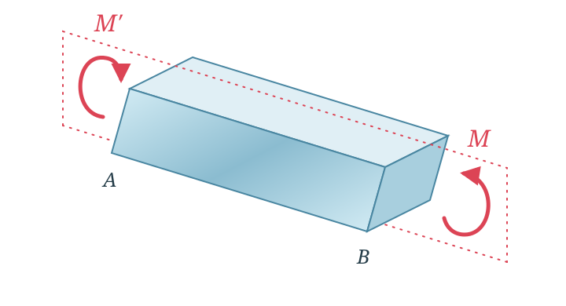
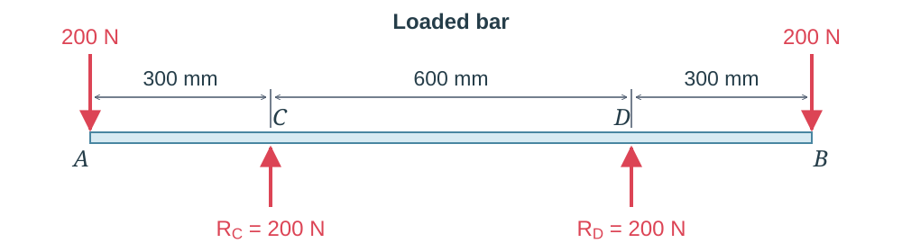
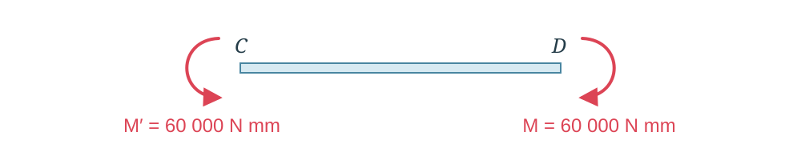
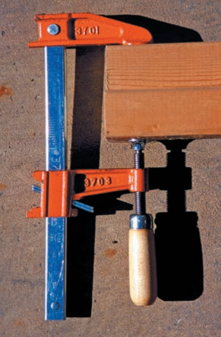
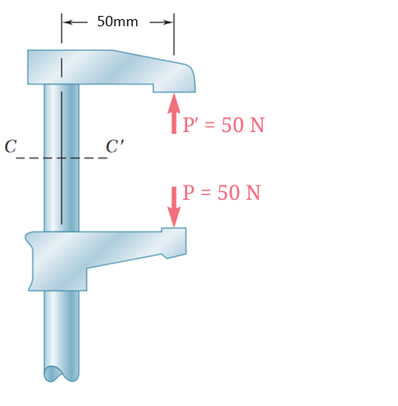
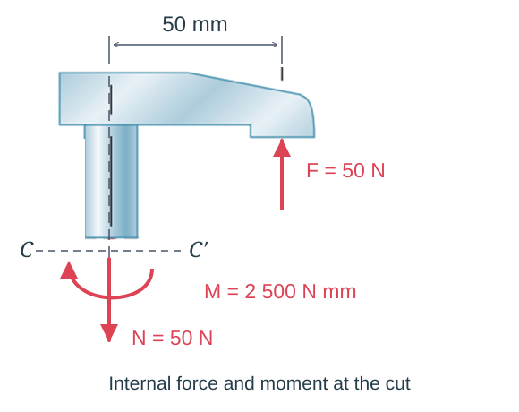
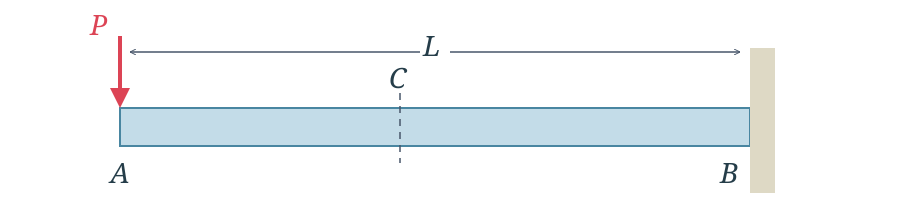
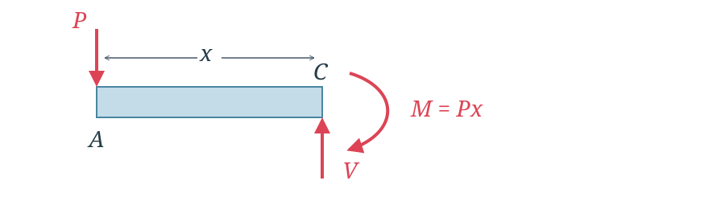
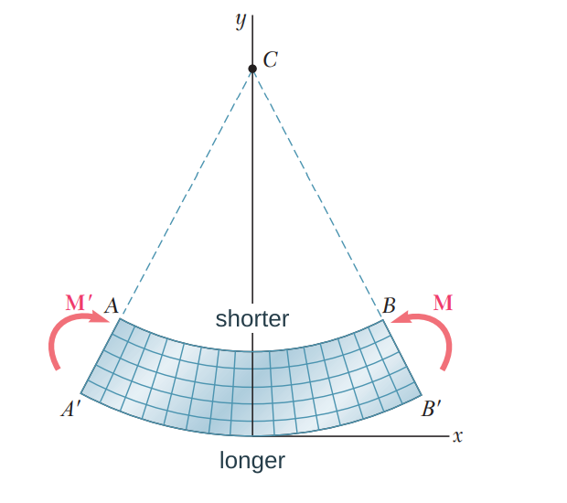
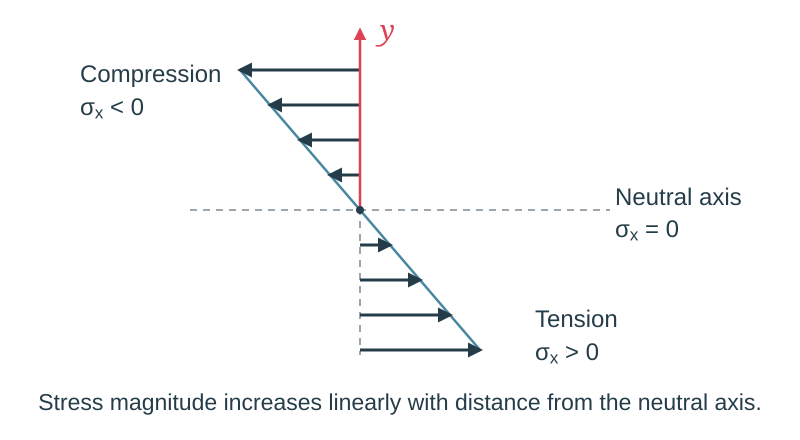

<!--
author: Matthew Blacklock
email: matthew.blacklock@northumbria.ac.uk
version: 0.0.2
mode: Presentation
import: https://raw.githubusercontent.com/MINT-the-GAP/lia-board-mode/main/README.md
        https://raw.githubusercontent.com/MINT-the-GAP/lia-annotation/main/README.md
        ../common/templates.md
comment: KB5034 Week 4 - Topic 2: bending and beam elements.
-->

# Week 4: Bending & Beam Elements

@moduleTitle

**Topic 2: Bending & Beam Elements**

---

@[course(Return to Week 3)](../week03/week03.md)

---

## Topic Learning Outcomes

By the end of this week, students will be able to:

<br>

**2.1.** **Demonstrate** the use of shear and bending moment diagrams to design beam sections for strength and deflection.

## A. INDEPENDENT STUDY: Before class

**PREPARATION STARTS HERE**

Study the pure-bending, eccentric-loading, transverse-loading and beam-deformation examples on the following pages before class.

Complete the quick checks as you work through the material. Bring your notes to class.

In class, we will bring these ideas together in a plenary on loading, supports and boundary conditions, then use them to construct shear-force and bending-moment diagrams and calculate beam deflections.

## Pure Bending

**Pure bending** occurs in a region of a beam where the bending moment is constant and the shear force is zero.

A **prismatic member** has a constant cross-sectional shape and size along its length.

Equal and opposite couples acting in the **same longitudinal plane** can produce pure bending. The dotted plane in the diagram shows this plane:

<!-- style="width: 55%; display: block; margin: auto;" -->

The weightlifting example shows how forces can also produce a region of pure bending.

<!-- style="width: 45%; display: block; margin: auto;" -->

The weights act downwards and the hands provide upward reaction forces. For the symmetric idealisation shown, neglecting the bar's own weight, the region **between the hands** has zero shear force and a constant bending moment.

<!-- style="width: 85%; display: block; margin: auto;" -->

Because the loading is symmetric, each hand provides an upward reaction of $200\text{ N}$.

Now consider the middle section $C-D$. The downward load at $A$ acts $300\text{ mm}$ from $C$, producing a moment about $C$. The reaction at $C$ has zero moment about $C$. Likewise, the downward load at $B$ produces a moment about $D$, while the reaction at $D$ has zero moment about $D$.

The two overhanging portions therefore transmit equal and opposite moments to the middle section, each of magnitude:

$$M=200\times300=60\,000\text{ N mm}.$$

<!-- style="width: 85%; display: block; margin: auto;" -->

On each side, the downward load and upward reaction cancel as forces. The middle section $C-D$ therefore carries equal and opposite end couples, with no resultant transverse force. The bending moment is constant throughout $C-D$ and the shear force is zero.

{{1}}
********************
<br>

**Quick check**

Which conditions describe a region of pure bending?

<!-- data-solution-button="3" -->
[( )] Zero bending moment and constant shear force.
[(X)] Constant bending moment and zero shear force.
[( )] Zero bending moment and zero shear force.

[[?]] A beam can bend even where the shear force is zero.
********************

## Eccentric Loading

An axial force can produce **bending** when its line of action is offset from the centroidal axis. The offset creates a bending moment. This is **eccentric loading**.

<!-- style="width: 20%; display: block; margin: auto;" -->

The timber pushes upwards on the upper jaw and downwards on the lower jaw. These equal and opposite forces act away from the centroidal axis of the straight member of the clamp.

<!-- style="width: 30%; display: block; margin: auto;" -->

Imagine cutting through the clamp at $C-C'$ and isolating the upper part. The upward force acts at a perpendicular distance of **50 mm** from the centroidal axis of the vertical member.

<!-- style="width: 30%; display: block; margin: auto;" -->

To keep this upper part in equilibrium, the cut section must carry:

- A **downward axial force**, equal in magnitude to the upward jaw force. This puts the vertical member in **tension**.
- A **bending moment**, balancing the moment of the jaw force about the centroid of the cut section.

Their magnitudes are:

$$N=F,\qquad M=Fe.$$

Here, $e$ is the perpendicular distance from the centroidal axis to the force's line of action.

Each jaw force has magnitude $F=50\text{ N}$.

For $e=50\text{ mm}$:

$$N=50\text{ N},\qquad M=50\times50=2\,500\text{ N mm}.$$

The straight member therefore carries **combined axial tension and bending**. To find the longitudinal stress across its section, we combine the axial stress from $N$ with the bending stress from $M$.

{{1}}
********************
<br>

**Quick check**

If the force stays the same but its offset from the centroidal axis doubles, what happens to the bending moment?

<!-- data-solution-button="3" -->
[( )] It stays the same.
[(X)] It doubles.
[( )] It halves.

[[?]] Use $M=Fe$.
********************

## Transverse Loading

A **transverse load** acts across the beam, perpendicular to its longitudinal axis.

A transverse force produces a **bending moment** because it acts at a distance from the section being considered.

The cantilever shown is fixed at $B$ and carries a downward force $P$ at its free end $A$.

<!-- style="width: 90%; display: block; margin: auto;" -->

Imagine cutting the beam at $C$, a distance $x$ from $A$, and isolating the segment $A-C$.

<!-- style="width: 90%; display: block; margin: auto;" -->

To keep this segment in equilibrium, the cut must carry:

- An **upward shear force** $V$, balancing the downward transverse force $P$.
- A **clockwise bending moment**, balancing the moment of $P$ about the cut.

Their magnitudes are:

$$|V|=P,\qquad |M|=Px.$$

This cantilever is **not in pure bending**: it carries a non-zero shear force, and its bending moment varies along its length.

The bending moment produces longitudinal normal stress, while the shear force produces shear stress. We can use the pure-bending stress relation to calculate the longitudinal bending stress at a section, even though that section also carries shear.

The bending moment increases towards the fixed end, where its magnitude is $PL$. We will establish the sign convention and draw the shear-force and bending-moment diagrams in class.

{{1}}
********************
<br>

**Quick check**

Where is the bending moment largest in magnitude for this cantilever?

<!-- data-solution-button="3" -->
[( )] At the free end $A$.
[( )] Halfway along the beam.
[(X)] At the fixed end $B$.

[[?]] The perpendicular distance from the load to the cut increases towards the fixed end.
********************

## Beam Deformation

Imagine longitudinal lines of material running along the beam, often called **fibres**. Under bending, the lines on one side shorten while those on the other side lengthen.

<!-- style="width: 55%; display: block; margin: auto;" -->

As the beam bends, the upper fibres shorten and the lower fibres lengthen. These changes in length produce compressive and tensile longitudinal strains. For a linear elastic material, the corresponding longitudinal stress follows Hooke's law:

$$\sigma_x=E\varepsilon_x.$$

For the bending direction shown:

- The **upper fibres** shorten and are in compression: longitudinal strain $\varepsilon_x$ and stress $\sigma_x$ are **negative**.
- The **lower fibres** lengthen and are in tension: longitudinal strain $\varepsilon_x$ and stress $\sigma_x$ are **positive**.
- The **neutral axis** separates these regions. The longitudinal bending strain and stress are zero there.

In the elementary beam model, cross-sections remain plane and perpendicular to the deformed centreline.

In the ideal **pure-bending** model, away from where loads are applied, the only non-zero stress component is the longitudinal normal stress $\sigma_x$:

$$\sigma_y=\sigma_z=0,\qquad \tau_{xy}=\tau_{xz}=\tau_{yz}=0.$$

These other stresses are zero because the ideal pure-bending model has no transverse normal loading or shear force. These conditions describe the **stress components**; they do not imply that strain in every other direction is zero.

This describes the pure-bending region. A beam carrying a transverse shear force, such as the cantilever on the previous page, also has shear stress.

The longitudinal bending stress varies linearly through the depth. Taking $y$ as positive upwards from the neutral axis, the signed stress for the bending direction shown is:

$$\sigma_x=-\frac{M\,y}{I}.$$

Here, $I$ is the second moment of area about the neutral axis. The largest bending-stress magnitude occurs at the outermost fibres:

$$|\sigma_{\max}|=\frac{|M|\,y_{\max}}{I}.$$

<!-- style="width: 65%; display: block; margin: auto;" -->

{{1}}
********************
<br>

**Quick check**

Where is the longitudinal bending stress zero?

<!-- data-solution-button="3" -->
[( )] At the upper surface.
[(X)] At the neutral axis.
[( )] At the lower surface.
********************

## Before class completion check

Before class, check that you can:

- [ ] Explain what is meant by pure bending.
- [ ] Identify bending caused by an eccentric or transverse load.
- [ ] Identify the tension, compression and neutral-axis regions in a bent beam.
- [ ] Explain how shortening and lengthening produce longitudinal strain and stress.

Bring your notes and any questions to class. We will use these ideas to construct shear-force and bending-moment diagrams and calculate beam deflections.

**There is no quiz due this week.**

## Further reading

@FurtherReading

@ReadingBook(@BeerBook,@BeerLibrary,```
- **Chapter 4:** Pure Bending
- **Chapter 5:** Analysis and Design of Beams for Bending
- **Chapter 9:** Deflection of Beams
```)

