<!--
author: Matthew Blacklock
email: matthew.blacklock@northumbria.ac.uk
version: 1.0.0
mode: Presentation
import: https://raw.githubusercontent.com/MINT-the-GAP/lia-board-mode/main/README.md
        https://raw.githubusercontent.com/MINT-the-GAP/lia-annotation/main/README.md
        ../common/templates.md
comment: KB5034 Week 4 - Topic 2: bending and beam elements.
-->

# Week 4: Bending & Beam Elements

@moduleTitle

**Topic 2: Bending & Beam Elements**

---

@[course(Return to Week 3)](../week03/week03.md)

---

## Topic Learning Outcomes

By the end of this week, students will be able to:

<br>

**2.1.** **Demonstrate** the use of shear and bending moment diagrams to design beam sections for strength and deflection.

## A. INDEPENDENT STUDY: Before class

**PREPARATION STARTS HERE**

Study the pure-bending, eccentric-loading, transverse-loading and beam-deformation examples on the following pages before class.

Complete the quick checks as you work through the material. Bring your notes to class.

In class, we will bring these ideas together in a plenary on loading, supports and boundary conditions, then use them to construct shear-force and bending-moment diagrams and calculate beam deflections.

## Pure Bending

**Pure bending** occurs in a region of a beam where the bending moment is constant and the shear force is zero.

A **prismatic member** has a constant cross-sectional shape and size along its length.

Equal and opposite couples acting in the **same longitudinal plane** can produce pure bending. The dotted plane in the diagram shows this plane:

<!-- style="width: 55%; display: block; margin: auto;" -->

The weightlifting example shows how forces can also produce a region of pure bending.

<!-- style="width: 45%; display: block; margin: auto;" -->

The weights act downwards and the hands provide upward reaction forces. For the symmetric idealisation shown, neglecting the bar's own weight, the region **between the hands** has zero shear force and a constant bending moment.

<!-- style="width: 85%; display: block; margin: auto;" -->

Because the loading is symmetric, each hand provides an upward reaction of $200\text{ N}$.

Now consider the middle section $C-D$. The downward load at $A$ acts $300\text{ mm}$ from $C$, producing a moment about $C$. The reaction at $C$ has zero moment about $C$. Likewise, the downward load at $B$ produces a moment about $D$, while the reaction at $D$ has zero moment about $D$.

The two overhanging portions therefore transmit equal and opposite moments to the middle section, each of magnitude:

$$M=200\times300=60\,000\text{ N mm}.$$

<!-- style="width: 85%; display: block; margin: auto;" -->

On each side, the downward load and upward reaction cancel as forces. The middle section $C-D$ therefore carries equal and opposite end couples, with no resultant transverse force. The bending moment is constant throughout $C-D$ and the shear force is zero.

{{1}}
********************
<br>

**Quick check**

Which conditions describe a region of pure bending?

<!-- data-solution-button="3" -->
[( )] Zero bending moment and constant shear force.
[(X)] Constant bending moment and zero shear force.
[( )] Zero bending moment and zero shear force.

[[?]] A beam can bend even where the shear force is zero.
********************

## Eccentric Loading

An axial force can produce **bending** when its line of action is offset from the centroidal axis. The offset creates a bending moment. This is **eccentric loading**.

<!-- style="width: 20%; display: block; margin: auto;" -->

The timber pushes upwards on the upper jaw and downwards on the lower jaw. These equal and opposite forces act away from the centroidal axis of the straight member of the clamp.

<!-- style="width: 30%; display: block; margin: auto;" -->

Imagine cutting through the clamp at $C-C'$ and isolating the upper part. The upward force acts at a perpendicular distance of **50 mm** from the centroidal axis of the vertical member.

<!-- style="width: 30%; display: block; margin: auto;" -->

To keep this upper part in equilibrium, the cut section must carry:

- A **downward axial force**, equal in magnitude to the upward jaw force. This puts the vertical member in **tension**.
- A **bending moment**, balancing the moment of the jaw force about the centroid of the cut section.

Their magnitudes are:

$$N=F,\qquad M=Fe.$$

Here, $e$ is the perpendicular distance from the centroidal axis to the force's line of action.

Each jaw force has magnitude $F=50\text{ N}$.

For $e=50\text{ mm}$:

$$N=50\text{ N},\qquad M=50\times50=2\,500\text{ N mm}.$$

The straight member therefore carries **combined axial tension and bending**. To find the longitudinal stress across its section, we combine the axial stress from $N$ with the bending stress from $M$.

{{1}}
********************
<br>

**Quick check**

If the force stays the same but its offset from the centroidal axis doubles, what happens to the bending moment?

<!-- data-solution-button="3" -->
[( )] It stays the same.
[(X)] It doubles.
[( )] It halves.

[[?]] Use $M=Fe$.
********************

## Transverse Loading

A **transverse load** acts across the beam, perpendicular to its longitudinal axis.

A transverse force produces a **bending moment** because it acts at a distance from the section being considered.

The cantilever shown is fixed at $B$ and carries a downward force $P$ at its free end $A$.

<!-- style="width: 90%; display: block; margin: auto;" -->

Imagine cutting the beam at $C$, a distance $x$ from $A$, and isolating the segment $A-C$.

<!-- style="width: 90%; display: block; margin: auto;" -->

To keep this segment in equilibrium, the cut must carry:

- An **upward shear force** $V$, balancing the downward transverse force $P$.
- A **clockwise bending moment**, balancing the moment of $P$ about the cut.

Their magnitudes are:

$$|V|=P,\qquad |M|=Px.$$

This cantilever is **not in pure bending**: it carries a non-zero shear force, and its bending moment varies along its length.

The bending moment produces longitudinal normal stress, while the shear force produces shear stress. We can use the pure-bending stress relation to calculate the longitudinal bending stress at a section, even though that section also carries shear.

The bending moment increases towards the fixed end, where its magnitude is $PL$. We will establish the sign convention and draw the shear-force and bending-moment diagrams in class.

{{1}}
********************
<br>

**Quick check**

Where is the bending moment largest in magnitude for this cantilever?

<!-- data-solution-button="3" -->
[( )] At the free end $A$.
[( )] Halfway along the beam.
[(X)] At the fixed end $B$.

[[?]] The perpendicular distance from the load to the cut increases towards the fixed end.
********************

## Beam Deformation

Imagine longitudinal lines of material running along the beam, often called **fibres**. Under bending, the lines on one side shorten while those on the other side lengthen.

<!-- style="width: 55%; display: block; margin: auto;" -->

As the beam bends, the upper fibres shorten and the lower fibres lengthen. These changes in length produce compressive and tensile longitudinal strains. For a linear elastic material, the corresponding longitudinal stress follows Hooke's law:

$$\sigma_x=E\varepsilon_x.$$

For the bending direction shown:

- The **upper fibres** shorten and are in compression: longitudinal strain $\varepsilon_x$ and stress $\sigma_x$ are **negative**.
- The **lower fibres** lengthen and are in tension: longitudinal strain $\varepsilon_x$ and stress $\sigma_x$ are **positive**.
- The **neutral axis** separates these regions. The longitudinal bending strain and stress are zero there.

In the elementary beam model, cross-sections remain plane and perpendicular to the deformed centreline.

In the ideal **pure-bending** model, away from where loads are applied, the only non-zero stress component is the longitudinal normal stress $\sigma_x$:

$$\sigma_y=\sigma_z=0,\qquad \tau_{xy}=\tau_{xz}=\tau_{yz}=0.$$

These other stresses are zero because the ideal pure-bending model has no transverse normal loading or shear force. These conditions describe the **stress components**; they do not imply that strain in every other direction is zero.

This describes the pure-bending region. A beam carrying a transverse shear force, such as the cantilever on the previous page, also has shear stress.

The longitudinal bending stress varies linearly through the depth. Taking $y$ as positive upwards from the neutral axis, the signed stress for the bending direction shown is:

$$\sigma_x=-\frac{M\,y}{I}.$$

Here, $I$ is the second moment of area about the neutral axis. The largest bending-stress magnitude occurs at the outermost fibres:

$$|\sigma_{\max}|=\frac{|M|\,y_{\max}}{I}.$$

<!-- style="width: 65%; display: block; margin: auto;" -->

{{1}}
********************
<br>

**Quick check**

Where is the longitudinal bending stress zero?

<!-- data-solution-button="3" -->
[( )] At the upper surface.
[(X)] At the neutral axis.
[( )] At the lower surface.
********************

## Before class completion check

Before class, check that you can:

- [ ] Explain what is meant by pure bending.
- [ ] Identify bending caused by an eccentric or transverse load.
- [ ] Identify the tension, compression and neutral-axis regions in a bent beam.
- [ ] Explain how shortening and lengthening produce longitudinal strain and stress.

Bring your notes and any questions to class. We will use these ideas to construct shear-force and bending-moment diagrams and calculate beam deflections.

**There is no quiz due this week.**

---

**PREPARATION ENDS HERE**

## B. IN-CLASS STUDY

<br>

**Learning Outcome 2.1.** Demonstrate the use of shear and bending moment diagrams to design beam sections for strength and deflection.

<br>

Keep your own workings. The dropdowns contain reference calculations for revision.

## Beam Loading

Use the pre-work examples to explain how an applied couple, an eccentric force and a transverse force can each produce bending.

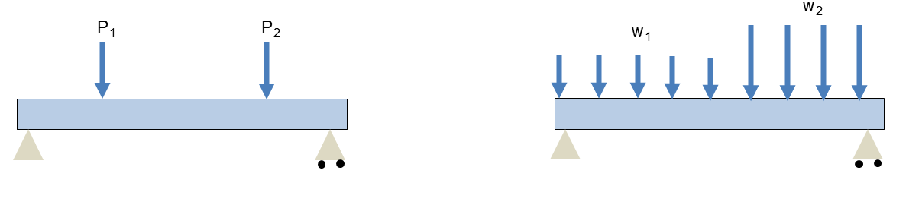<!-- style="width: 80%; display: block; margin: auto;" -->

For each beam, identify the loading type.

{{1}}
********************
<br>
**Concentrated force, $P$:** A force acting at a particular position, measured in N or kN, etc.

**Distributed load, $w$:** Force per unit length, measured in N/mm or kN/m, etc.

A uniform distributed load over length $L$ has an equivalent resultant force:

$$F=wL.$$

The resultant acts at the midpoint of the loaded length. Use it to calculate support reactions. When cutting within a distributed load, include only the loading on the isolated segment.
********************

## Supports and Boundary Conditions

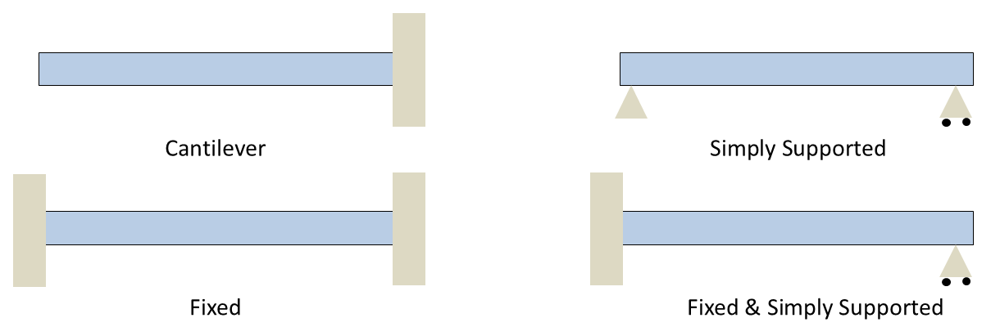<!-- style="width: 80%; display: block; margin: auto;" -->

For each support:

1. Which movements are prevented?
2. Which reaction forces or moments can develop?
3. Which displacement boundary conditions would you write?

Let $u$ be horizontal displacement, $v$ vertical displacement and $\theta$ rotation in the beam's plane.

{{1}}
********************
**Displacement boundary conditions**

For each support, select **every condition it imposes**. An unselected displacement or rotation is free.

<!-- data-solution-button="3" -->
- [[$u=0$] [$v=0$] [$\theta=0$]]
- [ [X] [X] [X] ] Fixed
- [ [X] [X] [ ] ] Pin
- [ [ ] [X] [ ] ] Roller on a horizontal surface

**Possible reactions**

Select **every reaction each support can provide**. $R_x$ and $R_y$ are horizontal and vertical reaction forces; $M$ is a reaction moment.

<!-- data-solution-button="3" -->
- [[$R_x$] [$R_y$] [$M$]]
- [ [X] [X] [X] ] Fixed
- [ [X] [X] [ ] ] Pin
- [ [ ] [X] [ ] ] Roller on a horizontal surface
********************

{{2}}
********************
For the small slopes used here, $\theta\approx dv/dx$. A fixed end therefore has $v=0$ and $dv/dx=0$.

A simply supported beam has $v=0$ at both supports, but its end slopes are generally **not zero**.
********************

## Shear Force and Bending Moment: Method

**Goal:** Find the bending moment $M(x)$ along the beam and draw its diagram, so we can locate the greatest bending stress and calculate deflection. We will also find and plot the shear force $V(x)$, which produces shear stress.

Consider a simply supported beam carrying a distributed load and two concentrated forces.

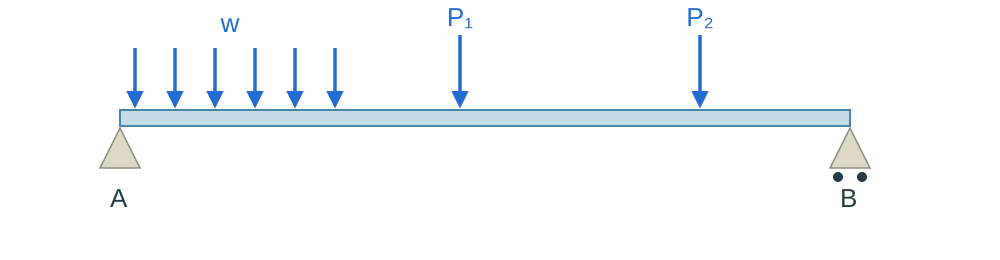<!-- style="width: 85%; display: block; margin: auto;" -->

<details>
<summary><strong>Reveal reference: free-body diagrams and method</strong></summary>

**1. Draw the whole-beam free-body diagram**

Replace the supports with their reaction forces and use equilibrium to determine them. Here, there are no horizontal loads, so the horizontal reaction at $A$ is zero. Only the vertical reactions $R_A$ and $R_B$ are shown.

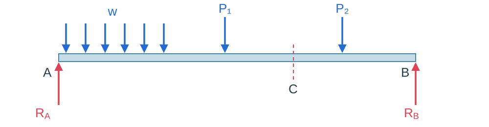<!-- style="width: 85%; display: block; margin: auto;" -->

**2. Cut at $C$ and isolate one side**

Measure $x$ from $A$ and retain the left-hand segment $A-C$. Include every load on that segment, and add the internal shear force $V$ and bending moment $M$ at the cut.

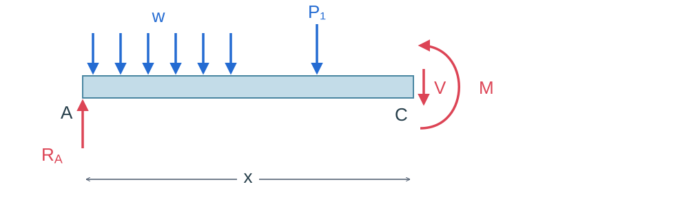<!-- style="width: 85%; display: block; margin: auto;" -->

The force $P_2$ lies beyond the cut, so it does not appear on this segment's FBD. It still affects the whole-beam reactions.

For a uniform load over a length $a$, the equivalent force is $wa$, acting at the midpoint of that loaded length.

**3. Use equilibrium to find $V(x)$ and $M(x)$**

Sum vertical forces and take moments about the cut. Repeat for each region separated by a concentrated force or a change in distributed loading, then plot the results.

The bending moment $M$ produces **longitudinal normal stress**. The shear force $V$ produces **shear stress**.

</details>

### Sign Convention

Take $x$ as positive to the right and vertical displacement $v$ as positive upwards.

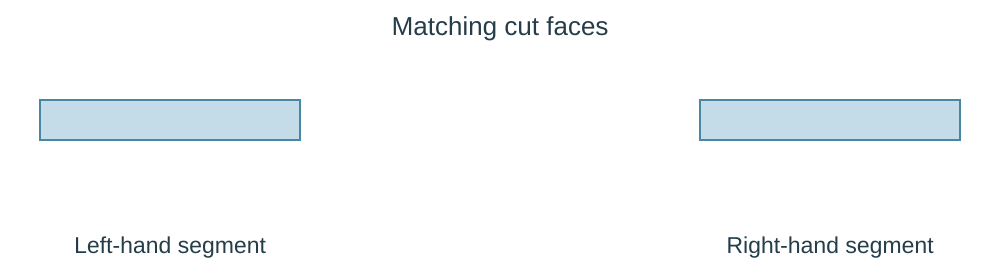<!-- style="width: 85%; display: block; margin: auto;" -->

Define the positive directions of $V$ and $M$ on each cut face. Sketch the bending shapes associated with positive and negative moment.

<details>
<summary><strong>Reveal reference: positive internal actions and bending shapes</strong></summary>

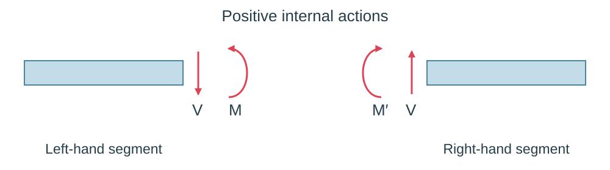<!-- style="width: 85%; display: block; margin: auto;" -->

For the **left-hand segment**, the positive internal actions at its right-hand cut face are:

- **Positive shear force $V$:** downwards.
- **Positive bending moment $M$:** anticlockwise.

On the matching face of the right-hand segment, the directions are opposite.

A positive bending moment produces **sagging**, a $\cup$ shape: the upper fibres are in compression and the lower fibres are in tension.

A negative moment produces **hogging**, a $\cap$ shape: the upper fibres are in tension and the lower fibres are in compression.

</details>

## Bending and Shear Stresses

**Bending Stress**

The longitudinal bending stress is:

$$\sigma_x=-\frac{My}{I}.$$

Where is the greatest stress magnitude in a cross-section? How can we use the bending-moment diagram to locate the critical section along the beam?

<details>
<summary><strong>Reveal reference: maximum bending stress and section modulus</strong></summary>

At a given cross-section, its greatest magnitude occurs at the outermost fibres, where $|y|=c$:

$$|\sigma|_{\max}=\frac{|M|c}{I}=\frac{|M|}{S},\qquad S=\frac{I}{c}.$$

Here, $c$ is the greatest distance from the neutral axis to the section's outer edge, and $S$ is the **section modulus**.

For a constant cross-section, we therefore need to find **where $|M|$ is greatest**. The bending-moment diagram shows this. We draw the shear-force diagram alongside it.

</details>

{{1}}
********************
<br>
**Shear Stress**

The shear force $V$ produces **shear stress**. Its magnitude is given by:

$$|\tau|=\frac{|V|Q}{It}.$$

Where is the greatest shear-stress magnitude in a rectangular cross-section? How can we use the shear-force diagram to locate the critical section along the beam?

<details>
<summary><strong>Reveal reference: maximum shear stress in a rectangular section</strong></summary>

Here, $Q$ is the first moment of the cross-sectional area above (or below) the level being considered about the neutral axis, $I$ is the second moment of area of the whole cross-section, and $t$ is the section width at that level.

For a **rectangular cross-section** of width $b$ and depth $h$, the maximum shear stress occurs at the **neutral axis**:

$$\tau_{\max}=\frac{3|V|}{2A}=\frac{3|V|}{2bh}.$$

The shear stress is zero at the top and bottom surfaces. For a constant rectangular cross-section, use the shear-force diagram to find where $|V|$ is greatest.

</details>
********************

{{2}}
********************
<br>
**Which stress usually dominates?**

In **long, slender beams**, the normal stress caused by bending is usually much greater than the shear stress. Beam design tends to focus on bending stress and deflection.

Shear stress is still present and can be important in short, deep beams or sections with thin webs.
********************

## Worked Example: Cantilever

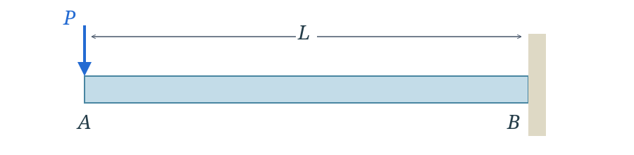<!-- style="width: 80%; display: block; margin: auto;" -->

Take $x=0$ at the free end $A$ and $x=L$ at the fixed end $B$.

Draw the complete free-body diagram, find the support reactions, then cut at a general position $x$ from $A$.

Determine $V(x)$ and $M(x)$ and sketch both diagrams.

<br>

<details>
<summary><strong>Reveal worked solution: reactions, shear force and bending moment</strong></summary>

**Complete free-body diagram**

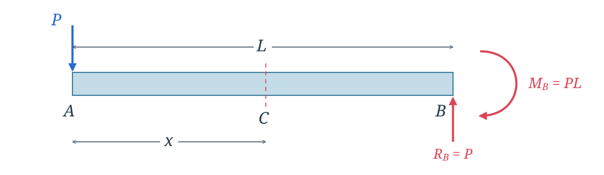<!-- style="width: 80%; display: block; margin: auto;" -->

The support provides an upward reaction $R_B=P$ and a clockwise reaction moment $M_B=PL$. This is the **support reaction moment**; the internal bending moment $M(x)$ is introduced when we cut the beam at $C$, a distance $x$ from $A$.

**Cut free-body diagram**

For the left-hand segment, take positive $V$ downwards and positive $M$ anticlockwise at the cut.

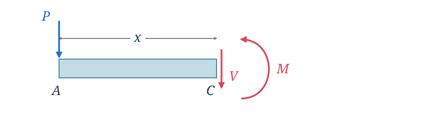<!-- style="width: 80%; display: block; margin: auto;" -->

Vertical equilibrium gives:

$$-P-V=0\quad\Rightarrow\quad V(x)=-P.$$

Taking moments about the cut gives:

$$Px+M=0\quad\Rightarrow\quad M(x)=-Px.$$

The shear force is constant. The bending moment is zero at $A$ and varies linearly to $-PL$ at $B$.

The greatest bending-moment magnitude is $PL$, at the fixed end.

**Shear-force and bending-moment diagrams**

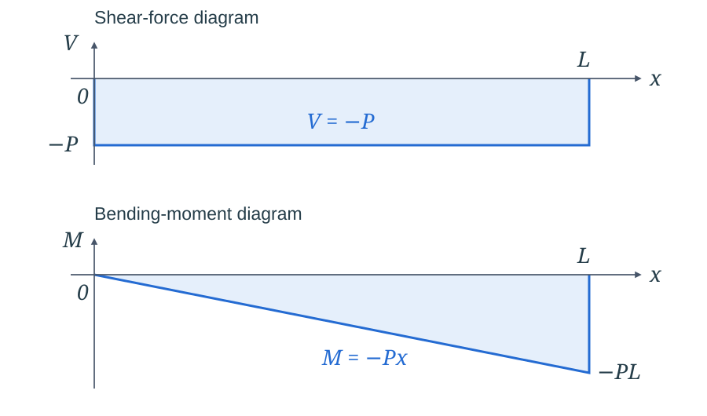<!-- style="width: 80%; display: block; margin: auto;" -->

**Normal bending stress**

The greatest bending-moment magnitude occurs at the fixed end $B$, where the internal moment is $M(L)=-PL$. Therefore:

$$\sigma_x=-\frac{My}{I}=\frac{PLy}{I}.$$

The top of the beam ($y>0$) is in **tension** and the bottom ($y<0$) is in **compression**. The stress varies linearly through the depth and is zero at the neutral axis.

For a section symmetric about the neutral axis, with outer surfaces at $y=\pm c$:

$$\sigma_{\mathrm{top}}=+\frac{PLc}{I},\qquad \sigma_{\mathrm{bottom}}=-\frac{PLc}{I},\qquad |\sigma|_{\max}=\frac{PLc}{I}.$$

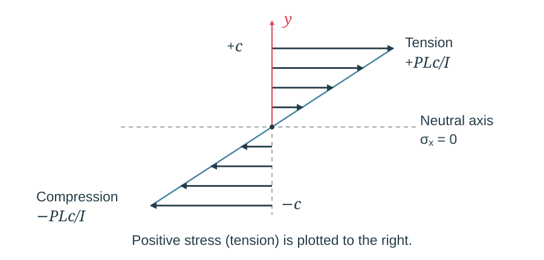<!-- style="width: 80%; display: block; margin: auto;" -->

</details>

{{1}}
********************
**Quick check**

Why is the bending-moment diagram a straight line?

<!-- data-solution-button="3" -->
[(X)] Because $M=-Px$, and $P$ is constant, so $M$ varies linearly with $x$.
[( )] The bending moment is zero everywhere.
[( )] The beam has no support reaction moment.
********************

## Problem: Uniform Distributed Load

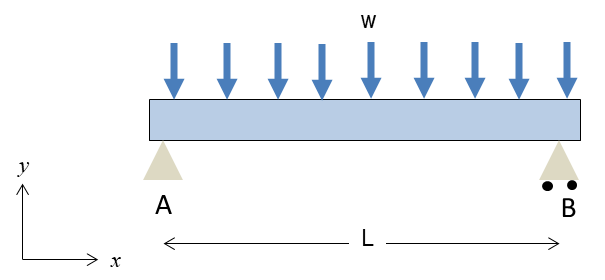<!-- style="display: block; margin: auto;" -->

Take $x=0$ at $A$.

Draw the complete free-body diagram, find the support reactions, then cut at a general position $x$ from $A$.

Determine $V(x)$ and $M(x)$ and sketch both diagrams. Find the maximum bending moment and the normal bending stress at that section.

**Reminder:** To calculate the support reactions, replace the uniformly distributed load $w$ over the full span $L$ with an equivalent resultant force $P=wL$, acting at midspan. For a cut segment of length $x$, its resultant is $wx$, acting at the segment's midpoint.

<br>

<details>
<summary><strong>Reveal worked solution: reactions, shear force, bending moment and normal stress</strong></summary>

**Complete free-body diagram**

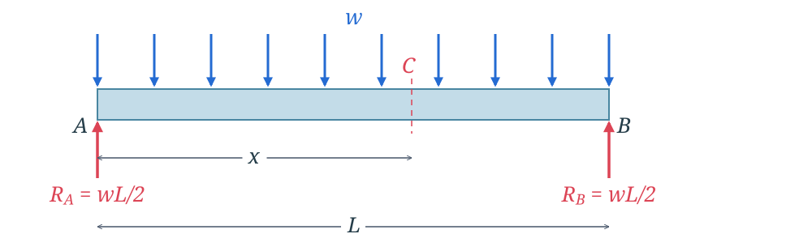<!-- style="width: 80%; display: block; margin: auto;" -->

The total load is $wL$. By symmetry, the support reactions are:

$$R_A=R_B=\frac{wL}{2}.$$

**Cut free-body diagram**

Cut at $C$, a distance $x$ from $A$. The load on the isolated segment has resultant $wx$, acting at its midpoint, a distance $x/2$ from the cut.

Take positive $V$ downwards and positive $M$ anticlockwise at the cut.

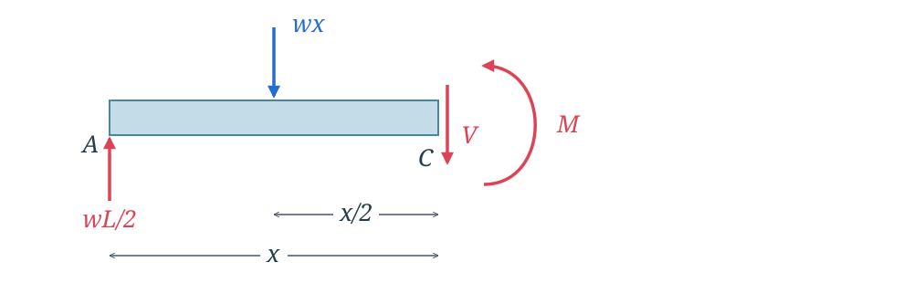<!-- style="width: 80%; display: block; margin: auto;" -->

Vertical equilibrium gives:

$$\frac{wL}{2}-wx-V=0\quad\Rightarrow\quad V(x)=\frac{wL}{2}-wx.$$

Taking moments about the cut, anticlockwise positive:

$$M-\frac{wL}{2}x+(wx)\frac{x}{2}=0\quad\Rightarrow\quad M(x)=\frac{wLx}{2}-\frac{wx^2}{2}.$$

**Shear-force and bending-moment diagrams**

The shear force decreases linearly from $+wL/2$ at $A$ to $-wL/2$ at $B$, crossing zero at midspan.

The bending-moment diagram is a positive parabola, zero at both supports. Its maximum occurs at $x=L/2$, where $V=0$:

$$M_{\max}=\frac{wL^2}{8}.$$

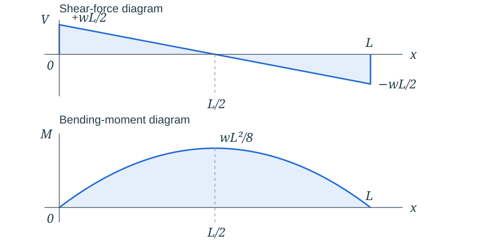<!-- style="width: 80%; display: block; margin: auto;" -->

**Maximum normal bending stress**

$$|\sigma|_{\max}=\frac{M_{\max}c}{I}=\frac{wL^2c}{8I}.$$

At midspan, the maximum bending stress occurs at the outer surfaces: **compression at the top** and **tension at the bottom**.

Keep this expression for $M(x)$: it is the starting point for the analytical deflection problem later in the session.

</details>

## Checking the Diagrams

The shear-force and bending-moment diagrams are connected. Look at the expressions we have just obtained.

How does the shear force relate to the slope of the bending-moment diagram? What changes when we apply a distributed load or a concentrated force?

<details>
<summary><strong>Reveal reference: connections between loading, shear force and bending moment</strong></summary>

**Shear force tells us how quickly bending moment changes along the beam.**

For the cantilever, $M=-Px$. Its slope is $-P$, which is also the shear force $V$. Because that slope is constant, the bending-moment diagram is a straight line.

We write this relationship as:

$$\frac{dM}{dx}=V.$$

**A distributed load tells us how quickly shear force changes along the beam.**

For the UDL, moving a distance $\Delta x$ along the beam includes an additional downward load $w\Delta x$. The shear force therefore decreases by $w\Delta x$:

$$\frac{\Delta V}{\Delta x}=-w.$$

For an infinitesimally small distance, we write:

$$\frac{dV}{dx}=-w.$$

These give useful checks on the shapes of the diagrams:

- A uniform distributed load gives a straight shear-force diagram and a parabolic bending-moment diagram.
- Constant shear force gives a straight bending-moment diagram.
- A concentrated force causes a jump in the shear-force diagram.

For a simply supported beam with a central point load, the shear force is constant on each half of the span, so the bending-moment diagram has two straight sides. At the load, the shear force drops by $P$, from $+P/2$ to $-P/2$.

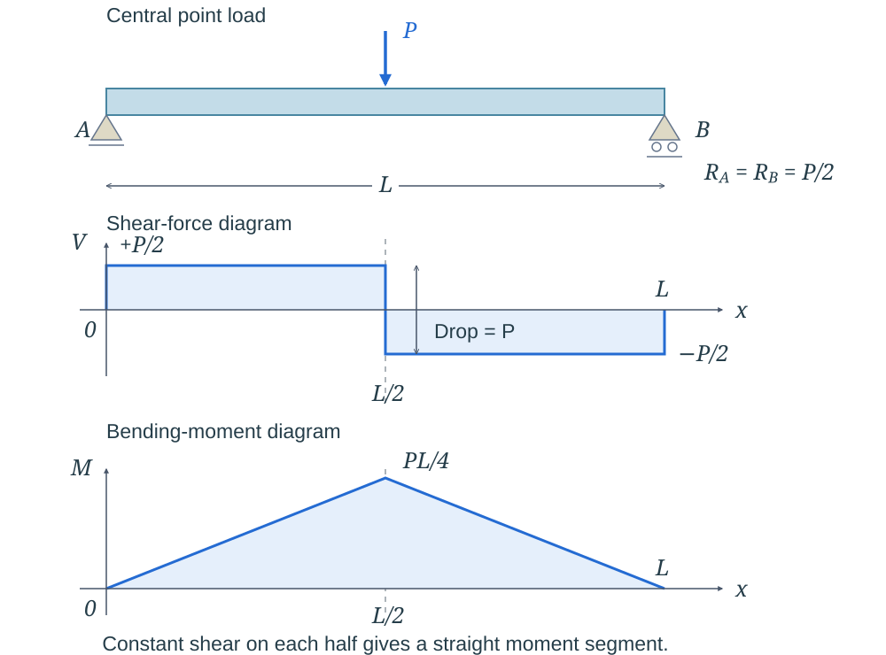<!-- style="width: 85%; display: block; margin: auto;" -->

</details>

## Bending Moment and Curvature

<!-- style="width: 50%; display: block; margin: auto;" -->

We will use the geometry of a bent beam to relate bending moment to curvature, then obtain an equation for the beam's deflection.

<details>
<summary><strong>Reveal derivation: strain, curvature and the beam equation</strong></summary>

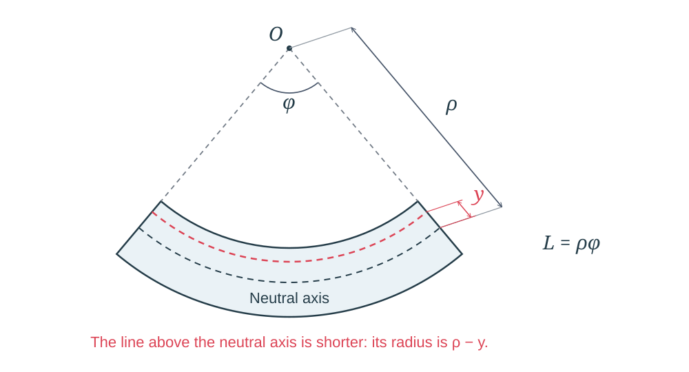<!-- style="width: 80%; display: block; margin: auto;" -->

Let the neutral-axis radius be $\rho$ and the angle subtended by a beam segment be $\phi$.

The neutral-axis length is $L=\rho\phi$. A fibre a distance $y$ above the neutral axis has length $L_y=(\rho-y)\phi$.

Its longitudinal strain is:

$$\varepsilon_x=\frac{L_y-L}{L}=-\frac{y}{\rho}.$$

Using Hooke's law and comparing with the bending-stress equation:

$$\sigma_x=-\frac{Ey}{\rho}=-\frac{My}{I}\quad\Rightarrow\quad\frac{1}{\rho}=\frac{M}{EI}.$$

Let $v(x)$ be vertical displacement, positive upwards. The slope is $dv/dx$, and the small rotation is $\theta\approx dv/dx$.

Curvature is the reciprocal of the radius of curvature: $\kappa=1/\rho$. A smaller radius means a more sharply curved beam. In terms of the deflection $v(x)$:

$$\kappa=\frac{1}{\rho}=\frac{d^2v/dx^2}{\left[1+(dv/dx)^2\right]^{3/2}}.$$

For small slopes, $(dv/dx)^2\ll1$, so $\kappa\approx d^2v/dx^2$. Combining this with the moment-curvature relation gives:

$$EI\frac{d^2v}{dx^2}=M(x).$$

</details>

{{1}}
********************
**Quick check**

If $I$ doubles while the material and bending moment stay the same, what happens to the curvature?

<!-- data-solution-button="3" -->
[( )] It doubles.
[(X)] It halves.
[( )] It stays the same.
********************

## Worked Example: Cantilever Deflection

<!-- style="width: 80%; display: block; margin: auto;" -->

Take $x=0$ at the free end $A$ and $x=L$ at the fixed end $B$.

Assume constant $E$ and $I$, small displacements and negligible shear deformation.

Use the bending-moment expression from the earlier worked example to determine the slope and deflection of the beam. Apply the support boundary conditions and find the signed displacement at the free end.

<br>

<details>
<summary><strong>Reveal worked solution: slope, boundary conditions and deflection</strong></summary>

**Bending moment and the beam equation**

From the earlier free-body diagrams, $M(x)=-Px$. Substituting into $EI\,d^2v/dx^2=M(x)$ gives:

$$EI\frac{d^2v}{dx^2}=-Px.$$

**Slope**

Integrate once:

$$EI\frac{dv}{dx}=-\frac{Px^2}{2}+C_1.$$

The fixed support at $B$ prevents rotation, so at **$x=L$**, $dv/dx=0$. Therefore:

$$0=-\frac{PL^2}{2}+C_1\quad\Rightarrow\quad C_1=\frac{PL^2}{2}.$$

The slope is:

$$EI\frac{dv}{dx}=-\frac{Px^2}{2}+\frac{PL^2}{2}.$$

**Deflection**

Integrate again:

$$EIv=-\frac{Px^3}{6}+\frac{PL^2x}{2}+C_2.$$

The fixed support also prevents vertical displacement, so at **$x=L$**, $v=0$. Therefore:

$$0=-\frac{PL^3}{6}+\frac{PL^3}{2}+C_2\quad\Rightarrow\quad C_2=-\frac{PL^3}{3}.$$

The deflection is:

$$v(x)=\frac{P}{6EI}\left(-x^3+3L^2x-2L^3\right).$$

**Maximum deflection**

At the free end $A$, $x=0$:

$$v(0)=-\frac{PL^3}{3EI},\qquad \left.\frac{dv}{dx}\right|_{x=0}=\frac{PL^2}{2EI}.$$

The negative sign denotes downward displacement.

At the fixed end $B$, $x=L$:

$$v(L)=0,\qquad \left.\frac{dv}{dx}\right|_{x=L}=0.$$

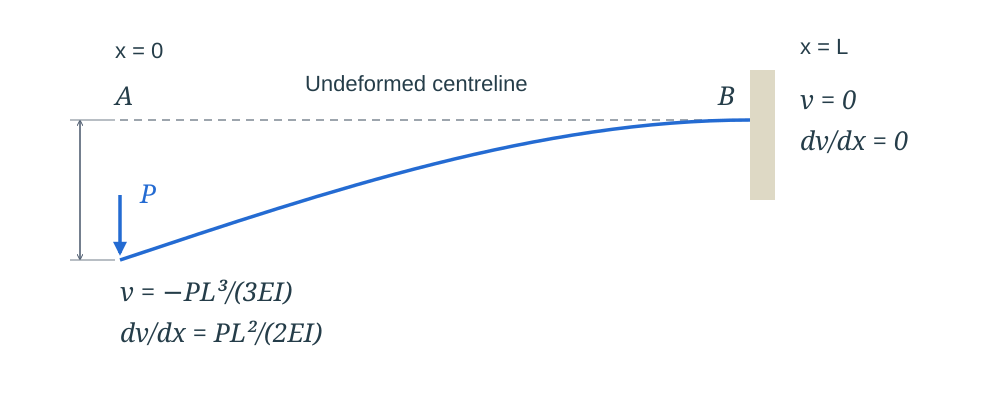<!-- style="width: 80%; display: block; margin: auto;" -->

</details>

{{1}}
********************
**Quick check**

Where do we apply $v=0$ and $dv/dx=0$ for this beam?

<!-- data-solution-button="3" -->
[( )] At $x=0$, the free end $A$.
[(X)] At $x=L$, the fixed end $B$.
[( )] At both ends.
********************

## Analytical Problem: Simply Supported Beam Deflection

*Start this problem in class. Use the individual values and submission deadline supplied on Blackboard.*

The simply supported beam has a constant rectangular cross-section and carries a uniformly distributed load over its complete span. Neglect shear deformation and beam self-weight.

<!-- style="display: block; margin: auto;" -->

| Quantity | Symbol |
|:--|:--|
| Beam length | $L$ |
| Section width | $b$ |
| Section depth | $h$ |
| Young's modulus | $E$ |
| Distributed load | $w$ |

**Determine the maximum downward vertical displacement, which occurs at midspan. Give your answer in mm.**

Use:

$$I=\frac{bh^3}{12}.$$

Keep your full workings for the final analytical submission.

{{1}}
********************
**Plan your calculation**

1. Calculate the section's second moment of area.
2. Use the support reactions to obtain $M(x)$.
3. Integrate the beam equation twice.
4. Apply the displacement boundary conditions for the supports shown.
5. Evaluate $v(L/2)$.

Use your own assigned values and keep your own workings.
********************

{{2}}
********************
<details>
<summary><strong>Reveal hints: boundary conditions and checks</strong></summary>

Take $x=0$ at $A$. The bending moment and shear force equations were derived earlier. Use:

$$M(x)=\frac{wLx}{2}-\frac{wx^2}{2}.$$

The supports prevent vertical displacement:

$$v(0)=0,\qquad v(L)=0.$$

They allow rotation, so do not set the end slopes to zero. Symmetry gives $dv/dx=0$ at midspan as a check on your result.

With upwards positive, $v(L/2)$ should be negative.

Keep units consistent. With N and mm, use $E$ in N/mm² and $w$ in N/mm. With kN and mm, use $E$ in kN/mm² and $w$ in kN/mm.

</details>
********************

## Strength and Deflection Checks

For the distributed-load beam, locate the section with the largest bending moment and use:

$$|\sigma_{\max}|=\frac{|M_{\max}|\,(h/2)}{I},\qquad I=\frac{bh^3}{12}.$$

A beam section must satisfy both the **allowable stress** and the **allowable deflection** for its application. Passing a stress check alone does not establish that the beam is sufficiently stiff.

**Discussion:** With width $b$ fixed, why does increasing depth $h$ have such a strong effect on the deflection?

<details>
<summary><strong>Reveal answer</strong></summary>

Because $I=bh^3/12$, doubling $h$ multiplies $I$ by eight. For the same material, span and loading, the bending deflection falls to one eighth.

At the same bending moment, the maximum bending stress falls to one quarter, because the outer-fibre distance also doubles.

</details>

## Week 4 Completion Check

**2.1. Demonstrate the use of shear and bending moment diagrams to design beam sections for strength and deflection.**

- [ ] I can translate fixed, pinned and roller supports into displacement boundary conditions and possible reactions.
- [ ] I can calculate reactions and derive shear-force and bending-moment expressions using a cut-section free-body diagram.
- [ ] I can draw the diagrams for a cantilever, a simply supported beam with a central point load and a simply supported beam with a uniform distributed load.
- [ ] I can use $EI\,d^2v/dx^2=M(x)$ and appropriate boundary conditions to determine beam deflection.
- [ ] I can calculate $I$ for a rectangular section and explain how it affects stress and deflection.
- [ ] I have started the analytical beam problem and recorded the remaining steps.

## C. INDEPENDENT STUDY: After class

Finish the analytical beam problem and submit the requested answer through Blackboard by **23:59 on Wednesday 28 October 2026**.

Keep the complete calculation, including reactions, the bending-moment equation, integrations, boundary conditions and the final displacement. You will submit your analytical workings for all problems by **23:59 on Thursday 17 December 2026**.

Complete the Week 5 preparation on beam elements, and bring any questions to the next session.

## Further reading

@FurtherReading

@ReadingBook(@BeerBook,@BeerLibrary,```
- **Chapter 4:** Pure Bending
- **Chapter 5:** Analysis and Design of Beams for Bending
- **Chapter 9:** Deflection of Beams
```)

