<!--
author: Matthew Blacklock
email: matthew.blacklock@northumbria.ac.uk
version: 1.0.0
mode: Presentation
import: https://raw.githubusercontent.com/MINT-the-GAP/lia-board-mode/main/README.md
        https://raw.githubusercontent.com/MINT-the-GAP/lia-annotation/main/README.md
        ../common/templates.md
comment: KB5034 Week 5 - Topic 2: beam elements, independent and in-class study.
-->

# Week 5: Beam Elements

@moduleTitle

**Topic 2: Bending & Beam Elements**

---

@[course(Return to Week 4)](../week04/week04.md)

---

## Topic Learning Outcomes

By the end of this week, students will be able to:

<br>

**2.3. Describe** the differences between beam elements and truss elements in terms of the number of nodes, degrees of freedom and the size of the stiffness matrix.

<br>

**2.4. Analyse** ABAQUS error messages and input files for beam element structures with concentrated and distributed loads.

<br>

**2.5. Derive** the stiffness matrix of a beam element by the unit displacement method (and by the method of virtual work — optional).

<br>

**2.6. Compare** the order of shape functions for beam and truss elements.

**2.7. Determine** when modelling with beam elements is appropriate for real engineering structures based on the features/limitations of the element.

## A. INDEPENDENT STUDY: Before class

**PREPARATION STARTS HERE**

Watch the four required videos in order, read the shape-function pages, then complete the three ABAQUS tutorials. This week connects the beam mechanics from Week 4 to finite element models.

Take your own notes. [Download the partial notes](files/Week%205%20Online%20Videos.pdf), if you prefer, to use with the unit-displacement and transformation videos. The notes also contain virtual-work material, which is optional.

The required shape-function explanation is provided in this lesson. You do **not** need to watch the virtual-work recordings to understand it.

Complete the quick checks before moving on. Bring your notes, calculations and model files to class.

## Video 1: Introduction to Beam Elements

@Panopto(82ef39ec-59f5-4725-b26b-b4ea014edf6b)

{{1}}
********************
**Quick check**

Why would a beam element be needed instead of a truss element for a cantilever carrying a transverse load?

<!-- data-solution-button="3" -->
[(X)] The model must represent bending and nodal rotations as well as axial deformation.
[( )] A truss element can represent the same bending behaviour if its area is increased.
[( )] Beam elements do not require material properties.
********************

## Video 2: Overview of Beam Elements

**Learning Outcome 2.3.** Describe the differences between beam and truss elements in terms of nodes, DOFs and stiffness-matrix size.

[Partial notes](files/Week%205%20Online%20Videos.pdf)

@Panopto(cbe8880d-2a09-45b4-899f-b4ea014ca070)

{{1}}
********************
**Quick check**

Complete the table for a **two-node planar element**. The beam here includes axial deformation as well as bending. Enter matrix sizes as `4x4`, `6x6`, etc.

<!--
data-solution-button="3"
data-type="none"
-->
| Element | Nodes | DOFs per node | Element stiffness matrix |
|:--|:--:|:--:|:--:|
| 2D truss | [[2]] | [[2]] | [[4x4]] |
| 2D beam, including axial deformation | [[2]] | [[3]] | [[6x6]] |

For the planar beam, the nodal DOFs are horizontal displacement $u$, vertical displacement $v$ and rotation about $z$.
********************

## Video 3: Unit Displacement Method

**Learning Outcome 2.5.** Derive the stiffness matrix of a beam element by the unit displacement method (and by the method of virtual work — optional).

In Week 4, we prescribed loads and calculated displacement. Here, we prescribe one nodal displacement or rotation, hold the other nodal displacement DOFs at zero, and calculate the forces and moments needed. These form one column of the stiffness matrix.

Follow one worked column to understand the method, then examine the completed matrix. You do not need to practise deriving the remaining columns.

[Partial notes](files/Week%205%20Online%20Videos.pdf)

@Panopto(27b57c31-0707-47cb-82a2-b4ea014ca0df)

{{1}}
********************
**Quick check**

How do we obtain column $j$ of an element stiffness matrix using the unit displacement method?

<!-- data-solution-button="3" -->
[( )] Apply a unit force at DOF $j$ and read off every displacement.
[(X)] Set displacement DOF $j$ to one, hold all other displacement DOFs at zero, and calculate the corresponding nodal forces and moments.
[( )] Set every nodal displacement to one at the same time.
********************

## Video 4: Transformation Matrix

[Partial notes](files/Week%205%20Online%20Videos.pdf)

@Panopto(9bdecd87-2e6e-4125-8803-b4ea014ca0a9)

{{1}}
********************
**Quick check**

For a planar beam element rotated within the $x$–$y$ plane, which statement is correct?

<!-- data-solution-button="3" -->
[( )] The rotational DOF is removed during transformation.
[( )] The Young’s modulus changes with the element angle.
[(X)] The translational components are transformed between local and global axes; rotation about the common $z$ axis is unchanged.
********************

## Shape Functions: Displacement Between Nodes

**Learning Outcome 2.6.** Compare the order of shape functions for beam and truss elements.

The FE solution gives displacement values **at the nodes**. Shape functions use those values to describe displacement **between the nodes**. This is called **interpolation**.

For a two-node truss element, we assume a **linear** axial displacement function:

$$u(x)=a+bx.$$

Take $x=0$ at node 1 and $x=L$ at node 2. The function must match the displacement at each node:

$$u(0)=u_1=a + b0\quad\Rightarrow\quad a=u_1,$$

$$u(L)=u_2=u_1+bL\quad\Rightarrow\quad b=\frac{u_2-u_1}{L}.$$

Substitute these coefficients into the straight-line equation:

$$u(x)=u_1+\frac{u_2-u_1}{L}x.$$

Collecting the terms multiplying each nodal displacement gives:

$$u(x)=\left(1-\frac{x}{L}\right)u_1+\frac{x}{L}u_2.$$

The two weighting functions are the **shape functions**:

$$N_1(x)=1-\frac{x}{L},\qquad N_2(x)=\frac{x}{L}.$$

So we can write $u(x)=N_1(x)u_1+N_2(x)u_2$. At node 1, $N_1=1$ and $N_2=0$; at node 2, $N_1=0$ and $N_2=1$. The interpolation therefore reproduces both nodal values exactly.

{{1}}
********************
**Quick check**

What order are these shape functions?

<!-- data-solution-button="3" -->
[(X)] First order (linear).
[( )] Second order (quadratic).
[( )] Third order (cubic).
********************

## Shape Functions: Why Beam Bending Uses a Cubic

A beam can curve between its nodes. Its bending shape must match **both displacement and rotation at each end**.

For small slopes, rotation is $\phi\approx dv/dx$. There are four end conditions:

$$v(0)=v_1,\qquad v'(0)=\phi_1,\qquad v(L)=v_2,\qquad v'(L)=\phi_2.$$

A cubic polynomial has four coefficients, which allows us to satisfy these four conditions:

$$v(x)=a+bx+cx^2+dx^3.$$

Differentiate to obtain the slope:

$$\frac{dv}{dx}=b+2cx+3dx^2.$$

**Apply the conditions at node 1, where $x=0$**

$$v(0)=v_1\quad\Rightarrow\quad a=v_1,$$

$$v'(0)=\phi_1\quad\Rightarrow\quad b=\phi_1.$$

Therefore:

$$v(x)=v_1+\phi_1x+cx^2+dx^3.$$

**Apply the conditions at node 2, where $x=L$**

$$v_2=v_1+\phi_1L+cL^2+dL^3,$$

$$\phi_2=\phi_1+2cL+3dL^2.$$

Rearrange these as two equations for the remaining coefficients $c$ and $d$:

$$cL^2+dL^3=v_2-v_1-\phi_1L,\tag{1}$$

$$2cL+3dL^2=\phi_2-\phi_1.\tag{2}$$

Multiply equation (2) by $L$ and subtract twice equation (1) to eliminate $c$:

$$dL^3=2(v_1-v_2)+L(\phi_1+\phi_2).$$

Hence:

$$d=\frac{2(v_1-v_2)}{L^3}+\frac{\phi_1+\phi_2}{L^2}.$$

Substitute this into equation (1) to find $c$:

$$cL^2=3(v_2-v_1)-L(2\phi_1+\phi_2),$$

$$c=\frac{3(v_2-v_1)}{L^2}-\frac{2\phi_1+\phi_2}{L}.$$

**Collect the terms multiplying each nodal value**

Substituting all four coefficients into $v(x)=a+bx+cx^2+dx^3$ gives:

$$
\begin{aligned}
v(x)={}&\left(1-\frac{3x^2}{L^2}+\frac{2x^3}{L^3}\right)v_1\\
&+\left(x-\frac{2x^2}{L}+\frac{x^3}{L^2}\right)\phi_1\\
&+\left(\frac{3x^2}{L^2}-\frac{2x^3}{L^3}\right)v_2\\
&+\left(-\frac{x^2}{L}+\frac{x^3}{L^2}\right)\phi_2.
\end{aligned}
$$

As with the truss, the expressions multiplying the nodal values are the **shape functions**. We can therefore write:

$$v(x)=N_1(x)v_1+N_2(x)\phi_1+N_3(x)v_2+N_4(x)\phi_2.$$

The four shape functions describe the contribution of each nodal displacement or rotation to the deflection along the element.

This expression describes **bending** and uses four nodal DOFs. Adding the two axial displacement DOFs gives the **six DOFs** of the full planar beam element discussed earlier.

{{1}}
********************
**Quick check**

Why is a straight-line interpolation generally insufficient for beam bending?

<!-- data-solution-button="3" -->
[( )] A straight line cannot connect two nodes.
[(X)] It cannot independently match the displacement and slope at both ends.
[( )] The beam's Young’s modulus changes along its length.
********************

## Shape Functions: What the Four Contributions Mean

The four beam bending shape functions are:

$$N_1(x)=1-\frac{3x^2}{L^2}+\frac{2x^3}{L^3},\qquad N_2(x)=x-\frac{2x^2}{L}+\frac{x^3}{L^2},$$

$$N_3(x)=\frac{3x^2}{L^2}-\frac{2x^3}{L^3},\qquad N_4(x)=-\frac{x^2}{L}+\frac{x^3}{L^2}.$$

- $N_1$ and $N_3$ describe the contributions from **nodal vertical displacement**.
- $N_2$ and $N_4$ describe the contributions from **nodal rotation**.

The actual deflection is the sum of all four contributions, scaled by the calculated nodal values.

The rotation functions $N_2$ and $N_4$ have units of length, so multiplying by a rotation gives a displacement.

These are the classical two-node Euler–Bernoulli beam bending functions. ABAQUS offers different beam formulations; the mesh-convergence tutorial compares linear and cubic elements.

{{1}}
********************
**Quick check**

Both end displacements are zero, but one end rotation is nonzero. Can the element have nonzero deflection between its nodes?

<!-- data-solution-button="3" -->
[(X)] Yes. The rotation shape function can produce a curve between the nodes.
[( )] No. Zero end displacements force the entire element to remain straight.
********************

## ABAQUS: Beam Elements

**Learning Outcome 2.4.** Analyse ABAQUS error messages and input files for beam structures with concentrated and distributed loads.

Work through the standalone tutorials in order:

1. @[course(Beam elements in ABAQUS)](../abaqus/Topic2/BeamElements/BeamElements.md)
2. @[course(Mesh convergence in ABAQUS)](../abaqus/Topic2/MeshConvergence/MeshConvergence.md)
3. @[course(Distributed loads in ABAQUS)](../abaqus/Topic2/DistributedLoads/DistributedLoads.md)

In the first tutorial, build the same cantilever using an input file and CAE. In the second, refine its mesh and compare linear and cubic beam formulations. In the third, apply a distributed line load with the correct units.

Save your input files and CAE models, and record your displacement results and any warnings or errors.

## Before class completion check

- [ ] I watched the four required videos: introduction, overview, unit displacement and transformation.
- [ ] I read the shape-function explanation and can describe the contributions of nodal displacement and rotation.
- [ ] I completed the required quick checks and made notes on the required material.
- [ ] I completed all three ABAQUS tutorials and saved my files.
- [ ] **Quiz:** Complete the Blackboard Beam Elements test in the Week 5 folder by **23:59 on the Wednesday before the session**.
- [ ] **Bring to class:** my notes, calculations, model files and any questions.

The Week 4 analytical beam-deflection problem is also due before this session. Check its Blackboard assignment for submission details.

**REQUIRED PREPARATION ENDS HERE**

## Optional Further Study: Virtual Work

**Optional:** These recordings develop an alternative derivation of the stiffness matrix using virtual work. They are not required for the Week 5 preparation or quiz.

The required shape-function explanation above is self-contained. Continue here if you want to see how strain, interpolation and virtual work can be combined to obtain the stiffness matrix.

Work through the optional recordings in the following order. Start with the simpler truss example before extending the method to beams.

## Optional: Virtual Work for Trusses

[Partial notes](files/Week%205%20Online%20Videos.pdf)

@Panopto(8084dd87-7644-4213-89f6-b4ea014cb2d6)

This introduces the virtual-work method using the simpler axial strain relation for a truss.

## Optional: Virtual Work for Beams

[Partial notes](files/Week%205%20Online%20Videos.pdf)

@Panopto(3faecef3-79e8-45f8-af39-b4ea014cb4bb)

This introduces the steps for extending the virtual-work method to beam bending.

## Optional: Beam Shape-Function Derivation

[Shape-function partial notes](files/Beam%20Shape%20Functions%20-%20Partial%20Notes.pdf)

@Panopto(aeaf515d-e1c6-4d20-b96e-b4ea014cba18)

This recording provides another explanation of the cubic interpolation and the four beam shape functions derived in the required lesson above.

## Optional: Strain–Displacement Matrix

[Shape-function partial notes](files/Beam%20Shape%20Functions%20-%20Partial%20Notes.pdf)

@Panopto(8b34b3ca-23ab-4826-8bc6-b4ea014cca0b)

This differentiates the displacement interpolation to obtain the strain–displacement matrix $B$.

## Optional: Stiffness Matrix by Virtual Work

[Shape-function partial notes](files/Beam%20Shape%20Functions%20-%20Partial%20Notes.pdf)

@Panopto(0bfe7a88-b7a2-44bb-bd35-b4ea014ca044)

This uses $B$ and virtual work to integrate the beam stiffness terms and recover the matrix obtained earlier by unit displacement.

## B. IN-CLASS STUDY: Beam Elements

**SUPPORTED CLASS STUDY STARTS HERE**

We will use the pre-work to interpret beam behaviour, assemble a small model and begin the assessed ABAQUS beam problem.

Keep your own notes and workings. The dropdowns contain reference answers for revision.

## Recap: Nodes, DOFs and Supports

**Which DOFs does each node of a planar truss have?**

<!-- data-solution-button="3" -->
[(X)] $u$ and $v$
[( )] $u$, $v$ and $\phi_z$
[( )] $\phi_z$ only

**Which DOFs does each node of a planar beam have, including axial deformation?**

<!-- data-solution-button="3" -->
[( )] $u$ and $v$
[(X)] $u$, $v$ and $\phi_z$
[( )] $u$, $v$ and $w$

**How many rows and columns does each two-node element stiffness matrix have?**

<!-- 
data-type="None"
data-solution-button="3"
-->
| Element | Rows | Columns |
|:--|:--:|:--:|
| Planar truss | [[4]] | [[4]] |
| Planar beam, including axial deformation | [[6]] | [[6]] |
| Conventional 3D beam | [[12]] | [[12]] |

**For a planar beam, select every DOF that must be set to zero at each support.**

<!-- data-solution-button="3" -->
- [[ $u$ ] [ $v$ ] [ $\phi_z$ ]]
- [  [X]     [X]       [X]     ] Fixed end
- [  [X]     [X]       [ ]     ] Pin
- [  [ ]     [X]       [ ]     ] Roller on a horizontal surface

## Recap: ABAQUS Setup and Loading

1. Why does a beam model need a cross-section and an orientation, rather than just a cross-sectional area?

<details>
<summary><strong>Reveal reference answer</strong></summary>

The section shape and dimensions determine its second moments of area. Its orientation determines which section direction resists the bending in the model.

For a truss element, the **local axial stiffness matrix**, acting on $[u_1,u_2]^T$, is:

$$
\mathbf k_{\mathrm{truss}}^{(e)}=\frac{EA}{L}
\begin{bmatrix}
1&-1\\
-1&1
\end{bmatrix}.
$$

The section enters through its area $A$: the truss carries axial force.

For a planar beam element, including axial deformation, the **local stiffness matrix**, acting on $[u_1,v_1,\phi_1,u_2,v_2,\phi_2]^T$, is:

$$
\mathbf k_{\mathrm{beam}}^{(e)}=\frac{E}{L^3}
\begin{bmatrix}
AL^2&0&0&-AL^2&0&0\\
0&12I&6IL&0&-12I&6IL\\
0&6IL&4IL^2&0&-6IL&2IL^2\\
-AL^2&0&0&AL^2&0&0\\
0&-12I&-6IL&0&12I&-6IL\\
0&6IL&2IL^2&0&-6IL&4IL^2
\end{bmatrix}.
$$

The beam needs both $A$ for axial stiffness and $I$ for bending stiffness. Area alone does not determine $I$: sections with the same area can resist bending differently.

For a rectangular section with width $b$ and depth $h$ in the bending direction, $I=bh^3/12$. Rotating the section swaps which dimension acts as the depth, so the section orientation matters.

</details>

**2. A beam carries a downward distributed load of $15$ N/m. The model uses N and mm, with positive $y$ upwards. What value should be entered for the line-load component in the $y$ direction? Give your answer in N/mm.**

<!-- data-solution-button="3" -->
[[-0.015]]
****************************************
Convert N/m to N/mm by dividing by $1000$. The downward load needs a negative sign because positive $y$ is upwards.
****************************************

**3. The beam has been refined from one element to two. The same distributed load should act over its full length. What must change in this input-file extract?**

```text
*NODE
1, 0., 0.
2, 150., 0.
3, 300., 0.
*ELEMENT, TYPE=B21, ELSET=BEAM
1, 1, 2
2, 2, 3
*DLOAD
1, PY, -0.015
```

{{1}}
********************
**Choose an answer after discussing the input file.**

<!-- data-solution-button="3" -->
[( )] Change the load line to `2, PY, -0.015`.
[(X)] Change the load line to `BEAM, PY, -0.015`.
[( )] Change the load line to `1, PY, -0.030`.
[( )] Nothing: the existing line loads both elements.
****************************************
The existing line loads only element 1. Using the element set `BEAM` applies the same load intensity to both elements. Refining the mesh does not change the load intensity.
****************************************
********************

{{2}}
Were there any warnings, errors or unexpected results from the tutorials you did not understand?

## Recap: Interpreting ABAQUS Errors

**Learning Outcome 2.4.** Analyse ABAQUS error messages and input files for beam element structures with concentrated and distributed loads.

```text
***WARNING: 1 elements have been defined with multiple property definitions.
            The last property definition encountered will be used. The
            elements have been identified in element set
            WarnElemRedundantSection.

***ERROR: 1 elements have missing property definitions. The elements have
          been identified in element set ErrElemMissingSection.
```

**Correct the input file.** Use the warning and error messages to find the mistake. Edit the input file below, then click **Execute** to check your correction.

<!-- data-readOnly="false" data-showGutter="true" data-firstLineNumber="1" data-ace-options="minLines=35 maxLines=80" style="display: block; width: 100%; --max-editor-line-count: 80; min-height: calc(36 * var(--global-font-size, 1.5rem) * var(--font-size-multiplier, 1) * 1.47);" -->
```text
*NODE, NSET=NODES
100, 0., 0.
200, 150., 0.
300, 300., 0.
*ELEMENT, TYPE=B21, ELSET=BEAM1
1, 100, 200
*ELEMENT, TYPE=B21, ELSET=BEAM2
2, 200, 300
*BEAM SECTION, SECTION=RECT, ELSET=BEAM1, MATERIAL=STEEL
12., 17.
0., 0., -1.
*BEAM SECTION, SECTION=RECT, ELSET=BEAM1, MATERIAL=ALUMINIUM
12., 17.
0., 0., -1.
*MATERIAL, NAME=STEEL
*ELASTIC
210000., 0.3
*MATERIAL, NAME=ALUMINIUM
*ELASTIC
69000., 0.27
*ELSET, ELSET=BEAMS
1, 2
*STEP
*STATIC
*BOUNDARY
100, 1, 2
100, 6, 6
*CLOAD
300, 2, -425.
*OUTPUT, FIELD
*NODE OUTPUT, NSET=NODES
U, RF
*ELEMENT OUTPUT, ELSET=BEAMS
S, E
*END STEP
```
<script>
const submitted = `@input`;
const expected = "*NODE, NSET=NODES\n100, 0., 0.\n200, 150., 0.\n300, 300., 0.\n*ELEMENT, TYPE=B21, ELSET=BEAM1\n1, 100, 200\n*ELEMENT, TYPE=B21, ELSET=BEAM2\n2, 200, 300\n*BEAM SECTION, SECTION=RECT, ELSET=BEAM1, MATERIAL=STEEL\n12., 17.\n0., 0., -1.\n*BEAM SECTION, SECTION=RECT, ELSET=BEAM2, MATERIAL=ALUMINIUM\n12., 17.\n0., 0., -1.\n*MATERIAL, NAME=STEEL\n*ELASTIC\n210000., 0.3\n*MATERIAL, NAME=ALUMINIUM\n*ELASTIC\n69000., 0.27\n*ELSET, ELSET=BEAMS\n1, 2\n*STEP\n*STATIC\n*BOUNDARY\n100, 1, 2\n100, 6, 6\n*CLOAD\n300, 2, -425.\n*OUTPUT, FIELD\n*NODE OUTPUT, NSET=NODES\nU, RF\n*ELEMENT OUTPUT, ELSET=BEAMS\nS, E\n*END STEP";
function normalise(text) {
  return text.split(/\r?\n/)
    .map(line => line.trim().toUpperCase())
    .filter(line => line && !line.startsWith("**"))
    .map(line => {
      const fields = line.split(",").map(field => field.trim());
      if (line.startsWith("*")) {
        return [fields[0].replace(/\s+/g, " "), ...fields.slice(1).map(field => field.replace(/\s+/g, "")).sort()].join(",");
      }
      return fields.map(field => field !== "" && Number.isFinite(Number(field)) ? String(Number(field)) : field).join(",");
    }).join("\n");
}
const correct = normalise(submitted) === normalise(expected);
console.log(correct ? "Correct: the input file has been fixed." : "Not yet correct. Review the messages and try again.");
"LIA: stop"
</script>

<br>
<details>
<summary><strong>Reveal what is wrong</strong></summary>

**Line 12 is incorrect:** it assigns the aluminium section to `BEAM1` instead of `BEAM2`. Both `*BEAM SECTION` lines therefore assign properties to `BEAM1`. Element 1 therefore has two section assignments, while element 2 in `BEAM2` has none.

The aluminium section should refer to `BEAM2`:

```text
*BEAM SECTION, SECTION=RECT, ELSET=BEAM2, MATERIAL=ALUMINIUM
12., 17.
0., 0., -1.
```

Read the warning and error together: the duplicate assignment and missing assignment have the same cause. Check the element-set names on the section keywords against those on the element definitions.

</details>

## What Does the Beam Stiffness Matrix Tell Us?

For a straight planar element in its **local axes**, use the DOF order:

$$\mathbf u=\begin{bmatrix}u_1&v_1&\phi_1&u_2&v_2&\phi_2\end{bmatrix}^{T}.$$

<div style="display: flex; flex-wrap: wrap; align-items: flex-start; gap: 1.5rem;">

<div style="flex: 3 1 0; min-width: 0;">

{{0-1}}
********************

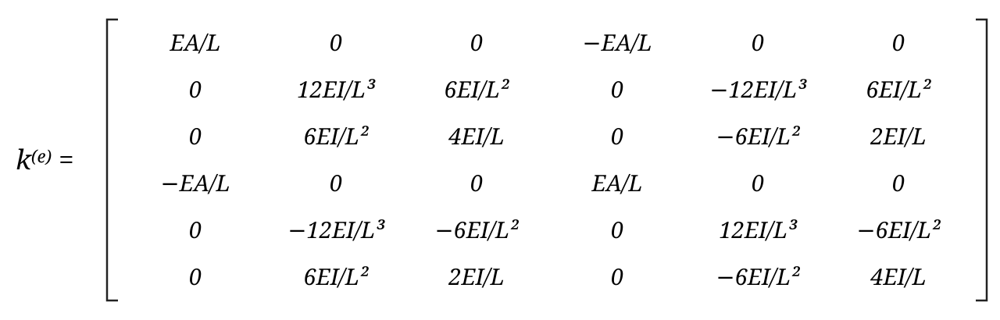<!-- style="width: 100%; display: block; margin: auto;" -->

********************

{{1}}
********************

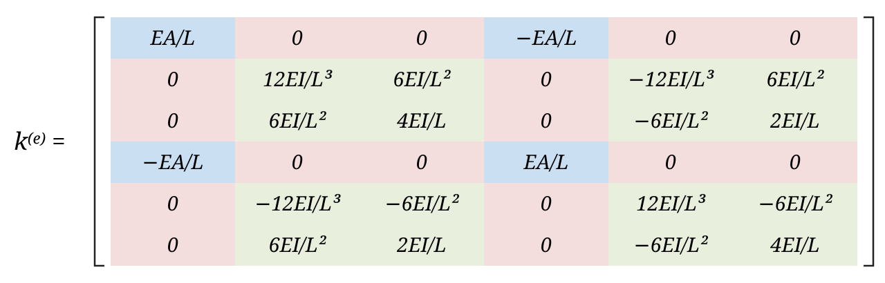<!-- style="width: 100%; display: block; margin: auto;" -->

********************

</div>

<div style="flex: 2 1 0; min-width: 0;">

{{0-2}}
********************

- Which entries describe axial deformation? Which describe bending?
- What does one column represent in the unit-displacement method?

<details>
<summary><strong>Reveal discussion points</strong></summary>

The axial DOFs are $u_1$ and $u_2$. Their stiffness terms are $EA/L$. The remaining four DOFs describe bending.

The zero entries between those two groups show that axial extension and bending are **uncoupled for this straight, linear element in its local axes**. Within the bending group, vertical displacement and rotation are coupled.

One column gives the nodal forces and moments needed when that column's displacement or rotation DOF is set to one and the others are held at zero.

The local axial/bending separation does not mean global horizontal and vertical components remain separate after rotating an inclined element.

</details>

********************

{{2-3}}
********************

**If $E$ doubles while the geometry stays the same, what happens to the stiffness matrix?**

<!-- data-solution-button="3" -->
[(X)] Every nonzero term doubles; the zero entries remain zero.
[( )] Only the axial terms double.
[( )] Only the bending terms double.
[( )] Every nonzero term halves.

********************

{{3-4}}
********************

**If $I$ doubles while $E$, $A$ and $L$ stay the same, what happens?**

<!-- data-solution-button="3" -->
[( )] Every nonzero term doubles.
[(X)] The bending terms double; the axial terms stay the same.
[( )] The axial terms double; the bending terms stay the same.
[( )] The bending terms halve; the axial terms stay the same.

********************

{{4}}
********************

**If $L$ doubles while $E$, $A$ and $I$ stay the same, by what factor does each term change? Select one factor per row.**

<div style="font-size: 85%;">

<!-- data-solution-button="3" -->
- [( $1/2$ ) ( $1/4$ ) ( $1/8$ )]
- [   (X)       ( )       ( )   ] $\frac{EA}{L}$
- [   (X)       ( )       ( )   ] $\frac{4EI}{L}$
- [   ( )       (X)       ( )   ] $\frac{6EI}{L^2}$
- [   ( )       ( )       (X)   ] $\frac{12EI}{L^3}$

</div>

********************

</div>

</div>

## Sketching the Truss Shape Functions

$$N_1(x)=1-\frac{x}{L},\qquad N_2(x)=\frac{x}{L}.$$

Sketch each shape function for a 1D truss element.

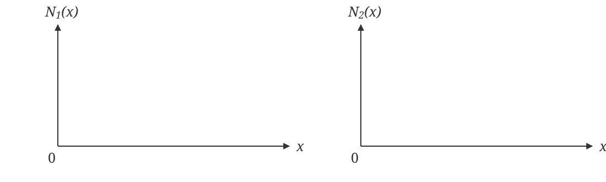<!-- style="width: 100%; display: block; margin: auto;" -->

{{1}}
********************
**Quick problem:** The finite element analysis has been run and the nodal displacements have been calculated: $u_1=0$ and $u_2=6$ mm. Use the shape functions to evaluate the displacement at 1/3rd of the way along the truss:

$$u(x)=N_1 u_1+N_2 u_2.$$

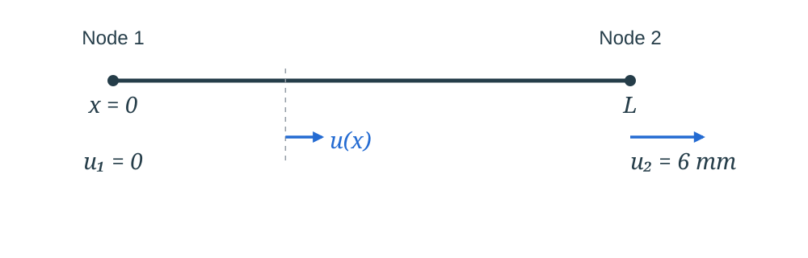<!-- style="width: 85%; display: block; margin: auto;" -->

<details>
<summary><strong>Reveal reference answer</strong></summary>

$N_1$ decreases linearly from 1 to 0; $N_2$ increases linearly from 0 to 1.

One-third of the way along means $x=L/3$, so $N_1=2/3$ and $N_2=1/3$:

$$u(L/3)=\frac23(0)+\frac13(6)=2\text{ mm}.$$

The interpolated displacement can be evaluated without adding another mesh node.

</details>

********************

{{2}}
********************

**How does FEA software show behaviour between the nodes?**

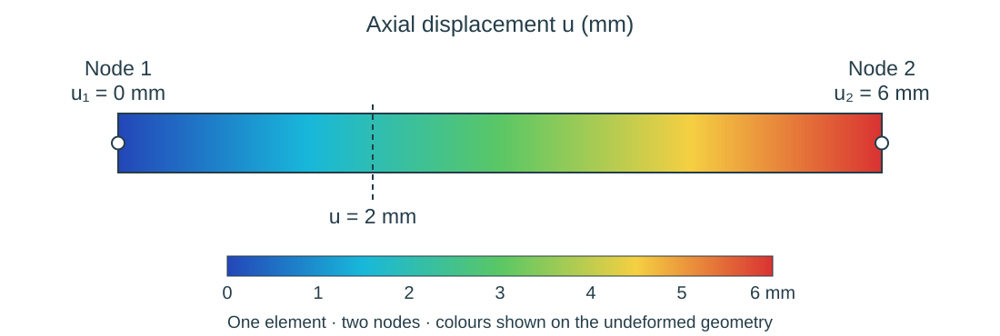<!-- style="width: 90%; display: block; margin: auto;" -->

The solver calculates the **nodal displacements**. Within this element, the software uses the shape functions to interpolate the displacement:

$$u(x)=N_1(x)u_1+N_2(x)u_2.$$

The contour colours represent those interpolated values. Here, displacement varies linearly from $0$ to $6$ mm, giving $2$ mm one-third of the way along. There are still only **two nodes**: displaying more colours does not add nodes or refine the mesh.

********************

## Sketching the Beam Shape Functions

$$N_1(x)=1-\frac{3x^2}{L^2}+\frac{2x^3}{L^3},\qquad N_2(x)=x-\frac{2x^2}{L}+\frac{x^3}{L^2},$$

$$N_3(x)=\frac{3x^2}{L^2}-\frac{2x^3}{L^3},\qquad N_4(x)=-\frac{x^2}{L}+\frac{x^3}{L^2}.$$

Sketch the contribution from each shape function for a planar beam. 

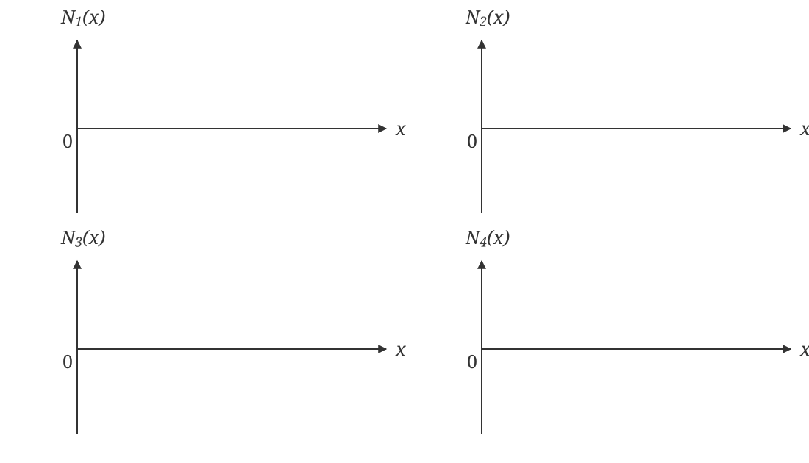<!-- style="width: 100%; display: block; margin: auto;" -->

<details>
<summary><strong>Reveal reference sketches</strong></summary>

Each sketch changes one bending DOF and keeps the other three at zero. The dashed line is the undeformed centreline. Separate illustrative vertical scales are used.

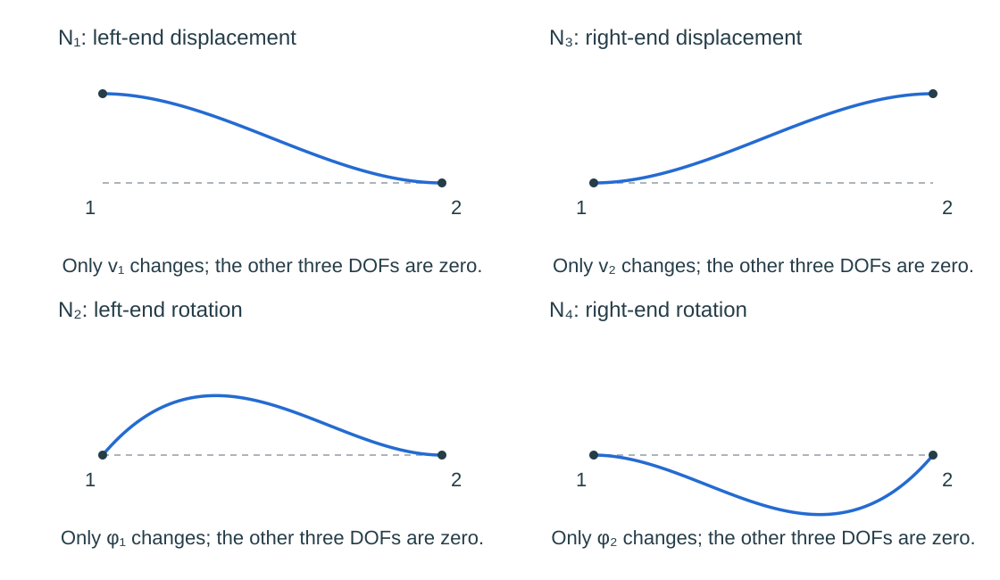<!-- style="width: 95%; display: block; margin: auto;" -->

The displacement functions $N_1$ and $N_3$ have zero end slopes. The rotation functions $N_2$ and $N_4$ have zero end displacements, but can produce deflection between the nodes.

</details>

{{1}}
********************

**Demonstration: Deflection and Rotation Along a Beam**

A cantilever of length $L=300$ mm is fixed at node 1 and carries a downward force at node 2. The finite element analysis has been run and the nodal values are:

$$v_1=0,\qquad\phi_1=0,\qquad v_2=-8.24\text{ mm},\qquad\phi_2=-0.04\text{ rad}.$$

Positive $v$ is upwards, so the downward tip displacement is negative.

**What are the deflection and rotation along the whole beam?**

$$v(x)=N_1(x)v_1+N_2(x)\phi_1+N_3(x)v_2+N_4(x)\phi_2.$$

For small slopes, the rotation is:

$$\phi(x)=\frac{dv}{dx}=\frac{dN_1}{dx}v_1+\frac{dN_2}{dx}\phi_1+\frac{dN_3}{dx}v_2+\frac{dN_4}{dx}\phi_2.$$

We will sketch both functions across the element, using the nodal values to check their ends.

<details>
<summary><strong>Reveal interpolation equations</strong></summary>

Only the node 2 terms are nonzero:

$$v(x)=-8.24N_3(x)-0.04N_4(x).$$

Substituting $L=300$ mm gives, with $x$ in mm:

$$v(x)=-12.72\frac{x^2}{300^2}+4.48\frac{x^3}{300^3}\quad\text{mm},$$

$$\phi(x)=-\frac{25.44x}{300^2}+\frac{13.44x^2}{300^3}\quad\text{rad}.$$

The displacement is cubic and the rotation is quadratic. At $x=0$, both are zero; at $x=300$ mm, they recover $v_2=-8.24$ mm and $\phi_2=-0.04$ rad.

</details>

********************

{{2}}
********************

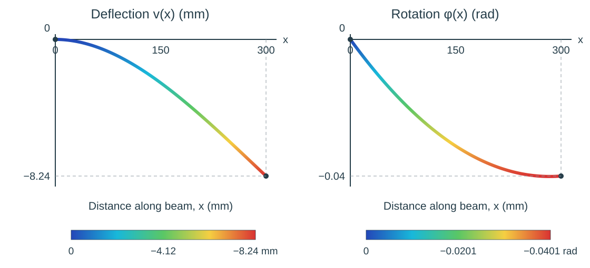<!-- style="width: 100%; display: block; margin: auto;" -->

The solver calculates the **nodal displacements and rotations**. The shape functions then interpolate the behaviour throughout the element: the curves show values between the nodes, without adding more mesh nodes.

The same interpolated displacement field is used to draw the deflected beam and its displacement contours. Rotation follows from the slope of that field.

********************

## Mesh Convergence

Use the results from the mesh-convergence tutorial. Compare the **same physical output at the same location** as the mesh is refined.

- Does a completed job necessarily mean the result is accurate?
- Which result did you monitor, and how did it change with refinement?
- What does the comparison of linear and cubic beam formulations show?

<details>
<summary><strong>Reveal reference comparison and discussion</strong></summary>

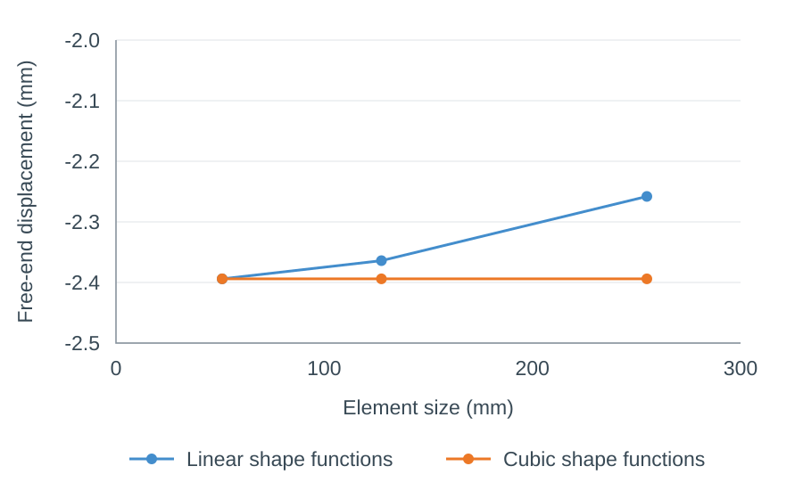<!-- style="width: 80%; display: block; margin: auto;" -->

The linear-element result changes as the mesh is refined; the cubic result is much less sensitive to mesh size for this example.

A completed job shows that the solver finished. It does not by itself establish that the mesh is sufficiently refined. Compare successive refinements while keeping geometry, material, supports and physical loading unchanged.

The linear and cubic elements use different beam assumptions, so their results may converge to slightly different values.

Cubic beam elements are generally a good choice for slender beams because they capture bending accurately with fewer elements. You should still check mesh convergence.

</details>

## Modelling Real Engineering Problems

<br>

**Learning Outcome 2.7.** Determine when modelling with beam elements is appropriate for real engineering structures based on the features/limitations of the element.

<br>

**How would you model each problem using FEM?** Choose the element type and explain how you would represent the loading and supports. Assume small displacements and elastic behaviour.

<br>

**1. A suspended platform**

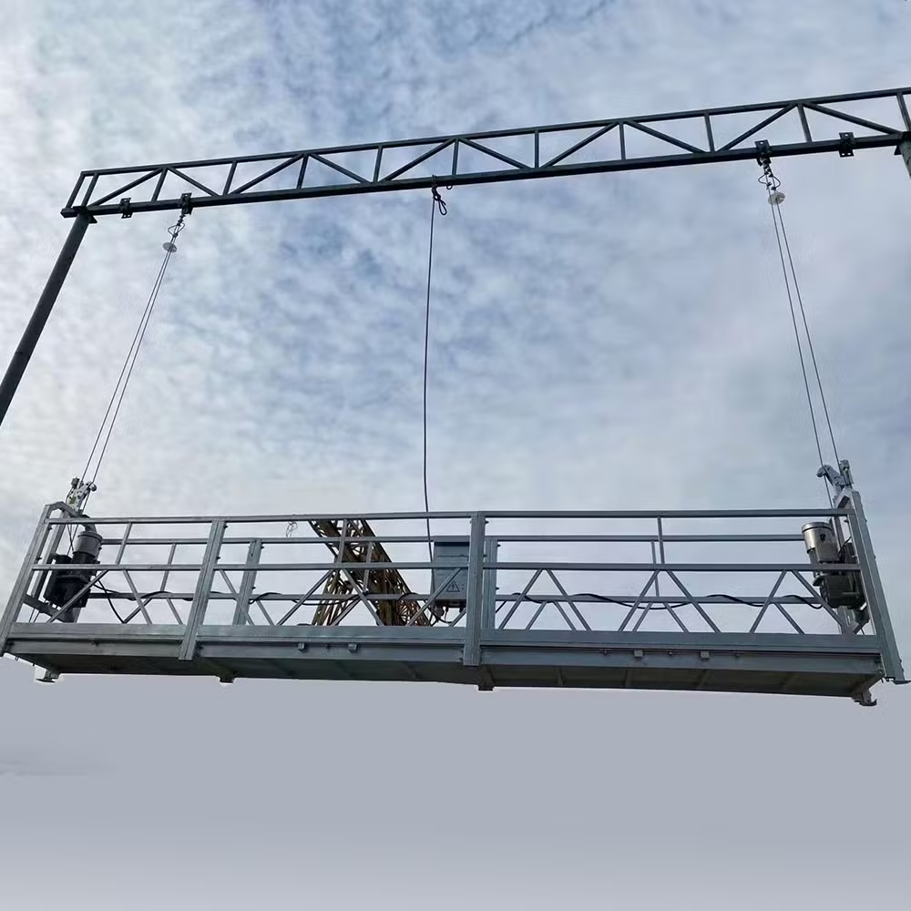<!-- style="width: 45%; display: block; margin: auto;" -->

**We are interested in the suspension cables.** What assumptions could you make about the platform, overhead structure and connections?

A platform is suspended by vertical steel cables. Given the cable dimensions, effective axial material properties and load, determine the **extension and axial stress in the cables**.

<details>
<summary><strong>Reveal discussion points</strong></summary>

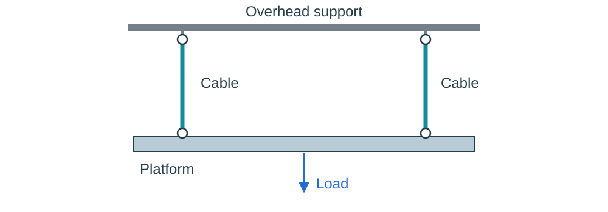<!-- style="width: 80%; display: block; margin: auto;" -->

**Truss elements** are suitable for the cables in this load case: the idealised connections and loading make them carry axial tension without bending moments.

Treat the platform and overhead support as rigid for this simplified model. Idealise the taut cables as straight axial members with freely rotating end connections, with the vertical loads acting through the connection centres.

Specify each cable's area and effective axial material properties. Represent the rigid platform and its connections so that its load is transferred to the cable ends, and restrain the upper attachment points. This idealisation assumes the cables remain taut; cables cannot carry compression. The planar sketch shows the vertical load case; the real installation also needs appropriate lateral restraint.

Use the calculated nodal displacements to find the cable extensions, and the axial forces to find $\sigma=F/A$.

</details>

{{1}}
********************

**2. A bookshelf**

<!-- style="width: 45%; display: block; margin: auto;" -->

**We are interested in the shelf between its supporting brackets.** What assumptions could you make about the loading and the way the brackets support it?

Given the shelf dimensions, material properties and weight of the books, determine the **maximum downward deflection**. Would turning the same rectangular section onto its edge change the answer?

<details>
<summary><strong>Reveal discussion points</strong></summary>

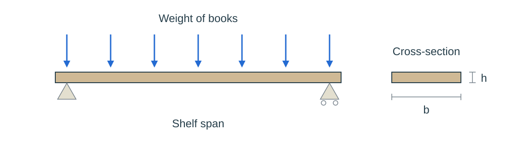<!-- style="width: 85%; display: block; margin: auto;" -->

**Beam elements** are suitable when the shelf is slender and bending along its span dominates. Truss elements would miss that bending behaviour.

For a first idealisation, spread the weight of the books into a uniform distributed load and treat the brackets as rigid supports. If the shelf can rotate at the supports, a pin and roller give a simply supported model of the span between them. Check whether the actual shelf fixings restrain rotation and whether overhanging or adjacent spans need to be included.

Specify the section and its orientation. With width $b$ and vertical depth $h$, $I=bh^3/12$. Turning the section onto its edge changes $I$ and its resistance to bending, even though its area stays the same.

</details>

********************

{{2}}
********************

**3. A raised-floor panel**

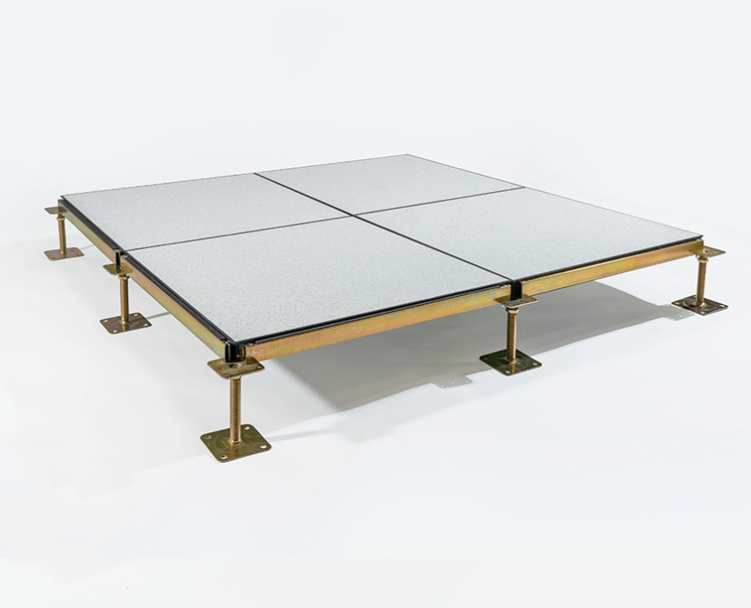<!-- style="width: 45%; display: block; margin: auto;" -->

A raised floor consists of panels resting on pedestals at their corners. Given the panel dimensions, material properties and applied floor loading, determine the **maximum deflection and stress distribution in one panel**. What assumptions could you make about the panel and its supports?

<details>
<summary><strong>Reveal discussion points</strong></summary>

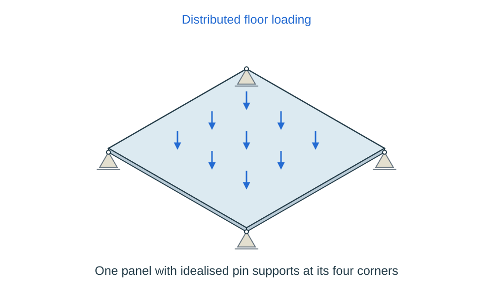<!-- style="width: 80%; display: block; margin: auto;" -->

**Shell elements** are suitable for a thin panel that bends in two directions. Its deflection and stress vary across the surface, which a single beam centreline cannot represent.

For a first model, represent the panel's surface and thickness, apply the floor loading over its face, and represent its support at the four corners. Resting on pedestals does not make the panel edges clamped. Include any supporting rails if they carry load in the real floor, and provide suitable in-plane restraints without artificially restricting the bending.

A 2D plane-stress model would not capture this out-of-plane bending. A **3D solid model** may be appropriate for a thick panel or detailed stresses where it contacts the pedestals. A layered panel needs a representation of its construction, using suitable layered shells or solids depending on the result required.

The element choice follows the physical behaviour and the result required. Check mesh convergence for that result.

</details>

********************

## Assembly Method: Two Beam Elements

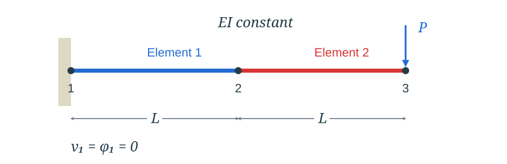<!-- style="width: 85%; display: block; margin: auto;" -->

Each element has length $L$ and the same $EI$. For this horizontal beam under transverse loading, focus on the **bending DOFs**; the axial part is uncoupled.

Use the global order:

$$\mathbf u_b=\begin{bmatrix}v_1&\phi_1&v_2&\phi_2&v_3&\phi_3\end{bmatrix}^{T}.$$

The two element matrices are shown in **blue for element 1** and **red for element 2**. Each element has length $L$ and the same $EI$.

$$
\textcolor{#246bd2}{\mathbf k_b^{(1)}}=\textcolor{#246bd2}{\begin{bmatrix}
\dfrac{12EI}{L^3}&\dfrac{6EI}{L^2}&-\dfrac{12EI}{L^3}&\dfrac{6EI}{L^2}\\[0.8em]
\dfrac{6EI}{L^2}&\dfrac{4EI}{L}&-\dfrac{6EI}{L^2}&\dfrac{2EI}{L}\\[0.8em]
-\dfrac{12EI}{L^3}&-\dfrac{6EI}{L^2}&\dfrac{12EI}{L^3}&-\dfrac{6EI}{L^2}\\[0.8em]
\dfrac{6EI}{L^2}&\dfrac{2EI}{L}&-\dfrac{6EI}{L^2}&\dfrac{4EI}{L}
\end{bmatrix}}
$$

$$
\textcolor{#d73535}{\mathbf k_b^{(2)}}=\textcolor{#d73535}{\begin{bmatrix}
\dfrac{12EI}{L^3}&\dfrac{6EI}{L^2}&-\dfrac{12EI}{L^3}&\dfrac{6EI}{L^2}\\[0.8em]
\dfrac{6EI}{L^2}&\dfrac{4EI}{L}&-\dfrac{6EI}{L^2}&\dfrac{2EI}{L}\\[0.8em]
-\dfrac{12EI}{L^3}&-\dfrac{6EI}{L^2}&\dfrac{12EI}{L^3}&-\dfrac{6EI}{L^2}\\[0.8em]
\dfrac{6EI}{L^2}&\dfrac{2EI}{L}&-\dfrac{6EI}{L^2}&\dfrac{4EI}{L}
\end{bmatrix}}
$$

Map the element DOFs into the global system:

| Element | Element DOF order | Global positions |
|:--|:--|:--|
| 1 | $v_1,\phi_1,v_2,\phi_2$ | $1,2,3,4$ |
| 2 | $v_2,\phi_2,v_3,\phi_3$ | $3,4,5,6$ |

What is added at the shared node? Which DOFs are fixed, and where does the applied load go?

<details>
<summary><strong>Reveal reference: assembly and boundary conditions</strong></summary>

Node 2 has one shared displacement $v_2$ and one shared rotation $\phi_2$. Contributions associated with the same global DOFs are added.

For example, the $v_2,v_2$ entry is $\textcolor{#246bd2}{\frac{12EI}{L^3}}+\textcolor{#d73535}{\frac{12EI}{L^3}}=\frac{24EI}{L^3}$, and the $\phi_2,\phi_2$ entry is $\textcolor{#246bd2}{\frac{4EI}{L}}+\textcolor{#d73535}{\frac{4EI}{L}}=\frac{8EI}{L}$.

The assembled bending matrix keeps the two contributions visible at the shared node:

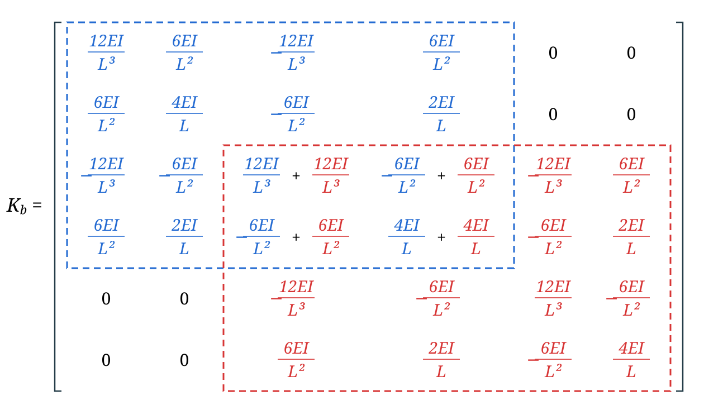<!-- style="width: 100%; display: block; margin: auto;" -->

The global equilibrium equation is:

$$
\mathbf K_b
\begin{bmatrix}v_1\\\phi_1\\v_2\\\phi_2\\v_3\\\phi_3\end{bmatrix}
=
\begin{bmatrix}R_1\\M_1\\0\\0\\-P\\0\end{bmatrix}.
$$

At the fixed end, $v_1=\phi_1=0$. Their columns contribute zero. Rows 1 and 2 contain the unknown support reactions; use the four free-DOF equations in rows 3–6 to solve for $v_2,\phi_2,v_3,\phi_3$.

The zero coupling entry between $v_2$ and $\phi_2$ here results from cancellation for these equal adjacent elements. It is not a general rule for every assembled beam model.

</details>

## ABAQUS Problem: Beam Elements

**Start the assessed beam problem in class. Use your own values from Blackboard.**

Model the aluminium cantilever under a uniformly distributed load using **linear and cubic beam elements**. Check mesh convergence and obtain the maximum vertical displacement requested in the assignment.

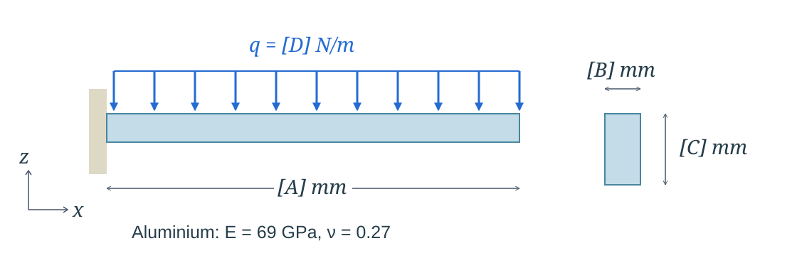<!-- style="width: 90%; display: block; margin: auto;" -->

| Quantity | Value |
|:--|:--|
| Beam length | [A] mm |
| Section width | [B] mm |
| Section depth | [C] mm |
| Young's modulus | 69 GPa |
| Poisson's ratio | 0.27 |
| Downward distributed load | [D] N/m |

Use the assignment's required answer format and precision. Keep the input and message files from your final analyses.

## Plan the ABAQUS Model

Before building the model, identify:

1. Geometry and cross-section, including which section dimension is vertical.
2. Element type and section orientation.
3. Support conditions at the fixed end.
4. Load direction, magnitude, units and loaded region.
5. The displacement component and location to monitor during refinement.

<details>
<summary><strong>Reveal setup checks</strong></summary>

Follow the planar workflow from the tutorials using B21 and B23. The assessment sketch labels the vertical axis $z$; in a 2D planar CAE model, use $x$ along the beam and $y$ vertically. Apply the load and read displacement in that model's vertical direction, U2.

If you instead build the model in the global $x$–$z$ plane in 3D, use the corresponding 3D beam types, load in $z$, and read U3. Constrain all six active DOFs at the fixed end. Keep the cross-section orientation consistent with the intended vertical section depth.

Monitor the free-end vertical displacement using the same physical point after each refinement. Compare linear and cubic formulations using their own refinement sequences.

</details>

<details>
<summary><strong>Reveal progress checks</strong></summary>

- Is the intended section assigned, with its depth in the bending direction?
- Does the fixed end prevent translation and rotation?
- Does the distributed load cover every element in the loaded span, with the right units and sign?
- Did the job complete, and have you inspected its messages?
- Does the deformed shape match the physical behaviour expected?
- Are you comparing the same output and location on successive meshes?
- Have you saved the model, input file and corresponding message file?

</details>

## Week 5 Completion Check

- [ ] I can identify the nodal DOFs and stiffness-matrix size for truss and beam elements.
- [ ] I can explain what a stiffness-matrix column represents in the unit-displacement method.
- [ ] I can compare linear truss interpolation with cubic beam bending interpolation.
- [ ] I can explain how nodal rotation contributes to deflection between beam nodes.
- [ ] I can map the shared displacement and rotation DOFs when assembling two beam elements.
- [ ] I can explain why a completed job alone is not evidence of mesh convergence.
- [ ] I can choose an appropriate element type for a real structure and explain the assumptions and limitations of that choice.
- [ ] I have started the assessed ABAQUS beam problem and recorded what remains to be completed.

## C. INDEPENDENT STUDY: After class

Finish the assessed ABAQUS beam problem, including the comparison of linear and cubic elements and a mesh-convergence check. Submit the requested answer by the deadline shown on Blackboard.

Keep your convergence results and the input and message files corresponding to your final analyses. Add the required files to your ABAQUS file-submission assignment; you can save it as a draft while completing the remaining problems, then submit the complete assignment by its final deadline.

Use the tutorials again if you need to revisit a procedure:

1. @[course(Beam elements in ABAQUS)](../abaqus/Topic2/BeamElements/BeamElements.md)
2. @[course(Mesh convergence in ABAQUS)](../abaqus/Topic2/MeshConvergence/MeshConvergence.md)
3. @[course(Distributed loads in ABAQUS)](../abaqus/Topic2/DistributedLoads/DistributedLoads.md)

## Optional ABAQUS Problem: A Cylindrical Spring

**Optional extension**

Analyse the cylindrical spring using **3D beam elements**. Use the force value $[A]$ supplied in the optional Blackboard question.

[Download the spring CAD geometry: SPRING.stp](files/SPRING.stp)

<!-- style="width: 80%; display: block; margin: auto;" -->

The spring is **clamped at one end** and carries a force $F_x=[A]$ N at the other. Use a circular beam cross-section of radius $r$.

| Material property | Value |
|:--|:--|
| Material | Steel |
| Young's modulus | $200$ GPa |
| Poisson's ratio | $0.30$ |
| Density | $7800$ kg/m³ |

Due to its geometry, the spring also displaces laterally in the $y$ direction. Determine the **minimum cross-sectional radius**, in mm to **two decimal places**, that keeps the **maximum lateral displacement magnitude at or below 10 mm**:

$$\max |U_2|\leq 10\text{ mm}.$$

**Ensure your mesh is converged.**

<details>
<summary><strong>Reveal starting points</strong></summary>

Import the STEP file into ABAQUS/CAE as a 3D deformable part. Assign the steel material, circular beam section and a suitable beam orientation, then mesh the wire geometry with 3D beam elements.

Constrain all six active DOFs at the clamped end and apply the force in the global $x$ direction at the other end. Monitor the largest **absolute U2 value anywhere along the spring**, rather than only its loaded-end displacement.

Vary the section radius and refine the mesh to check the displacement limit. Check that the radius reported to two decimal places still satisfies the limit.

Use the university version of ABAQUS for the CAD import; the Learning Edition does not support CAD import. See @[course(Accessing ABAQUS off campus)](../abaqus/General/OffCampusAccess/OffCampusAccess.md).

</details>

## Further reading

@FurtherReading

@ReadingBook(@LoganBook,@LoganLibrary,```
- **Chapter 4:** Development of Beam Equations
```)
