<!--
author: Matthew Blacklock
email: matthew.blacklock@northumbria.ac.uk
version: 1.0.0
mode: Presentation
import: https://raw.githubusercontent.com/MINT-the-GAP/lia-board-mode/main/README.md
        https://raw.githubusercontent.com/MINT-the-GAP/lia-annotation/main/README.md
        ../common/templates.md
comment: KB5034 Week 7 - torsion, independent and in-class study.
-->

# Week 7: Torsion

@moduleTitle

**Topic 2: Torsion, Bending & Beam Elements**

## Topic Learning Outcome

By the end of this week, students will be able to:

<br>

**2.8. Design** transmission shafts subject to torsional loading.

## A. INDEPENDENT STUDY: Before class

**PREPARATION STARTS HERE**

Read the following pages and complete the quick checks. We will use these ideas in class to compare shaft designs and calculate the diameter required to transmit power safely.

Make notes on:

- How a circular shaft deforms under torque.
- How shear strain and shear stress vary across its section.
- The polar second moment of area, $J$.
- The relationship between torque and angle of twist.

Bring your notes and a calculator to class. The derivations are included on the following pages so that you can return to them for revision.

## Torsion: Twisting a Shaft

Torsion occurs when a torque acts about the longitudinal axis of a member. Transmission shafts carry torque between components in many engineering systems.

<div style="display: flex; gap: 1.2rem; align-items: flex-start;">
<div style="flex: 1.498339 1 0; min-width: 0;">

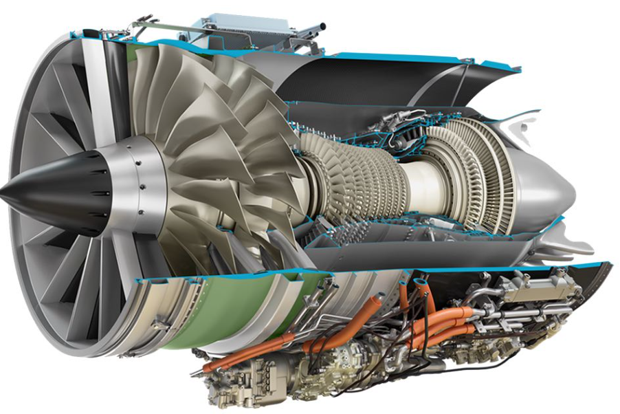<!-- style="width: 100%; height: auto; display: block;" -->

**Aircraft engine:** Shafts transmit torque from the turbine to the compressor and fan.

</div>
<div style="flex: 1.359677 1 0; min-width: 0;">

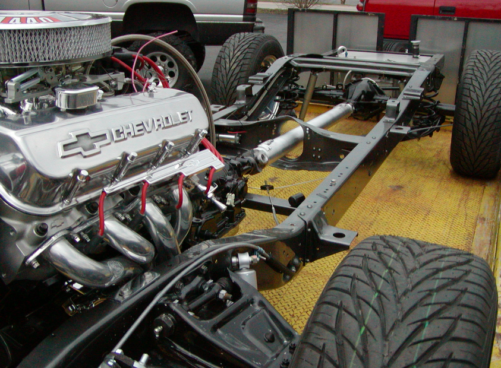<!-- style="width: 100%; height: auto; display: block;" -->

**Vehicle driveshaft:** The shaft transmits torque from the gearbox to the differential.

</div>
<div style="flex: 1.526149 1 0; min-width: 0;">

<!-- style="width: 100%; height: auto; display: block;" -->

**Wind turbine:** The drivetrain transmits torque from the rotor to the generator.

</div>
</div>

{{1}}
********************
**A Transmission Shaft**

A turbine at $A$ drives a generator at $B$ through the connecting shaft. The shaft transmits torque and power between the two machines.

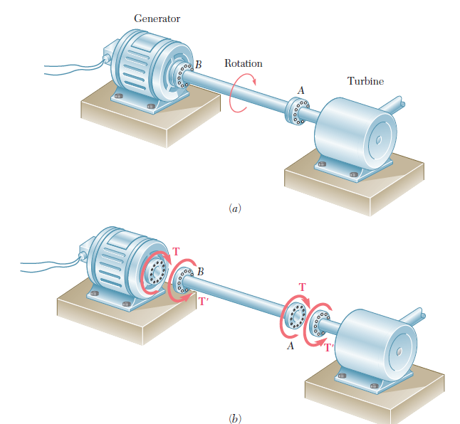<!-- style="width: 65%; display: block; margin: auto;" -->

The separated components show the torques acting at each connection:

- The turbine applies a driving torque to the shaft.
- The generator applies an opposing torque to the shaft.
- At constant rotational speed, these torques have equal magnitudes and opposite directions, so the net torque on the shaft is zero.

The shaft still carries **internal torque**. A cut through it exposes the internal torque needed to balance the external torque on the isolated part.

The internal torque is carried by shear stresses acting tangentially over the cross-section. Their moments about the shaft axis must add up to the internal torque.

Equilibrium tells us the total torque, but **not how the stress varies across the section**. To find that distribution, we first examine how the shaft deforms.
********************

## Deformation of a Circular Shaft

We will describe the twisting deformation before using it to calculate strain and stress.

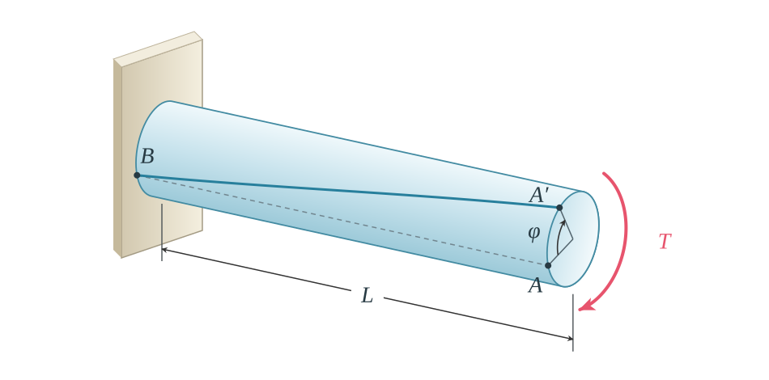<!-- style="width: 70%; display: block; margin: auto;" -->

The **angle of twist**, $\phi$, is the relative rotation between two cross-sections. With section $B$ fixed, the free end rotates so that $A$ moves to $A′$.

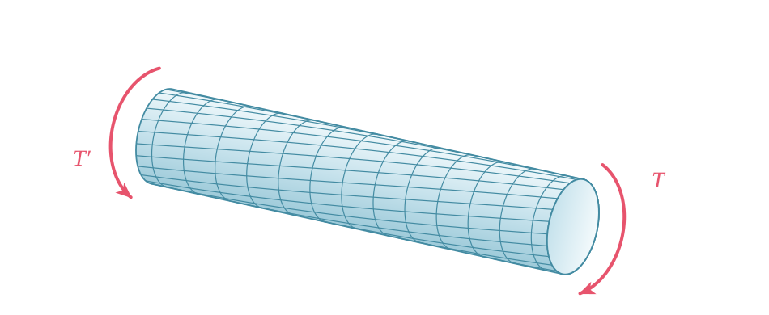<!-- style="width: 70%; display: block; margin: auto;" -->

For a circular shaft in torsion, circular cross-sections remain **plane and undistorted**: each section rotates as a whole, with its radii remaining straight. Different sections rotate through different angles. A line initially drawn along the shaft's surface becomes a helical curve as the shaft twists.

The **shear strain**, $\gamma$, describes the change in angle of an initially rectangular material element in the grid. It is different from the overall angle of twist, $\phi$.

This behaviour applies to solid and hollow circular shafts. A noncircular section, such as a square, generally **warps**: points in the section move out of its original plane. The circular-shaft formulas should not be applied directly to it.

We use a uniform circular shaft of homogeneous material under pure torsion. The simple stress and deformation relationships describe regions away from load application, restraints and abrupt changes in section, where local effects may be important.

## Shear Strain in a Shaft

Consider a uniform circular shaft of length $L$. Its two end sections rotate relative to one another through $\phi$ radians.

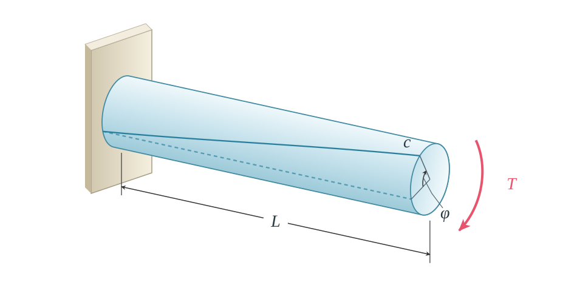<!-- style="width: 70%; display: block; margin: auto;" -->

To examine the strain at a distance $\rho$ from the shaft axis, consider the smaller cylinder below. The dashed outline shows the original outer surface of the shaft.

**Before twisting:** The red material element is rectangular, with right angles between its sides. The $x$–$y$ diagram beside the shaft shows this same element enlarged. Locally, $x$ runs along the shaft and $y$ runs around its circumference.

<div style="display: flex; gap: 1.2rem; align-items: center; flex-wrap: wrap;">
<div style="flex: 3; min-width: 18rem;">

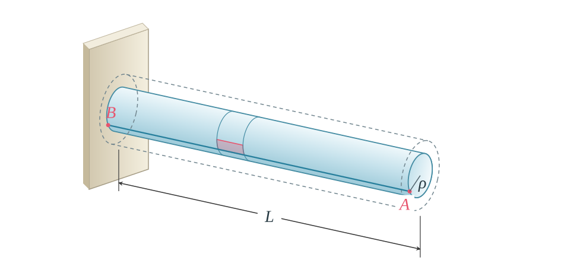<!-- style="width: 100%; display: block;" -->

</div>
<div style="flex: 2; min-width: 12rem;">

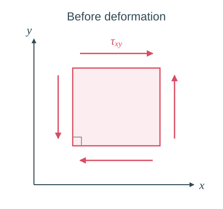<!-- style="width: 100%; display: block;" -->

</div>
</div>

**After twisting:** $A$ moves to $A′$ through the end rotation $\phi$, and the longitudinal line $BA$ becomes $BA′$. The same red element now forms a parallelogram, as shown in the enlarged view alongside.

<div style="display: flex; gap: 1.2rem; align-items: center; flex-wrap: wrap;">
<div style="flex: 3; min-width: 18rem;">

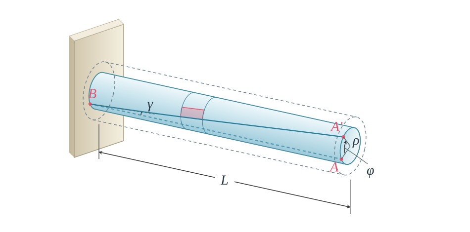<!-- style="width: 100%; display: block;" -->

</div>
<div style="flex: 2; min-width: 12rem;">

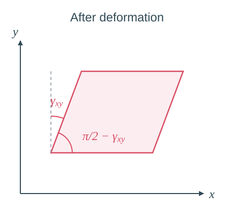<!-- style="width: 100%; display: block;" -->

</div>
</div>

**Shear strain is the change in an initially right angle.** In the enlarged view, the interior angle changes from $\pi/2$ to $\pi/2-\gamma_{xy}$. We write this shear strain as $\gamma$ in the shaft derivation below.

In the shaft, the circular cross-sections remain unchanged in shape. Therefore, $\gamma$ is the angle between the original longitudinal line $BA$ and its displaced position $BA′$, measured in radians.

For small values of $\gamma$, the circumferential arc length $AA′$ is:

$$AA′\approx L\gamma.$$

The same arc is produced by rotating through $\phi$ at radius $\rho$:

$$AA′=\rho\phi.$$

Equating the two expressions, using the small-strain approximation:

$$L\gamma=\rho\phi.$$

Hence:

$$\boxed{\gamma=\frac{\rho\phi}{L}.}$$

Both $\gamma$ and $\phi$ must be expressed in **radians**.

**For a solid shaft, where is the shear strain greatest?**

<!-- data-solution-button="3" -->
[( )] At the centre.
[(X)] At the outer surface.
[( )] It is the same throughout the section.
****************************************
**Shear strain is proportional to distance from the shaft axis.** For a given $\phi$ and $L$, $\gamma=(\phi/L)\rho$: it increases linearly from zero at the centre to its maximum at the outer surface, where $\rho=c$.

<div style="display: flex; gap: 1.2rem; align-items: center; flex-wrap: wrap;">
<div style="flex: 1; min-width: 18rem;">

<!-- style="width: 100%; display: block;" -->

</div>
<div style="flex: 1; min-width: 18rem;">

<!-- style="width: 100%; display: block;" -->

</div>
</div>

$$\gamma_{\max}=\frac{c\phi}{L},\qquad
\gamma(\rho)=\frac{\rho}{c}\gamma_{\max}.$$
****************************************

## Shear Stress in a Shaft

We will use the shear-strain distribution to determine how shear stress varies across the shaft.

In the linear elastic range, Hooke's law for shear is:

$$\tau=G\gamma,$$

where $G$ is the **shear modulus**, also called the modulus of rigidity.

From the previous page, for outer radius $c$:

$$\gamma=\frac{\rho}{c}\gamma_{\max}.$$

Multiply both sides by $G$:

$$G\gamma=\frac{\rho}{c}G\gamma_{\max}.$$

Since $\tau=G\gamma$ and $\tau_{\max}=G\gamma_{\max}$:

$$\boxed{\tau(\rho)=\frac{\rho}{c}\tau_{\max}.}$$

This relationship assumes the material remains **linearly elastic throughout the section**. If part of the section yields, the linear stress distribution no longer applies.

**Solid shaft**

Shear stress is proportional to distance from the shaft axis. In a solid shaft, it increases linearly from **zero at the centre** to **a maximum at the outer surface**, where $\rho=c$.

<div style="display: flex; gap: 1.2rem; align-items: center; flex-wrap: wrap;">
<div style="flex: 1; min-width: 18rem;">

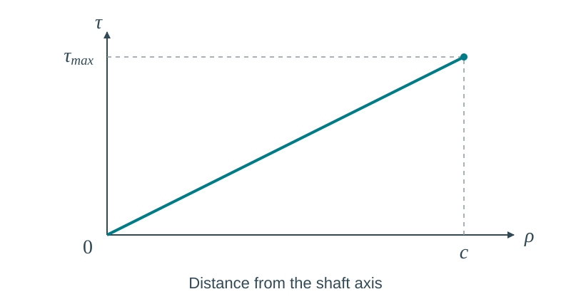<!-- style="width: 100%; display: block;" -->

</div>
<div style="flex: 1; min-width: 18rem;">

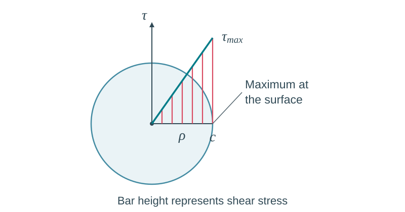<!-- style="width: 100%; display: block;" -->

</div>
</div>

The bars show **stress magnitudes**; the shear stress itself acts tangentially around the cross-section.

<br>

**Hollow shaft**

For a hollow shaft, write the outer radius as $c_o$ and the inner radius as $c_i$. There is no material inside the bore; the inner surface is at $\rho=c_i$.

The same linear relationship applies through the material. The minimum stress magnitude occurs at the **inner surface** and is generally **not zero**. The maximum remains at the outer surface.

<div style="display: flex; gap: 1.2rem; align-items: center; flex-wrap: wrap;">
<div style="flex: 1; min-width: 18rem;">

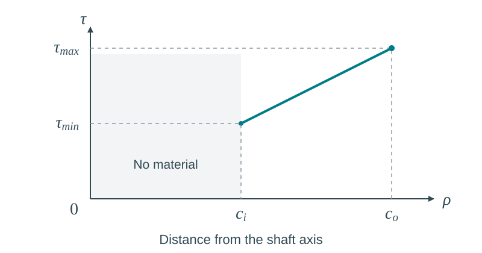<!-- style="width: 100%; display: block;" -->

</div>
<div style="flex: 1; min-width: 18rem;">

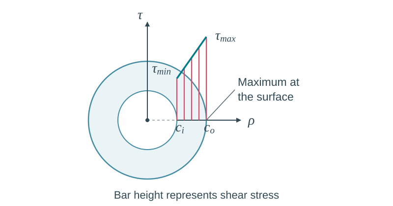<!-- style="width: 100%; display: block;" -->

</div>
</div>

The bars show **stress magnitudes**; the shear stress itself acts tangentially around the cross-section.

**A hollow shaft has inner radius $c_i=c_o/2$. If the outer-surface stress is 100 MPa, what is the stress magnitude at the inner surface, in MPa?**

<!-- data-solution-button="3" -->
[[50]]
****************************************
At the inner surface:

$$\tau_{\min}=\frac{c_i}{c_o}\tau_{\max}
=\frac{1}{2}(100)=\boxed{50\text{ MPa}}.$$

****************************************

## Relating Stress to Torque

We will add the moments produced by the shear stresses over the cross-section to obtain the internal torque.

Pass a transverse cut through the shaft at $C$:

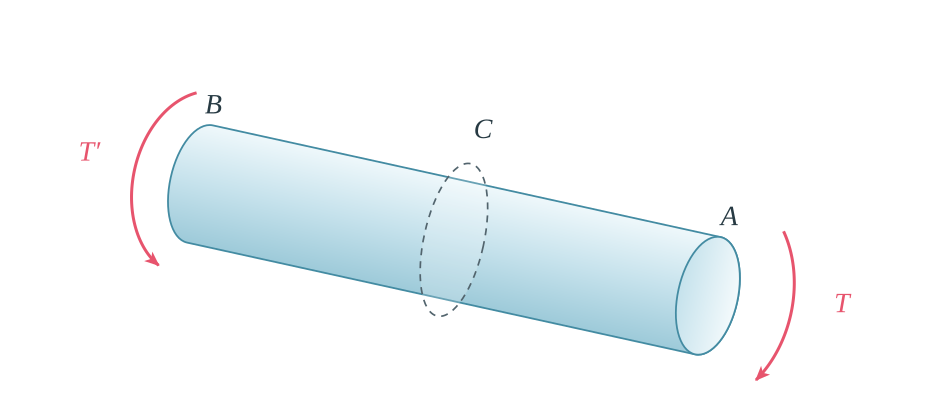<!-- style="width: 85%; display: block; margin: auto;" -->

Isolate the portion $BC$. The cut face carries tangential shear forces $dF=\tau\,dA$. Together, their moments about the shaft axis are equivalent to an **internal torque $T$**, balancing the external torque $T′$ on this portion.

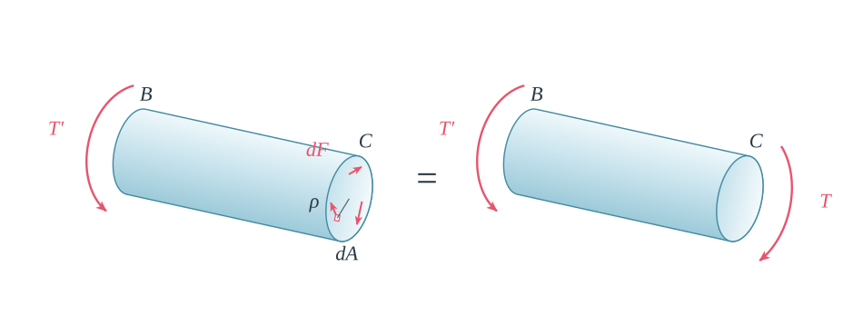<!-- style="width: 100%; display: block; margin: auto;" -->

$$\boxed{\tau(\rho)=\frac{T\rho}{J}},\qquad
\boxed{\tau_{\max}=\frac{|T|c_o}{J}}.$$

Here, $T$ is the **internal torque at the section being considered**, $J$ is that section's **polar second moment of area**, and $c_o$ is its outer radius. Obtain $T$ from a cut-section free-body diagram; it need not be the same along a shaft with several applied torques.

Take a small area $dA$ at radius $\rho$. The shear stress acts tangentially and produces a force of magnitude:

$$dF=\tau\,dA.$$

Its moment about the shaft axis is:

$$dT=\rho\,dF=\rho\tau\,dA.$$

Adding over the section:

$$T=\int_A\rho\tau\,dA.$$

Since $\tau=(\rho/c_o)\tau_{\max}$ for the chosen positive torque direction:

$$T=\frac{\tau_{\max}}{c_o}\int_A\rho^2\,dA.$$

Define:

$$J=\int_A\rho^2\,dA.$$

Then:

$$T=\frac{\tau_{\max}J}{c_o},\qquad
\tau_{\max}=\frac{Tc_o}{J},\qquad
\tau(\rho)=\frac{T\rho}{J}.$$

Use magnitudes when checking against an allowable stress. Stress directions must balance the torque on the chosen cut face.

With $T$ in N mm, distances in mm and $J$ in mm$^4$, stress is in N/mm$^2$ (MPa).

## Polar Second Moment of Area

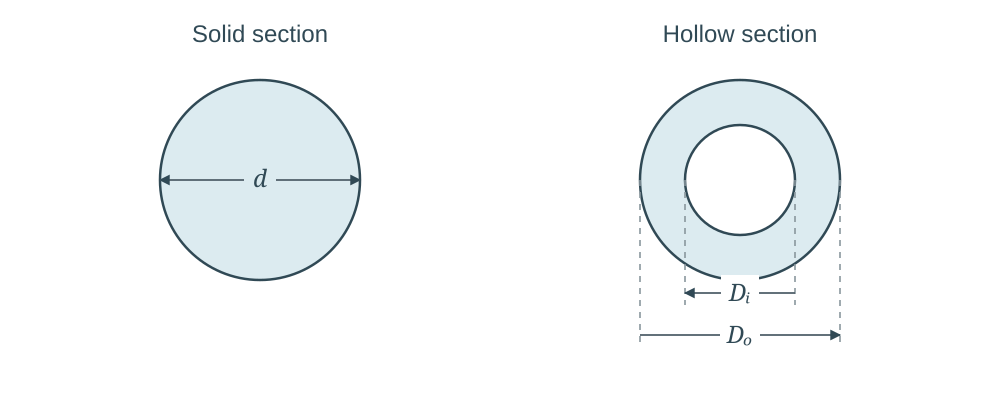

For a **solid circular section**:

$$J=\frac{\pi d^4}{32}=\frac{\pi c_o^4}{2}.$$

For a **hollow circular section**:

$$J=\frac{\pi}{32}(D_o^4-D_i^4)
=\frac{\pi}{2}(c_o^4-c_i^4).$$

Use the diameter expression with diameters, or the radius expression with radii. Do not mix them.

<details>
<summary><strong>Reveal connection to the bending second moment of area</strong></summary>

Both $I$ and $J$ describe how area is distributed, and both have units of length to the fourth power. They use different distances:

$$I_z=\int_A y^2\,dA,\qquad
J=\int_A\rho^2\,dA=\int_A(y^2+z^2)\,dA=I_y+I_z.$$

For a circular section, symmetry gives $I_y=I_z$, so $J=2I$ about either centroidal bending axis. Thus, for a solid circular section:

$$I=\frac{\pi d^4}{64},\qquad J=\frac{\pi d^4}{32}.$$

Use $I$ for the bending calculation and $J$ for the circular-shaft torsion calculation.

</details>

**If the diameter of a solid shaft doubles, by what factor does $J$ increase?**

[[16]]

## Angle of Twist

We will relate the applied torque to the angle through which one end section rotates relative to the other.

<!-- style="width: 70%; display: block; margin: auto;" -->

Consider a linearly elastic, uniform circular shaft with constant internal torque $T$, section property $J$ and shear modulus $G$.

From the earlier derivations, at the outer radius $c$:

$$\gamma_{\max}=\frac{c\phi}{L},\qquad
\tau_{\max}=\frac{Tc}{J}.$$

Hooke's law gives:

$$\gamma_{\max}=\frac{\tau_{\max}}{G}=\frac{Tc}{JG}.$$

Equate the two expressions for $\gamma_{\max}$:

$$\frac{c\phi}{L}=\frac{Tc}{JG}.$$

Cancel $c$ and rearrange:

$$\boxed{\phi=\frac{TL}{JG}.}$$

For the same torque, a longer shaft twists more. A larger $G$ or $J$ reduces the twist. The torsional stiffness is:

$$\frac{T}{\phi}=\frac{GJ}{L}.$$

Consistent N–mm units give $\phi$ in radians. Convert to degrees only after the calculation if required:

$$\phi_{\mathrm{degrees}}=\phi_{\mathrm{radians}}\frac{180}{\pi}.$$

{{1}}
********************
**A torsion test**

Apply a torque $T$ to a specimen of known length and circular section, and measure its angle of twist $\phi$. In the linear elastic range:

$$T=\frac{JG}{L}\phi.$$

<div style="display: flex; gap: 1.2rem; align-items: center; flex-wrap: wrap;">
<div style="flex: 1; min-width: 18rem;">

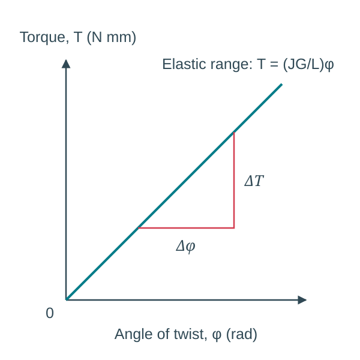<!-- style="width: 100%; display: block;" -->

</div>
<div style="flex: 1; min-width: 18rem;">

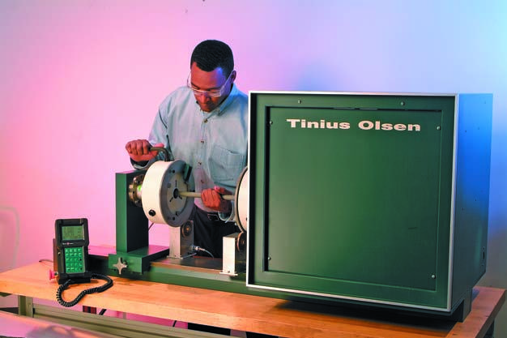<!-- style="width: 100%; display: block;" -->

</div>
</div>

Plotting **torque vertically against angle of twist horizontally** gives a straight line with slope $JG/L$. The measured slope therefore allows us to calculate $G$:

$$G=\frac{L}{J}\frac{\Delta T}{\Delta\phi}.$$

Use angles in radians when calculating the slope.
********************

**If a shaft's length doubles while its torque, material and section remain unchanged, its angle of twist:**

<!-- data-solution-button="3" -->
[(X)] Doubles.
[( )] Halves.
[( )] Remains unchanged.

## Before-class Completion Check

- [ ] I can distinguish angle of twist from shear strain.
- [ ] I can explain why shear stress increases with radius in a circular shaft.
- [ ] I can calculate $J$ for solid and hollow circular sections.
- [ ] I can use $\tau=T\rho/J$ and $\phi=TL/(JG)$ with consistent units.

## B. IN-CLASS STUDY: Torsion and Shaft Design

**LECTORIAL STARTS HERE**

We will use the circular-shaft relationships to compare solid and hollow designs, then connect power and rotational speed to the torque a shaft must carry.

You will begin the analytical transmission-shaft problem in class. Bring together your diagrams, equations, substitutions and unit conversions in your workings.

## Retrieval: Circular Shafts

**1. Where is the maximum shear stress in a solid circular shaft?**

<!-- data-solution-button="3" -->
[( )] At the centre.
[(X)] At the outer surface.
[( )] Halfway between the centre and the surface.

**2. Is the inner-surface shear stress zero in a hollow shaft carrying torque?**

<!-- data-solution-button="3" -->
[( )] Yes, because the bore is empty.
[(X)] No; the material at the inner surface is at a non-zero radius.

**3. For a solid shaft, which expression gives $J$ when $d$ is its diameter?**

<!-- data-solution-button="3" -->
[( )] $\pi d^4/64$
[(X)] $\pi d^4/32$
[( )] $\pi d^2/4$

**4. If the length doubles at the same torque, what changes?**

<!-- data-solution-button="3" -->
[( )] Both maximum stress and angle of twist double.
[(X)] Angle of twist doubles; maximum stress is unchanged.
[( )] Maximum stress doubles; angle of twist is unchanged.

## Worked Example: A Hollow Shaft

Determine the maximum torque that can be applied without exceeding the allowable shear stress. At that torque, find the minimum shear stress magnitude **in the shaft material**.

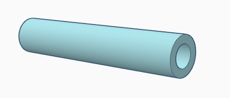<!-- style="display: block; margin: auto;" -->

<!-- data-type="none" -->
| Quantity | Value |
|:--|:--|
| Outer diameter, $D_o$ | 60 mm |
| Inner diameter, $D_i$ | 40 mm |
| Length, $L$ | 1.5 m |
| Allowable shear stress | 120 MPa |

<details>
<summary><strong>Reveal worked solution</strong></summary>

The maximum stress occurs at $c_o=30$ mm:

$$J=\frac{\pi}{32}(60^4-40^4)
=1.02102\times10^6\text{ mm}^4.$$

Rearrange the stress equation:

$$T_{\max}=\frac{\tau_{\mathrm{allow}}J}{c_o}
=\frac{120(1.02102\times10^6)}{30}
=4.08407\times10^6\text{ N mm}.$$

$$\boxed{T_{\max}=4.084\text{ kN m}.}$$

The minimum stress magnitude in the material occurs at the inner surface, $c_i=20$ mm:

$$\tau_{\min}=\frac{c_i}{c_o}\tau_{\max}
=\frac{20}{30}(120)=\boxed{80\text{ MPa}}.$$

The length is not needed for this stress calculation. It would be needed to calculate the angle of twist.

</details>

## Problem: Solid or Hollow?

A wind turbine's low-speed shaft has a hollow circular section. Determine the maximum torque it can carry, then compare two solid alternatives.

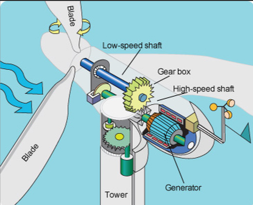<!-- style="display: block; margin: auto;" -->

<!-- data-type="none" -->
| Quantity | Value |
|:--|:--|
| Outer diameter | 150 mm |
| Inner diameter | 100 mm |
| Length | 3000 mm |
| Allowable shear stress | 90 MPa |

1. Calculate the maximum torque for the hollow shaft.
2. Would a **solid shaft of the same mass**, material and length carry more torque?
3. Would a **solid shaft of the same outer diameter** carry more torque? What is the mass penalty?

Show your section calculations and explain the comparison, rather than giving only numerical answers.

{{1}}
********************
<details>
<summary><strong>Reveal comparison</strong></summary>

**Hollow shaft**

$$J_h=\frac{\pi}{32}(150^4-100^4)
=3.98835\times10^7\text{ mm}^4.$$

$$T_h=\frac{90J_h}{75}=\boxed{47.86\text{ kN m}}.$$

**Solid shaft of equal mass**

For the same material and length, equal mass means equal section area:

$$\frac{\pi d_s^2}{4}=\frac{\pi}{4}(150^2-100^2),
\qquad d_s=\sqrt{150^2-100^2}=111.80\text{ mm}.$$

$$T_s=\frac{\tau_{\mathrm{allow}}\pi d_s^3}{16}
=\boxed{24.70\text{ kN m}}.$$

The hollow shaft carries more torque for the same mass: more material is positioned farther from the axis.

**Solid shaft of the same outer diameter**

$$T_s=\frac{90\pi(150)^3}{16}
=\boxed{59.64\text{ kN m}}.$$

It carries more torque, but its mass is:

$$\frac{m_s}{m_h}=\frac{150^2}{150^2-100^2}=1.8.$$

It is **80% heavier**, while its torque capacity is about **24.6% greater**.

</details>
********************

{{2}}
********************
**Gearbox connection:** In an ideal lossless gearbox, an 80 mm pitch-diameter gear on the low-speed shaft drives a 40 mm gear on the high-speed shaft. How do the speed and torque change?

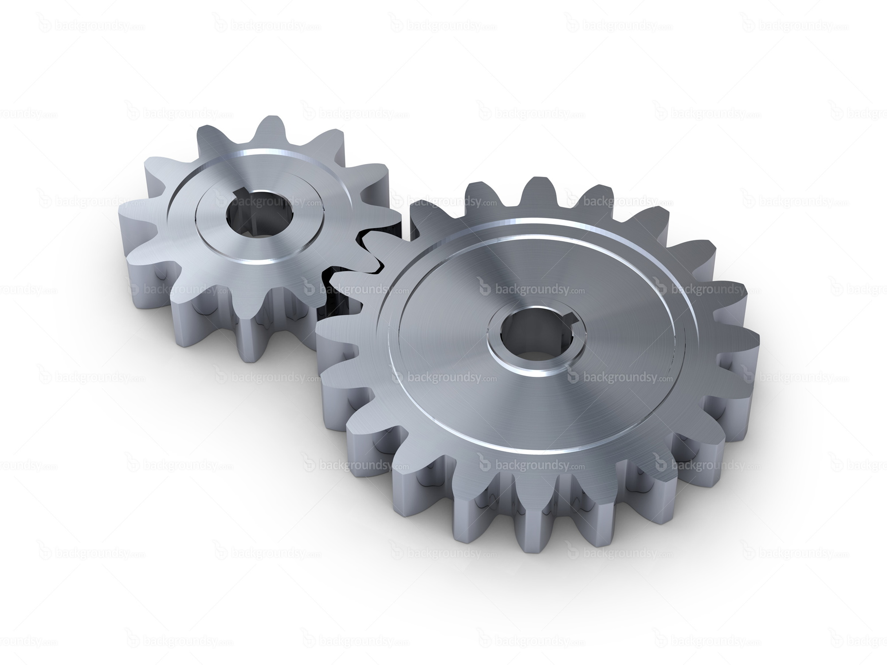<!-- style="width: 40%; display: block; margin: auto;" -->

<details>
<summary><strong>Reveal answer</strong></summary>

The tangential speeds at the contact are equal. The smaller gear rotates twice as fast. With the same transmitted power, its shaft carries half the torque magnitude.

For the hollow shaft's limiting torque of 47.86 kN m, the corresponding high-speed-shaft torque is 23.93 kN m. This does not establish the high-speed shaft's own allowable torque; that depends on its section and material.

</details>
********************

## Power, Speed and Torque

We will determine the torque a shaft must carry from the power it transmits and its rotational speed.

$$P=T\omega.$$

If the rotational frequency is $f$ revolutions per second (rps):

$$\omega=2\pi f,\qquad
\boxed{T=\frac{P}{2\pi f}.}$$

<details>
<summary><strong>Reveal explanation and units</strong></summary>

Work done by a constant torque through an angle $\theta$ is $W=T\theta$. At constant angular velocity, dividing by time gives:

$$P=T\frac{\theta}{t}=T\omega.$$

One revolution is $2\pi$ radians. A frequency of $f$ revolutions per second therefore gives $\omega=2\pi f$ rad/s:

$$P=2\pi fT.$$

Use **power in W** with **frequency in rps** in the torque equation above to obtain **torque in N m**. Convert to N mm if you then use section dimensions in mm and stress in MPa.

Alternatively, with power in kW:

$$T\text{ (N m)}=\frac{1000\,P\text{ (kW)}}{2\pi f\text{ (rps)}}.$$

</details>

**At the same transmitted power, doubling the rotational speed:**

<!-- data-solution-button="3" -->
[( )] Doubles the torque.
[(X)] Halves the torque.
[( )] Leaves the torque unchanged.


## Problem: Transmission Shaft Design

The Koenigsegg Agera RS has a measured top speed of 285 mph (458 km/h). The engine is capable of delivering **1,341 hp at 7,800 rpm**. Assuming a **factor of safety of five**, and the use of **10Mn high-quality carbon steel**, what size driveshaft should be used?

<!-- style="display: block; margin: auto;" -->

Research the material properties needed for your calculation. Record your source, the material condition and any assumptions you make when determining the allowable shear stress.

For this calculation, assume a **solid circular shaft** transmitting the full quoted engine power at the quoted rotational speed. Convert the power to W and the rotational frequency to rps before calculating the torque.

Determine the minimum diameter, then select a practical shaft diameter. Show your calculations and justify your choice.

<details>
<summary><strong>Reveal suggested approach</strong></summary>

1. Convert the power from hp to W and the rotational frequency from rpm to rps.
2. Calculate the torque using $T=P/(2\pi f)$.
3. Use the material data you found to establish an allowable **shear** stress, including the factor of safety. State whether the published strength is a tensile or shear value and justify how you use it.
4. For a solid circular shaft, use $J=\pi d^4/32$ and $c=d/2$:

$$\tau_{\max}=\frac{Tc}{J}=\frac{16T}{\pi d^3}.$$

5. Rearrange for the minimum diameter:

$$d_{\min}=\left(\frac{16T}{\pi\tau_{\mathrm{allow}}}\right)^{1/3}.$$

With torque in N mm and allowable stress in MPa, the diameter is in mm. Select a practical diameter at least as large as your calculated minimum.

Your result depends on the material properties and assumptions you justify. This calculation checks torsional strength; it does not check a twist limit, bending, fatigue or local stress concentrations.

</details>

## Analytical Problem: Transmission Shaft Design

*Assesses the design of a solid circular transmission shaft subjected to torsional loading.*

A solid circular transmission shaft delivers the power shown at the specified rotational speed. The material shear yield strength and required factor of safety are also given.

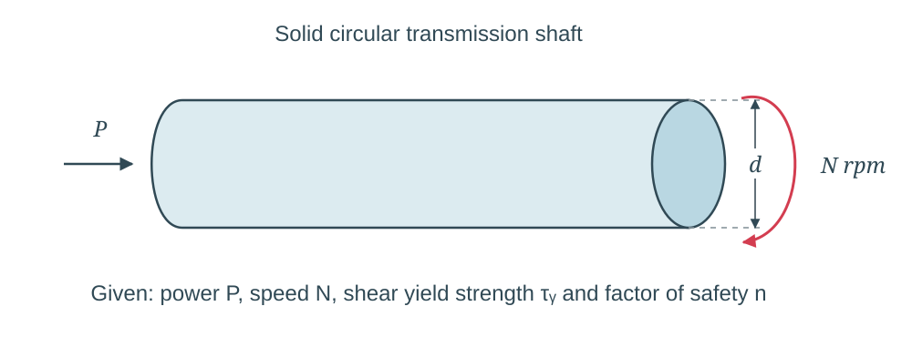

<!-- data-type="none" -->
| Quantity | Symbol | Value |
|:--|:--:|:--|
| Transmitted power | $P$ | Use your Blackboard value, kW |
| Rotational speed | $N$ | Use your Blackboard value, rpm |
| Material shear yield strength | $\tau_Y$ | Use your Blackboard value, MPa |
| Factor of safety | $n$ | Use your Blackboard value |

**Determine the minimum required shaft diameter. Give your answer in mm.**

Start your calculation in class. Record the equations, unit conversions and substitutions in your workings, then check your result before entering it in Blackboard.

<details>
<summary><strong>Reveal checks</strong></summary>

- Check your power, rotational frequency and torque units are consistent.
- Check whether each section-property expression uses a radius or a diameter.
- Check that you have applied the factor of safety to the supplied shear yield strength.
- Substitute your calculated diameter back into the shear-stress equation and compare the result with the allowable stress.

Use the precision requested in Blackboard, and keep the complete calculation for your analytical workings submission.

</details>

## Week 7 Completion Check

**2.8. Design transmission shafts subject to torsional loading.**

- [ ] I can explain the shear-stress distribution in a circular shaft.
- [ ] I can calculate stress and angle of twist using the correct polar second moment of area.
- [ ] I can compare hollow and solid shafts, distinguishing equal mass from equal outer diameter.
- [ ] I can calculate torque from power and rotational speed.
- [ ] I can apply a factor of safety to the supplied shear yield strength.
- [ ] I can calculate the minimum diameter of a solid transmission shaft.
- [ ] I have started the analytical problem and identified any remaining questions.

## C. INDEPENDENT STUDY: After class

Finish the analytical transmission-shaft problem using your own Blackboard values. Submit the requested numerical answer by **23:59 on Wednesday 18th November 2026**, as shown in Blackboard.

Keep the full calculation, including the torque calculation, allowable stress, section properties, diameter calculation and units. Upload your workings to the analytical-workings assignment and retain them for the final submission by **23:59 on Thursday 17 December 2026**.

Revisit any quick checks you found difficult and use the worked solutions to check your method.

## Optional ABAQUS Problem: Beam Torsion

Model the circular shaft below using a **cubic beam element (B33)**. Calculate the angle of twist by hand, then compare it with the free-end rotation from ABAQUS.

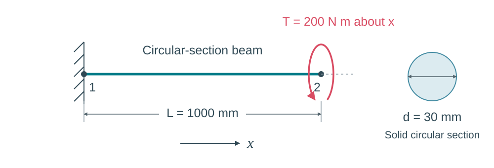

<!-- data-type="none" -->
| Quantity | Symbol | Value |
|:--|:--:|:--|
| Shaft length | $L$ | 1000 mm |
| Solid-section diameter | $d$ | 30 mm |
| Young's modulus | $E$ | 200 GPa |
| Poisson's ratio | $\nu$ | 0.30 |
| Torque about global $x$ | $T$ | 200 N m |

Use a linear elastic material and a small-displacement static analysis. Work in **N and mm**, so the applied torque is **200,000 N mm**.

**1. Hand calculation**

Calculate the angle of twist in radians and degrees using:

$$G=\frac{E}{2(1+\nu)},\qquad J=\frac{\pi d^4}{32},\qquad
\phi=\frac{TL}{JG}.$$

The expression for $G$ gives the shear modulus consistent with the isotropic elastic material entered in ABAQUS.

**2. ABAQUS model**

Model the shaft using a **cubic beam element (B33)**.

**3. Compare results**

Read the free-end **UR1** rotation about global $x$, in radians. Also check the fixed-end **RM1** reaction moment.

Use one B33 element. Click the blank result cells to enter your values, and keep a copy in your notes:

<!-- data-type="none" -->
| Quantity | Hand calculation | ABAQUS |
|:--|:--:|:--:|
| Free-end angle of twist (rad) | <span contenteditable="true" role="textbox" aria-label="Hand-calculated angle of twist in radians" style="display: inline-block; min-width: 7em; min-height: 1.6em;"></span> | <span contenteditable="true" role="textbox" aria-label="ABAQUS angle of twist in radians" style="display: inline-block; min-width: 7em; min-height: 1.6em;"></span> |
| Fixed-end reaction torque (N mm) | <span contenteditable="true" role="textbox" aria-label="Hand-calculated reaction torque in N mm" style="display: inline-block; min-width: 7em; min-height: 1.6em;"></span> | <span contenteditable="true" role="textbox" aria-label="ABAQUS reaction torque in N mm" style="display: inline-block; min-width: 7em; min-height: 1.6em;"></span> |

Does the rotation agree with your calculation? Does the reaction moment balance the applied torque?

<details>
<summary><strong>Reveal analytical reference</strong></summary>

$$G=\frac{200000}{2(1+0.30)}=76923.08\text{ N/mm}^2.$$

$$J=\frac{\pi(30)^4}{32}=79521.56\text{ mm}^4.$$

$$\phi=\frac{200000(1000)}{79521.56(76923.08)}
=\boxed{0.03270\text{ rad}}\approx\boxed{1.873^\circ}.$$

For the positive moment shown, free-end UR1 should be positive. Fixed-end RM1 should be approximately **−200,000 N mm**.

</details>

**Extension: hollow shaft**

Keep the outer diameter at 30 mm, but introduce an inner diameter of 20 mm. Keep the material, length and torque unchanged. Predict whether the twist will increase or decrease, then update the section and compare with:

$$J=\frac{\pi}{32}(D_o^4-D_i^4).$$

## Further reading

@FurtherReading

@ReadingBook(@BeerBook,@BeerLibrary,```
- **Sections 3.1–3.4:** Torque, circular-shaft deformation and the elastic stress distribution.
- **Section 3.5:** Angle of twist and the torsion test.
- **Section 3.7:** Design of transmission shafts.
```)
