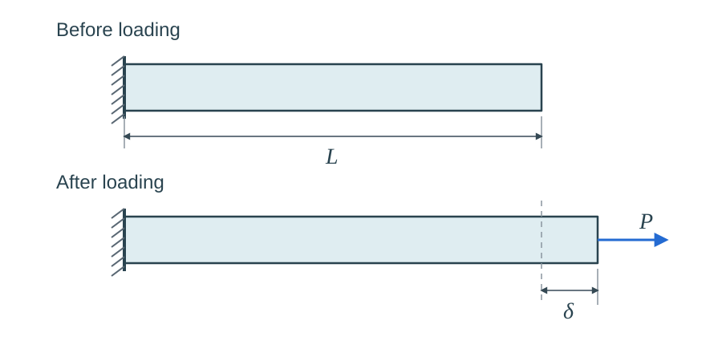
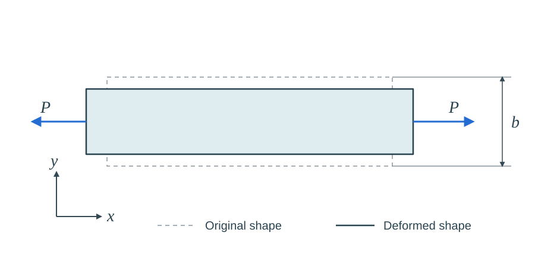
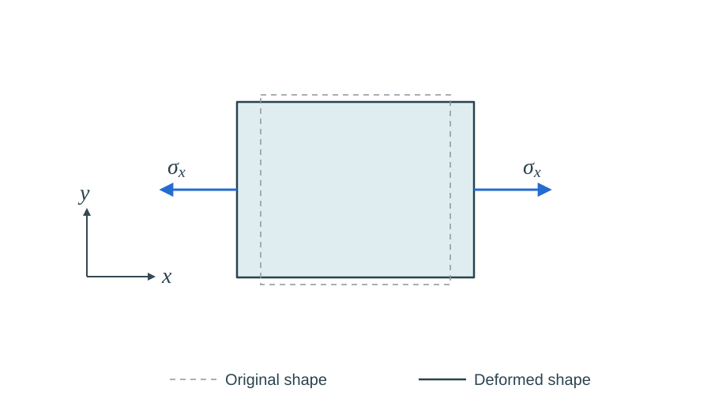
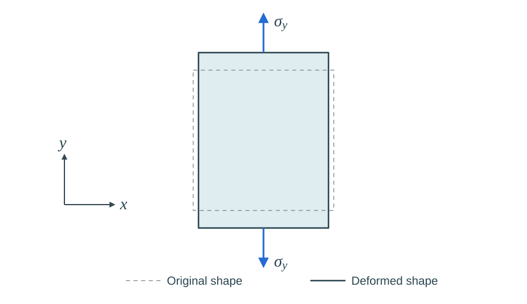
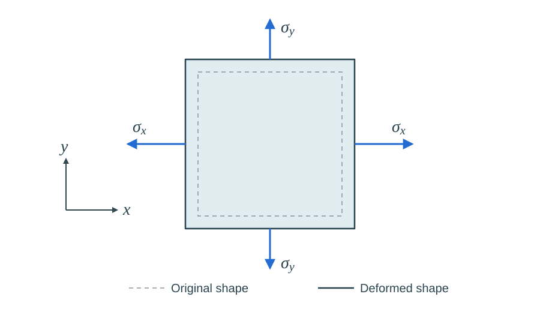
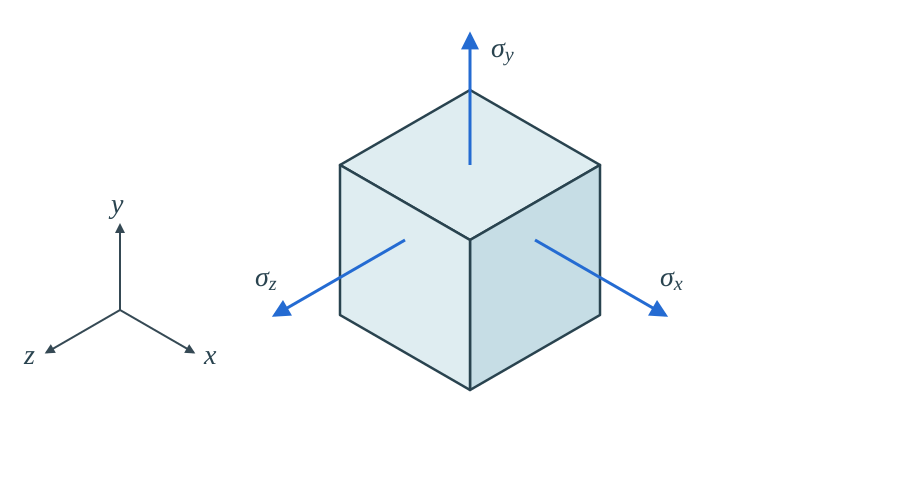
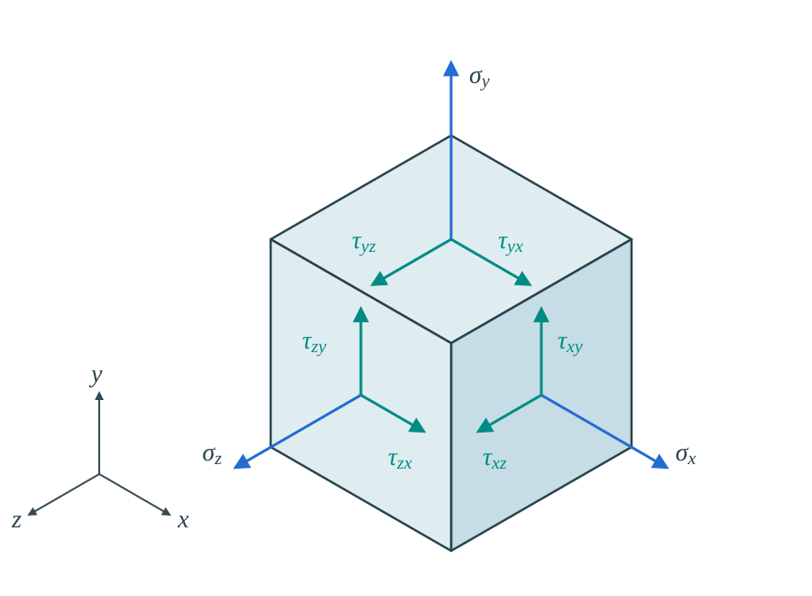
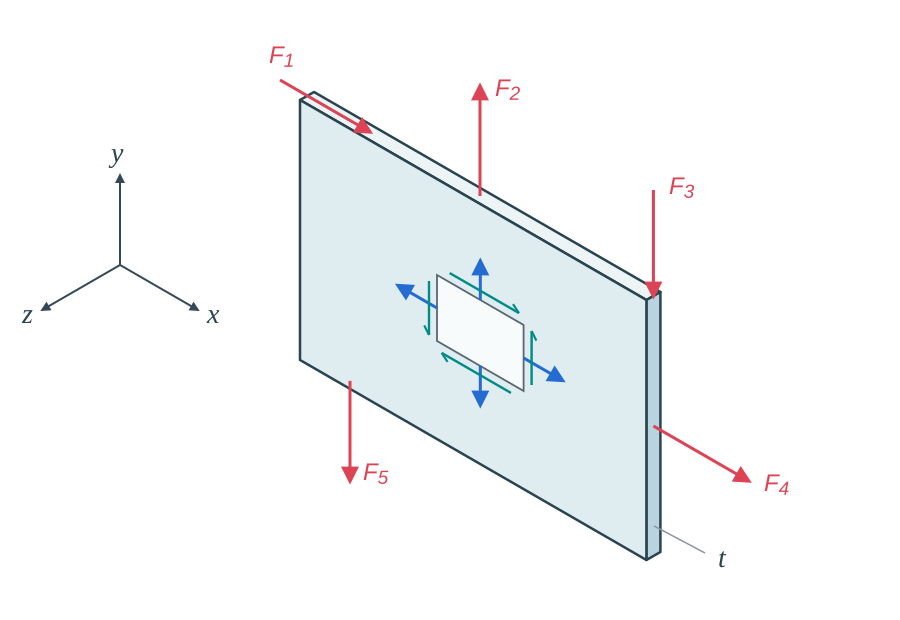
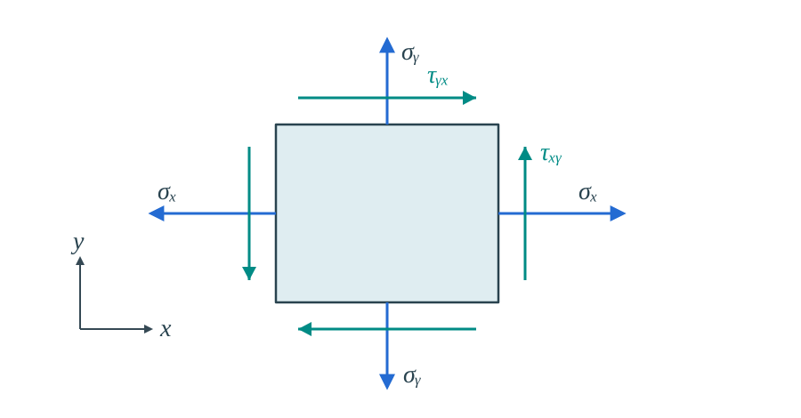

<!--
author: Matthew Blacklock
email: matthew.blacklock@northumbria.ac.uk
version: 0.0.1
mode: Presentation
import: https://raw.githubusercontent.com/MINT-the-GAP/lia-board-mode/main/README.md
        https://raw.githubusercontent.com/MINT-the-GAP/lia-annotation/main/README.md
        ../common/templates.md
comment: KB5034 Week 8 - Topic 3: multiaxial stress, strain and plane stress; before-class study.
-->

# Week 8: 2D Stresses & Plane Stress Elements

@moduleTitle

**Topic 3: 2D Stresses & Plane Stress Elements**

## Topic Learning Outcome

By the end of this week, students will be able to:

<br>

**3.1. Recognise** when the plane stress formulation is applicable to simplify the analysis of plate structures.

## A. INDEPENDENT STUDY: Before class

**PREPARATION STARTS HERE**

So far, we have considered axial stress, bending stress and shear stress in torsion. We will now describe stresses acting in several directions and relate them to the resulting strains.

Make notes on:

- Poisson's ratio and lateral deformation.
- Normal and shear stress components.
- When a three-dimensional stress state can be simplified to **plane stress**.
- The stress–strain relationships for a linearly elastic material in plane stress.

Bring your notes and a calculator to class. We will apply these relationships to numerical problems and begin the analytical problem for this week.

## Reminder: Axial Stress and Strain

An axial tensile force extends a bar. Engineering strain compares the change in length with the **original length**:

<!-- style="width: 75%; display: block; margin: auto;" -->

$$
\sigma_x=\frac{P}{A},\qquad
\varepsilon_x=\frac{\delta}{L}.
$$

For uniaxial loading in the linear elastic range:

$$\sigma_x=E\varepsilon_x,\qquad \delta=\frac{PL}{EA}.$$

Tensile normal stress and extension are **positive**. Compressive normal stress and shortening are **negative**.

{{1}}
********************
**Quick check**

A bar extends by $0.02\text{ mm}$ from an original length of $100\text{ mm}$. What is its axial strain? Enter a decimal value.

[[0.0002]]
****************************************
$$\varepsilon_x=\frac{0.02}{100}=0.0002.$$

Strain is a ratio of lengths, so it is dimensionless.
****************************************
********************

## Poisson's Ratio

When a bar is stretched, it usually becomes **longer in the loading direction** and **narrower perpendicular to it**. Compression usually produces the opposite behaviour.

<!-- style="width: 80%; display: block; margin: auto;" -->

Poisson's ratio, $\nu$, relates lateral strain to axial strain in a uniaxial test:

$$\boxed{\nu=-\frac{\text{lateral strain}}{\text{axial strain}}.}$$

For an isotropic material loaded only in $x$:

$$\nu=-\frac{\varepsilon_y}{\varepsilon_x}
=-\frac{\varepsilon_z}{\varepsilon_x},\qquad
\varepsilon_y=\varepsilon_z=-\nu\varepsilon_x.$$

An **isotropic** material has the same elastic properties in every direction. We use a homogeneous, isotropic, linearly elastic material throughout this module.

The minus sign gives a positive $\nu$ when tensile axial strain produces negative lateral strain. Poisson's ratio is **dimensionless**.

**Typical values**

<!-- data-type="none" -->
| Material | Typical Poisson's ratio, $\nu$ |
|:--|:--:|
| Steel | 0.27–0.30 |
| Aluminium | 0.33 |
| Concrete | 0.20 |
| Glass | 0.24–0.29 |
| Rubber | 0.48–approximately 0.50 |
| Cork | Approximately 0 |

These are approximate reference values and vary with the particular material. **Use the value specified in each problem.**

Source: [Altair Radioss documentation — Poisson's ratio](https://2023.help.altair.com/2023/hwsolvers/rad/topics/solvers/rad/poissons_ratio_definitions_r.htm).

{{1}}
********************
**Quick check**

A steel bar has axial strain $\varepsilon_x=0.001$ and Poisson's ratio $\nu=0.30$. What is its lateral strain $\varepsilon_y$? Include the sign.

[[-0.0003]]
****************************************
$$\varepsilon_y=-\nu\varepsilon_x=-0.30(0.001)=-0.0003.$$

The negative sign represents lateral contraction. The change in width is $\delta_y=\varepsilon_y b$, where $b$ is the original width.
****************************************
********************

## Building the Normal Stress–Strain Equations

A **normal stress** acts perpendicular to a face. We will first build the equations in two dimensions by applying one stress at a time, then adding the strain contributions.

Assume small deformations of a homogeneous, isotropic, linearly elastic material with positive Poisson's ratio. The diagrams show the original square dashed and the deformed shape shaded.

{{0-1}}
********************
<div style="display: flex; gap: 1.5rem; align-items: center; flex-wrap: wrap;">
<div style="flex: 3; min-width: 18rem;">

<!-- style="width: 100%; display: block; margin: auto;" -->

</div>
<div style="flex: 2; min-width: 16rem;">

**1. Apply $\sigma_x$ only**

The element extends in $x$:

$$\varepsilon_x=\frac{\sigma_x}{E}.$$

It contracts in $y$ through the Poisson effect:

$$\varepsilon_y=-\nu\varepsilon_x
=-\frac{\nu\sigma_x}{E}.$$

The minus sign represents **contraction transverse to a tensile stress**. There is strain in $y$ even though $\sigma_y=0$.

</div>
</div>
********************

{{1-2}}
********************
<div style="display: flex; gap: 1.5rem; align-items: center; flex-wrap: wrap;">
<div style="flex: 3; min-width: 18rem;">

<!-- style="width: 100%; display: block; margin: auto;" -->

</div>
<div style="flex: 2; min-width: 16rem;">

**2. Apply $\sigma_y$ only**

Now start again from the original square and load it in $y$. It extends in $y$:

$$\varepsilon_y=\frac{\sigma_y}{E}.$$

The Poisson effect makes it contract in $x$:

$$\varepsilon_x=-\nu\varepsilon_y
=-\frac{\nu\sigma_y}{E}.$$

This gives the **negative contribution to $\varepsilon_x$** that we will need when both stresses act.

</div>
</div>
********************

{{2-3}}
********************
<div style="display: flex; gap: 1.5rem; align-items: center; flex-wrap: wrap;">
<div style="flex: 3; min-width: 18rem;">

<!-- style="width: 100%; display: block; margin: auto;" -->

</div>
<div style="flex: 2; min-width: 16rem;">

**3. Apply both stresses**

For small, linear-elastic deformation, **add the strain contributions** from the two loading cases:

$$\boxed{\varepsilon_x=
\underbrace{\frac{\sigma_x}{E}}_{\text{direct extension}}
-\underbrace{\frac{\nu\sigma_y}{E}}_{\text{Poisson contraction}}.}$$

$$\boxed{\varepsilon_y=
-\underbrace{\frac{\nu\sigma_x}{E}}_{\text{Poisson contraction}}
+\underbrace{\frac{\sigma_y}{E}}_{\text{direct extension}}.}$$

Each strain therefore depends on **both normal stresses**. In each direction, one stress acts directly and the other produces a lateral Poisson effect.

</div>
</div>

For illustration, the diagram uses **equal tensile stresses**, so both net strains are positive. With unequal stresses, the balance between direct and Poisson contributions determines whether a particular direction extends or contracts. Deformations are shown schematically.
********************

{{3}}
********************
**4. Extend the same reasoning to three dimensions**

<!-- style="width: 60%; display: block; margin: auto;" -->

The three normal stress components are $\sigma_x$, $\sigma_y$ and $\sigma_z$. The diagram omits the opposite-face stresses for clarity.

For strain in $x$, $\sigma_x$ acts directly. Both $\sigma_y$ and $\sigma_z$ act transversely and therefore contribute Poisson terms:

$$\boxed{\varepsilon_x=\frac{\sigma_x}{E}
-\frac{\nu\sigma_y}{E}-\frac{\nu\sigma_z}{E}.}$$

The same reasoning gives:

$$\varepsilon_y=\frac{\sigma_y}{E}-\frac{\nu\sigma_x}{E}-\frac{\nu\sigma_z}{E},$$

$$\varepsilon_z=\frac{\sigma_z}{E}-\frac{\nu\sigma_x}{E}-\frac{\nu\sigma_y}{E}.$$

The minus signs describe the **Poisson contributions**, not a rule that the resulting strains must be negative. Use the signs of the applied stresses: a compressive transverse stress gives a positive lateral contribution.
********************

{{4}}
********************
**Quick check**

If $\sigma_x=0$ but $\sigma_y$ is tensile and $\sigma_z=0$, must $\varepsilon_x$ be zero?

<!-- data-solution-button="3" -->
[( )] Yes, because there is no normal stress in $x$.
[(X)] No. The Poisson effect produces strain in $x$.
****************************************
$$\varepsilon_x=-\frac{\nu\sigma_y}{E}.$$

For positive $\nu$, the material contracts in $x$ even though $\sigma_x=0$.
****************************************
********************

## Shear Stress and Shear Strain

A **shear stress** acts along a face. We use the first subscript for the direction normal to the face and the second for the direction of the stress along that face. Thus, $\tau_{xy}$ acts on an $x$ face in the $y$ direction.

<!-- style="width: 80%; display: block; margin: auto;" -->

The blue arrows show normal stresses; the teal arrows show shear stresses. Each visible face carries one normal component and two shear components. All arrows show the positive component directions; opposite-face stresses are omitted for clarity.

Moment equilibrium requires the complementary shear stresses to have equal values:

$$\tau_{xy}=\tau_{yx},\qquad
\tau_{yz}=\tau_{zy},\qquad
\tau_{zx}=\tau_{xz}.$$

A general three-dimensional stress state therefore has **six independent components**: three normal stresses and three shear stresses.

As in torsion, engineering shear strain $\gamma$ describes the change in an initially right angle. In the linear elastic range:

$$\tau_{xy}=G\gamma_{xy},\qquad
G=\frac{E}{2(1+\nu)}.$$

Hence:

$$\gamma_{xy}=\frac{2(1+\nu)}{E}\tau_{xy}.$$

Engineering shear strain is measured in radians. Use $E$, $G$ and stress in consistent units.

{{1}}
********************
**Quick check**

Which statement describes a shear stress?

<!-- data-solution-button="3" -->
[( )] It acts perpendicular to a face.
[(X)] It acts along a face.
[( )] It is the change in length divided by original length.
********************

## When Can We Use Plane Stress?

We can often simplify a **thin plate loaded in its own plane** to a plane-stress model. Let $x$ and $y$ lie in the plate and $z$ run through its thickness.

<!-- style="width: 75%; display: block; margin: auto;" -->

The red arrows show applied forces acting in the plate's mid-plane. The small element on the face shows the in-plane normal and shear stress components.

The approximation is appropriate when:

- The thickness is small compared with the in-plane dimensions.
- The broad faces are free of applied traction.
- Loading acts in the plane of the plate, without significant out-of-plane bending.
- Through-thickness constraints and local load or support effects do not create significant out-of-plane stresses in the region being considered.

We then take:

$$\boxed{\sigma_z=0,\qquad \tau_{xz}=0,\qquad \tau_{yz}=0.}$$

The retained components are $\sigma_x$, $\sigma_y$ and $\tau_{xy}$. For the plate models in this topic, we also use a constant thickness $t$.

{{1}}
********************
**Quick check**

Which situation is the best candidate for a plane-stress model?

<!-- data-solution-button="3" -->
[(X)] A thin, flat plate pulled along its edges, with its broad faces free.
[( )] A thick block compressed on all six faces.
[( )] A thin plate carrying a load perpendicular to its broad face and bending substantially.
****************************************
The first case has thin geometry and in-plane loading. Thin geometry alone is insufficient: the loading and constraints must also support the plane-stress assumption.
****************************************
********************

## Stress–Strain Relationships for Plane Stress

Set $\sigma_z=0$ in the general normal-strain equations. Together with the shear relationship, this gives:

<!-- style="width: 65%; display: block; margin: auto;" -->

$$\boxed{\varepsilon_x=\frac{\sigma_x-\nu\sigma_y}{E},\qquad
\varepsilon_y=\frac{\sigma_y-\nu\sigma_x}{E},\qquad
\gamma_{xy}=\frac{\tau_{xy}}{G}
=\frac{2(1+\nu)}{E}\tau_{xy}.}$$

**Zero stress does not necessarily mean zero strain.** The plate can still change thickness through the Poisson effect:

$$\boxed{\varepsilon_z=-\frac{\nu}{E}(\sigma_x+\sigma_y).}$$

Plane stress sets the out-of-plane **stresses** to zero; it does not set $\varepsilon_z$ to zero.

{{1}}
********************
**Quick check**

A plate is in plane stress with $\sigma_x>0$, $\sigma_y>0$ and $\nu>0$. What happens to its thickness?

<!-- data-solution-button="3" -->
[( )] It must stay unchanged because $\sigma_z=0$.
[(X)] It decreases because $\varepsilon_z<0$.
[( )] It increases because both in-plane stresses are tensile.
****************************************
Both tensile in-plane normal stresses contribute to contraction through the thickness:

$$\varepsilon_z=-\frac{\nu}{E}(\sigma_x+\sigma_y)<0.$$
****************************************
********************

## Writing the Relationships as a Matrix

The individual plane-stress equations are:

$$
\begin{aligned}
\varepsilon_x&=\frac{\sigma_x-\nu\sigma_y}{E},\\[0.5em]
\varepsilon_y&=\frac{\sigma_y-\nu\sigma_x}{E},\\[0.5em]
\gamma_{xy}&=\frac{2(1+\nu)}{E}\tau_{xy}.
\end{aligned}
$$

Collect the terms in the column order $\sigma_x$, $\sigma_y$, $\tau_{xy}$:

$$
\begin{alignedat}{4}
\varepsilon_x&={} &\frac{1}{E}\sigma_x &{}-{} &\frac{\nu}{E}\sigma_y &{}+{} &0\tau_{xy} &\\[0.5em]
\varepsilon_y&={} &-\frac{\nu}{E}\sigma_x &{}+{} &\frac{1}{E}\sigma_y &{}+{} &0\tau_{xy} &\\[0.5em]
\gamma_{xy}&={} &0\sigma_x &{}+{} &0\sigma_y &{}+{} &\frac{2(1+\nu)}{E}\tau_{xy} &.
\end{alignedat}
$$

Each equation becomes one row of the matrix:

$$
\underbrace{\begin{bmatrix}\varepsilon_x\\\varepsilon_y\\\gamma_{xy}\end{bmatrix}}_{\boldsymbol{\varepsilon}}
=
\underbrace{\frac{1}{E}\begin{bmatrix}
1&-\nu&0\\
-\nu&1&0\\
0&0&2(1+\nu)
\end{bmatrix}}_{\mathbf C}
\underbrace{\begin{bmatrix}\sigma_x\\\sigma_y\\\tau_{xy}\end{bmatrix}}_{\boldsymbol{\sigma}}.
$$

This is the same set of equations written as $\boldsymbol{\varepsilon}=\mathbf C\boldsymbol{\sigma}$. The **compliance matrix**, $\mathbf C$, converts stresses into strains.

{{1}}
********************
To calculate stress from strain, multiply both sides by the inverse of the compliance matrix:

$$\mathbf C^{-1}\boldsymbol{\varepsilon}
=\mathbf C^{-1}\mathbf C\boldsymbol{\sigma}
=\boldsymbol{\sigma}.$$

Hence:

$$\boldsymbol{\sigma}=\mathbf C^{-1}\boldsymbol{\varepsilon}
=\mathbf D\boldsymbol{\varepsilon},\qquad
\mathbf D=\mathbf C^{-1}.$$

Taking the inverse gives:

$$
\underbrace{\begin{bmatrix}\sigma_x\\\sigma_y\\\tau_{xy}\end{bmatrix}}_{\boldsymbol{\sigma}}
=
\underbrace{\frac{E}{1-\nu^2}\begin{bmatrix}
1&\nu&0\\
\nu&1&0\\
0&0&\dfrac{1-\nu}{2}
\end{bmatrix}}_{\mathbf D}
\underbrace{\begin{bmatrix}\varepsilon_x\\\varepsilon_y\\\gamma_{xy}\end{bmatrix}}_{\boldsymbol{\varepsilon}}.
$$

Here, $\mathbf D=\mathbf C^{-1}$ is the **stress–strain matrix**. We will use it later when constructing the stiffness matrix for a plane-stress finite element.

The final diagonal term, including the factor outside the matrix, is:

$$\frac{E}{1-\nu^2}\frac{1-\nu}{2}
=\frac{E}{2(1+\nu)}=G.$$

Thus the last row still gives $\tau_{xy}=G\gamma_{xy}$.
********************

{{2}}
********************
**Quick check**

Which statement explains the $-\nu$ terms in the compliance matrix?

<!-- data-solution-button="3" -->
[(X)] A normal stress in one direction produces lateral strain in the other direction.
[( )] Normal stress is always negative.
[( )] Normal stress produces engineering shear strain in this material.
********************

{{3}}
********************
**General three-dimensional form**

For the same homogeneous, isotropic, linearly elastic material, the full compliance relationship is:

$$
\underbrace{\begin{bmatrix}
\varepsilon_x\\\varepsilon_y\\\varepsilon_z\\\gamma_{xy}\\\gamma_{yz}\\\gamma_{zx}
\end{bmatrix}}_{\boldsymbol{\varepsilon}}
=
\underbrace{\frac{1}{E}\begin{bmatrix}
1&-\nu&-\nu&0&0&0\\
-\nu&1&-\nu&0&0&0\\
-\nu&-\nu&1&0&0&0\\
0&0&0&2(1+\nu)&0&0\\
0&0&0&0&2(1+\nu)&0\\
0&0&0&0&0&2(1+\nu)
\end{bmatrix}}_{\mathbf C}
\underbrace{\begin{bmatrix}
\sigma_x\\\sigma_y\\\sigma_z\\\tau_{xy}\\\tau_{yz}\\\tau_{zx}
\end{bmatrix}}_{\boldsymbol{\sigma}}.
$$

The first three rows contain the direct and Poisson contributions. The final three rows give the engineering shear strains, $\gamma=\tau/G$.

Taking the inverse gives the **stress–strain matrix**, $\mathbf D=\mathbf C^{-1}$:

$$
\underbrace{\begin{bmatrix}
\sigma_x\\\sigma_y\\\sigma_z\\\tau_{xy}\\\tau_{yz}\\\tau_{zx}
\end{bmatrix}}_{\boldsymbol{\sigma}}
=
\underbrace{\frac{E}{(1+\nu)(1-2\nu)}\begin{bmatrix}
1-\nu&\nu&\nu&0&0&0\\
\nu&1-\nu&\nu&0&0&0\\
\nu&\nu&1-\nu&0&0&0\\
0&0&0&\dfrac{1-2\nu}{2}&0&0\\
0&0&0&0&\dfrac{1-2\nu}{2}&0\\
0&0&0&0&0&\dfrac{1-2\nu}{2}
\end{bmatrix}}_{\mathbf D}
\underbrace{\begin{bmatrix}
\varepsilon_x\\\varepsilon_y\\\varepsilon_z\\\gamma_{xy}\\\gamma_{yz}\\\gamma_{zx}
\end{bmatrix}}_{\boldsymbol{\varepsilon}}.
$$

Including the factor outside the matrix, each shear diagonal entry is $G=E/[2(1+\nu)]$. The strain vector uses **engineering shear strains** $\gamma$, as in the plane-stress equations above.
********************

## Before-class Completion Check

- [ ] I can use Poisson's ratio to relate axial and lateral strains.
- [ ] I can distinguish normal stress from shear stress.
- [ ] I can identify the three stress components retained in a plane-stress model.
- [ ] I can explain when the plane-stress approximation is appropriate.
- [ ] I understand why $\sigma_z=0$ does not imply $\varepsilon_z=0$.
- [ ] I can use the plane-stress equations to relate stress and strain.

Bring any questions to class. We will use these ideas to solve numerical stress–strain problems.

## Further reading

@FurtherReading

@ReadingBook(@BeerBook,@BeerLibrary,```
- **Chapter 2:** Axial strain, Poisson's ratio and the generalised form of Hooke's law.
```)
