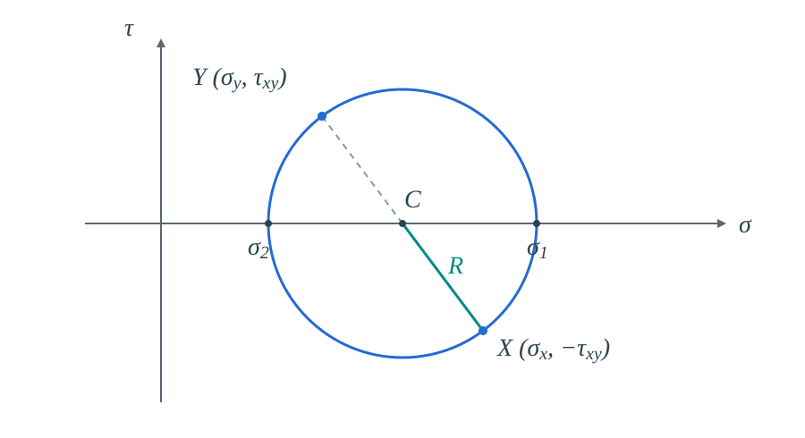

<!--
author: Matthew Blacklock
email: matthew.blacklock@northumbria.ac.uk
version: 0.0.1
mode: Presentation
import: https://raw.githubusercontent.com/MINT-the-GAP/lia-board-mode/main/README.md
        https://raw.githubusercontent.com/MINT-the-GAP/lia-annotation/main/README.md
        ../common/templates.md
comment: KB5034 Week 9 - Topic 3: stress transformations, Mohr's circle and principal stresses; before-class study.
-->

# Week 9: Stress Transformations & Principal Stresses

@moduleTitle

**Topic 3: 2D Stresses & Plane Stress Elements**

## Topic Learning Outcome

By the end of this week, students will be able to:

<br>

**3.2. Calculate** principal stresses for simple engineering structures.

## A. INDEPENDENT STUDY: Before class

**PREPARATION STARTS HERE**

In Week 8, we described the stresses acting on faces aligned with $x$ and $y$. This week, we will calculate the stresses acting on faces at other orientations through the **same material point**.

Watch the five recordings embedded on the following pages in order. There are approximately **47 minutes of video**; allow **60–75 minutes** including notes and quick checks.

Make notes on:

- How stress components change when the axes rotate.
- The normal and shear stress on an inclined face.
- How Mohr's circle represents the transformation equations.
- Principal stresses and the orientations on which shear stress is zero.

Bring your notes and a calculator to class. We will work through numerical examples, construct Mohr's circle and use failure criteria to begin analytical problem Q5.

## Video 1: Transformations of Stresses

**Approximately 7 minutes.**

@Panopto(6d7696c4-7cfc-453a-9fd2-b50300ac061b)

[Open the recording in Panopto](https://northumbria.cloud.panopto.eu/Panopto/Pages/Viewer.aspx?id=6d7696c4-7cfc-453a-9fd2-b50300ac061b)

**Look for:** The stresses at a material point can be described using different face orientations. Rotating the coordinate axes changes the normal and shear components used to describe that same physical stress state.

We measure the physical rotation angle $\theta$ **counterclockwise from $x$ to $x′$**. The $y′$ axis rotates by the same angle and remains perpendicular to $x′$.

<!-- style="width: 60%; display: block; margin: auto;" -->

Rotating the axes does not mean applying a new load or physically turning the body.

{{1}}
********************
**Quick check**

When we rotate the axes used to describe the stresses at a point, what changes?

<!-- data-solution-button="3" -->
[(X)] The normal and shear stress components associated with the chosen face orientations.
[( )] The physical loading on the body must change.
[( )] The material's Young's modulus must change.
****************************************
We are describing the same physical stress state using a different orientation. The principal stress values are unchanged by this choice of axes.
****************************************
********************

## Video 2: Summing Forces

**Approximately 6 minutes.**

@Panopto(99ebf28f-a620-480d-b1e3-b50300ac0650)

[Open the recording in Panopto](https://northumbria.cloud.panopto.eu/Panopto/Pages/Viewer.aspx?id=99ebf28f-a620-480d-b1e3-b50300ac0650)

**Look for:** Cut a small material element on an inclined plane, replace the stresses on each face by their corresponding forces and resolve those forces into the rotated directions.

For a uniform stress over a face:

$$F=\text{stress}\times\text{face area}.$$

The inclined face and the faces aligned with $x$ and $y$ generally have **different areas**. Their projected areas introduce the sine and cosine terms when we enforce equilibrium.

Normal stress acts **perpendicular to the inclined face**; shear stress acts **along that face**. Follow which direction each force is being resolved into before substituting values.

{{1}}
********************
**Quick check**

Why must the derivation account for the areas of the different faces?

<!-- data-solution-button="3" -->
[(X)] Equilibrium balances forces, so each stress must first be multiplied by the area on which it acts.
[( )] Every face of the inclined element has the same area.
[( )] Normal and shear stresses cannot act on the same inclined face.
****************************************
Stress is force per unit area. Force equilibrium must therefore use the area associated with each face, rather than simply adding stress values acting on faces of different areas.
****************************************
********************

## Video 3: Rotating Stresses

**Approximately 11 minutes.**

@Panopto(3617427c-f42c-4b0c-8b78-b50300ac0689)

[Open the recording in Panopto](https://northumbria.cloud.panopto.eu/Panopto/Pages/Viewer.aspx?id=3617427c-f42c-4b0c-8b78-b50300ac0689)

**Look for:** The transformation equations calculate $\sigma_{x′}$, $\sigma_{y′}$ and $\tau_{x′y′}$ from the known stress components and the rotation angle.

Use the Week 8 sign convention: tension is positive. On the positive $x$ face, positive $\tau_{xy}$ acts in positive $y$. Here, $\theta$ is positive counterclockwise from $x$ to $x′$.

$$\sigma_{x′}=\frac{\sigma_x+\sigma_y}{2}
+\frac{\sigma_x-\sigma_y}{2}\cos(2\theta)
+\tau_{xy}\sin(2\theta),$$

$$\sigma_{y′}=\frac{\sigma_x+\sigma_y}{2}
-\frac{\sigma_x-\sigma_y}{2}\cos(2\theta)
-\tau_{xy}\sin(2\theta),$$

$$\tau_{x′y′}=-\frac{\sigma_x-\sigma_y}{2}\sin(2\theta)
+\tau_{xy}\cos(2\theta).$$

Check that $\theta=0$ returns the original stress components. At $\theta=90^\circ$, the two normal components exchange places and the shear component changes sign.

{{1}}
********************
**Quick check**

What happens to the sum $\sigma_{x′}+\sigma_{y′}$ when the axes rotate?

<!-- data-solution-button="3" -->
[( )] It must become zero.
[(X)] It remains equal to $\sigma_x+\sigma_y$.
[( )] It always doubles.
****************************************
Adding the two normal-stress transformation equations cancels the sine and cosine terms:

$$\sigma_{x′}+\sigma_{y′}=\sigma_x+\sigma_y.$$
****************************************
********************

## Video 4: Mohr's Circle

**Approximately 12 minutes.**

@Panopto(f410d510-d838-4450-b3b7-b50300ac1546)

[Open the recording in Panopto](https://northumbria.cloud.panopto.eu/Panopto/Pages/Viewer.aspx?id=f410d510-d838-4450-b3b7-b50300ac1546)

**Look for:** Mohr's circle provides a graphical representation of the same stress transformations. Its horizontal coordinate is normal stress; its vertical coordinate represents shear with the stated plotting convention.

The centre and radius are:

$$C=\frac{\sigma_x+\sigma_y}{2},\qquad
R=\sqrt{\left(\frac{\sigma_x-\sigma_y}{2}\right)^2+\tau_{xy}^{\,2}}.$$

<!-- style="width: 80%; display: block; margin: auto;" -->

**Plotting convention:** In the diagram, the upward vertical coordinate is $-\tau$. The two face points are therefore labelled by their plotted coordinates:

$$X=(\sigma_x,-\tau_{xy}),\qquad Y=(\sigma_y,+\tau_{xy}).$$

For positive $\tau_{xy}$, $X$ lies below the horizontal axis and $Y$ lies above it. They are opposite ends of a diameter. Use this convention consistently with the element sketch.

A physical rotation of the axes through $\theta$ corresponds to a movement of **$2\theta$ around the circle**. With the plotted convention above, counterclockwise rotation of the axes corresponds to counterclockwise movement around the circle from $X$.

We will practise constructing and interpreting the circle together in class.

{{1}}
********************
**Quick check**

The physical axes rotate through $20^\circ$. What is the corresponding angular movement around Mohr's circle, in degrees?

[[40]]
****************************************
$$2\theta=2(20^\circ)=40^\circ.$$

The angle on the circle is twice the angle between the physical face orientations.
****************************************
********************

## Video 5: Principal Stresses

**Approximately 11 minutes.**

@Panopto(39c687b7-ebd7-400c-be40-b50300ac05d5)

[Open the recording in Panopto](https://northumbria.cloud.panopto.eu/Panopto/Pages/Viewer.aspx?id=39c687b7-ebd7-400c-be40-b50300ac05d5)

**Look for:** Principal stresses are the normal stresses acting on orientations where the shear stress is zero. The two in-plane principal directions are perpendicular to each other.

The principal stresses occur where Mohr's circle intersects the normal-stress axis:

$$\boxed{\sigma_1=C+R,\qquad \sigma_2=C-R.}$$

These are the maximum and minimum **in-plane normal stresses**. At the corresponding orientations, $\tau_{x′y′}=0$.

For the convention used here, the principal orientations satisfy:

$$\tan(2\theta_p)=\frac{2\tau_{xy}}{\sigma_x-\sigma_y}.$$

The two in-plane principal orientations differ by $90^\circ$. An inverse-tangent result alone does not identify which orientation carries $\sigma_1$: check the orientation using the transformation equations or Mohr's circle.

{{1}}
********************
**Quick check**

Which statement defines a principal-stress orientation?

<!-- data-solution-button="3" -->
[( )] Both the normal and shear stresses must be zero.
[(X)] Shear stress is zero and the remaining stress on the face is normal.
[( )] Normal stress is zero and only shear stress acts.
****************************************
A principal stress can be tensile, compressive or zero. It is the **absence of shear stress on that orientation** that defines a principal plane.
****************************************
********************

## Equation Reference

Use the sign convention stated on the video pages. For the in-plane stress components:

$$C=\frac{\sigma_x+\sigma_y}{2},\qquad
R=\sqrt{\left(\frac{\sigma_x-\sigma_y}{2}\right)^2+\tau_{xy}^{\,2}}.$$

**In-plane principal stresses**

$$\sigma_1=C+R,\qquad \sigma_2=C-R.$$

$$\tan(2\theta_p)=\frac{2\tau_{xy}}{\sigma_x-\sigma_y}.$$

**Maximum in-plane shear-stress magnitude**

$$\boxed{\tau_{\max,\mathrm{in\text{-}plane}}=R.}$$

The normal stress on these maximum-in-plane-shear orientations is $C$. They lie $45^\circ$ from the in-plane principal directions.

**Remember the third direction:** For plane stress, the through-thickness principal stress is zero. Here, $\sigma_1$ and $\sigma_2$ label the two **in-plane** values; zero is not necessarily the smallest of the three principal stresses. The absolute maximum shear stress in three dimensions can therefore differ from the maximum **in-plane** shear stress. We will return to this when discussing failure criteria in class.

## Before-class Completion Check

- [ ] I have watched all five recordings and made notes.
- [ ] I can explain why rotating the axes changes stress components without changing the physical stress state.
- [ ] I can identify normal and shear stresses acting on an inclined face.
- [ ] I can use the transformation equations with a consistent sign and angle convention.
- [ ] I can identify the centre, radius and face points on Mohr's circle.
- [ ] I understand the difference between the physical angle $\theta$ and the circle angle $2\theta$.
- [ ] I can calculate the two in-plane principal stresses and explain why shear stress is zero on principal planes.

Bring your notes and a calculator to class. We will use these ideas in numerical examples and then introduce von Mises stress and factor of safety for Q5.

## Further reading

@FurtherReading

@ReadingBook(@BeerBook,@BeerLibrary,```
- **Chapter 7:** Transformation of plane stress, principal stresses and Mohr's circle.
```)
