<!--
author: Matthew Blacklock
email: matthew.blacklock@northumbria.ac.uk
version: 0.0.1
mode: Presentation
import: https://raw.githubusercontent.com/MINT-the-GAP/lia-board-mode/main/README.md
        https://raw.githubusercontent.com/MINT-the-GAP/lia-annotation/main/README.md
        ../common/templates.md
comment: KB5034 Week 9 - Topic 3: stress transformations, Mohr's circle and principal stresses; before-class study.

@Week09Solution: <div class="week09-post-class" style="display: none;" hidden>
-->

# Week 9: Stress Transformations & Principal Stresses

@moduleTitle

**Topic 3: 2D Stresses & Plane Stress Elements**

## Topic Learning Outcome

By the end of this week, students will be able to:

<br>

**3.2. Calculate** principal stresses for simple engineering structures.

## A. INDEPENDENT STUDY: Before class

**PREPARATION STARTS HERE**

In Week 8, we described the stresses acting on faces aligned with $x$ and $y$. This week, we will calculate the stresses acting on faces at other orientations through the **same material point**.

Make notes on:

- How stress components change when the axes rotate.
- The normal and shear stress on an inclined face.
- How Mohr's circle represents the transformation equations.
- Principal stresses and the orientations on which shear stress is zero.

Bring your notes and a calculator to class. We will work through numerical examples, construct Mohr's circle and use failure criteria to begin analytical problem Q5.

## Video 1: Transformations of Stresses

**Approximately 7 minutes.**

@Panopto(6d7696c4-7cfc-453a-9fd2-b50300ac061b)

[Open the recording in Panopto](https://northumbria.cloud.panopto.eu/Panopto/Pages/Viewer.aspx?id=6d7696c4-7cfc-453a-9fd2-b50300ac061b)

**Look for:** The stresses at a material point can be described using different face orientations. Rotating the coordinate axes changes the normal and shear components used to describe that same physical stress state.

We measure the physical rotation angle $\theta$ **counterclockwise from $x$ to $x′$**. The $y′$ axis rotates by the same angle and remains perpendicular to $x′$.

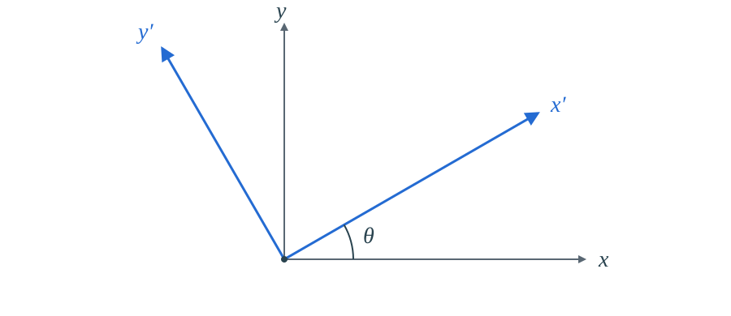<!-- style="width: 60%; display: block; margin: auto;" -->

Rotating the axes does not mean applying a new load or physically turning the body.

{{1}}
********************
**Quick check**

When we rotate the axes used to describe the stresses at a point, what changes?

<!-- data-solution-button="3" -->
[(X)] The normal and shear stress components associated with the chosen face orientations.
[( )] The physical loading on the body must change.
[( )] The material's Young's modulus must change.
****************************************
We are describing the same physical stress state using a different orientation. The principal stress values are unchanged by this choice of axes.
****************************************
********************

## Video 2: Summing Forces

**Approximately 6 minutes.**

@Panopto(99ebf28f-a620-480d-b1e3-b50300ac0650)

[Open the recording in Panopto](https://northumbria.cloud.panopto.eu/Panopto/Pages/Viewer.aspx?id=99ebf28f-a620-480d-b1e3-b50300ac0650)

**Look for:** Cut a small material element on an inclined plane, replace the stresses on each face by their corresponding forces and resolve those forces into the rotated directions.

For a uniform stress over a face:

$$F=\text{stress}\times\text{face area}.$$

The inclined face and the faces aligned with $x$ and $y$ generally have **different areas**. Their projected areas introduce the sine and cosine terms when we enforce equilibrium.

Normal stress acts **perpendicular to the inclined face**; shear stress acts **along that face**. Follow which direction each force is being resolved into before substituting values.

{{1}}
********************
**Quick check**

Why must the derivation account for the areas of the different faces?

<!-- data-solution-button="3" -->
[(X)] Equilibrium balances forces, so each stress must first be multiplied by the area on which it acts.
[( )] Every face of the inclined element has the same area.
[( )] Normal and shear stresses cannot act on the same inclined face.
****************************************
Stress is force per unit area. Force equilibrium must therefore use the area associated with each face, rather than simply adding stress values acting on faces of different areas.
****************************************
********************

## Video 3: Rotating Stresses

**Approximately 11 minutes.**

@Panopto(3617427c-f42c-4b0c-8b78-b50300ac0689)

[Open the recording in Panopto](https://northumbria.cloud.panopto.eu/Panopto/Pages/Viewer.aspx?id=3617427c-f42c-4b0c-8b78-b50300ac0689)

**Look for:** The transformation equations calculate $\sigma_{x′}$, $\sigma_{y′}$ and $\tau_{x′y′}$ from the known stress components and the rotation angle.

Use the Week 8 sign convention: tension is positive. On the positive $x$ face, positive $\tau_{xy}$ acts in positive $y$. Here, $\theta$ is positive counterclockwise from $x$ to $x′$.

$$\sigma_{x′}=\frac{\sigma_x+\sigma_y}{2}
+\frac{\sigma_x-\sigma_y}{2}\cos(2\theta)
+\tau_{xy}\sin(2\theta),$$

$$\sigma_{y′}=\frac{\sigma_x+\sigma_y}{2}
-\frac{\sigma_x-\sigma_y}{2}\cos(2\theta)
-\tau_{xy}\sin(2\theta),$$

$$\tau_{x′y′}=-\frac{\sigma_x-\sigma_y}{2}\sin(2\theta)
+\tau_{xy}\cos(2\theta).$$

Check that $\theta=0$ returns the original stress components. At $\theta=90^\circ$, the two normal components exchange places and the shear component changes sign.

{{1}}
********************
**Quick check**

What happens to the sum $\sigma_{x′}+\sigma_{y′}$ when the axes rotate?

<!-- data-solution-button="3" -->
[( )] It must become zero.
[(X)] It remains equal to $\sigma_x+\sigma_y$.
[( )] It always doubles.
****************************************
Adding the two normal-stress transformation equations cancels the sine and cosine terms:

$$\sigma_{x′}+\sigma_{y′}=\sigma_x+\sigma_y.$$
****************************************
********************

## Video 4: Mohr's Circle

**Approximately 12 minutes.**

@Panopto(f410d510-d838-4450-b3b7-b50300ac1546)

[Open the recording in Panopto](https://northumbria.cloud.panopto.eu/Panopto/Pages/Viewer.aspx?id=f410d510-d838-4450-b3b7-b50300ac1546)

<div class="video-correction" style="background: #fff4df; color: #29434f; border: 1px solid #e6bf83; border-left: 5px solid #d28a20; border-radius: 6px; padding: 1rem 1.25rem; margin: 1.5rem 0;">

**Correction to Video 4 (1:25)**

The intermediate squared equations in the recording omit the cross terms. The final equation of Mohr's circle is correct.

Write $\sigma_{\mathrm{ave}}=(\sigma_x+\sigma_y)/2$ and let:

$$A=\frac{\sigma_x-\sigma_y}{2},\qquad B=\tau_{xy}.$$

The transformation equations become:

$$\begin{aligned}
\sigma_{x'}-\sigma_{\mathrm{ave}}&=A\cos(2\theta)+B\sin(2\theta),\\
\tau_{x'y'}&=-A\sin(2\theta)+B\cos(2\theta).
\end{aligned}$$

Squaring each equation gives:

**Equation 1**

$$\begin{aligned}
(\sigma_{x'}-\sigma_{\mathrm{ave}})^2
={}&A^2\cos^2(2\theta)\\
&\boxed{+2AB\sin(2\theta)\cos(2\theta)}\\
&+B^2\sin^2(2\theta).
\end{aligned}$$

**Equation 2**

$$\begin{aligned}
\tau_{x'y'}^2
={}&A^2\sin^2(2\theta)\\
&\boxed{-2AB\sin(2\theta)\cos(2\theta)}\\
&+B^2\cos^2(2\theta).
\end{aligned}$$

The boxed cross terms have opposite signs. They cancel **when the two squared equations are added**, not when each equation is squared individually. Using $\sin^2(2\theta)+\cos^2(2\theta)=1$ gives:

$$\boxed{(\sigma_{x'}-\sigma_{\mathrm{ave}})^2+\tau_{x'y'}^2
=A^2+B^2
=\left(\frac{\sigma_x-\sigma_y}{2}\right)^2+\tau_{xy}^2.}$$

</div>

**Look for:** Mohr's circle provides a graphical representation of the same stress transformations. Its horizontal coordinate is normal stress; its vertical coordinate represents shear with the stated plotting convention.

The centre and radius are:

$$C=\frac{\sigma_x+\sigma_y}{2},\qquad
R=\sqrt{\left(\frac{\sigma_x-\sigma_y}{2}\right)^2+\tau_{xy}^{\,2}}.$$

<!-- style="width: 80%; display: block; margin: auto;" -->

**Plotting convention:** The vertical axis is labelled $\tau$, with positive plotted shear upwards. Clockwise shear tendency on an individual face is plotted above the horizontal axis; anticlockwise shear tendency is plotted below it. Determine the sign by considering the shear acting on each individual face. The face-point coordinates are:

$$X=(\sigma_x,-\tau_{xy}),\qquad Y=(\sigma_y,+\tau_{xy}).$$

For positive $\tau_{xy}$, $X$ lies below the horizontal axis and $Y$ lies above it. They are opposite ends of a diameter. Use this convention consistently with the element sketch.

A physical rotation of the axes through $\theta$ corresponds to a movement of **$2\theta$ around the circle**. With the plotted convention above, counterclockwise rotation of the axes corresponds to counterclockwise movement around the circle from $X$.

We will practise constructing and interpreting the circle together in class.

{{1}}
********************
**Quick check**

The physical axes rotate through $20^\circ$. What is the corresponding angular movement around Mohr's circle, in degrees?

[[40]]
****************************************
$$2\theta=2(20^\circ)=40^\circ.$$

The angle on the circle is twice the angle between the physical face orientations.
****************************************
********************

## Video 5: Principal Stresses

**Approximately 11 minutes.**

@Panopto(39c687b7-ebd7-400c-be40-b50300ac05d5)

[Open the recording in Panopto](https://northumbria.cloud.panopto.eu/Panopto/Pages/Viewer.aspx?id=39c687b7-ebd7-400c-be40-b50300ac05d5)

**Look for:** Principal stresses are the normal stresses acting on orientations where the shear stress is zero. The two in-plane principal directions are perpendicular to each other.

The principal stresses occur where Mohr's circle intersects the normal-stress axis:

$$\boxed{\sigma_1=C+R,\qquad \sigma_2=C-R.}$$

These are the maximum and minimum **in-plane normal stresses**. At the corresponding orientations, $\tau_{x′y′}=0$.

For the convention used here, the principal orientations satisfy:

$$\tan(2\theta_p)=\frac{2\tau_{xy}}{\sigma_x-\sigma_y}.$$

The two in-plane principal orientations differ by $90^\circ$. An inverse-tangent result alone does not identify which orientation carries $\sigma_1$: check the orientation using the transformation equations or Mohr's circle.

{{1}}
********************
**Quick check**

Which statement defines a principal-stress orientation?

<!-- data-solution-button="3" -->
[( )] Both the normal and shear stresses must be zero.
[(X)] Shear stress is zero and the remaining stress on the face is normal.
[( )] Normal stress is zero and only shear stress acts.
****************************************
A principal stress can be tensile, compressive or zero. It is the **absence of shear stress on that orientation** that defines a principal plane.
****************************************
********************

## Equation Reference

Use the sign convention stated on the video pages. For the in-plane stress components:

$$C=\frac{\sigma_x+\sigma_y}{2},\qquad
R=\sqrt{\left(\frac{\sigma_x-\sigma_y}{2}\right)^2+\tau_{xy}^{\,2}}.$$

**In-plane principal stresses**

$$\sigma_1=C+R,\qquad \sigma_2=C-R.$$

$$\tan(2\theta_p)=\frac{2\tau_{xy}}{\sigma_x-\sigma_y}.$$

**Maximum in-plane shear-stress magnitude**

$$\boxed{\tau_{\max,\mathrm{in\text{-}plane}}=R.}$$

The normal stress on these maximum-in-plane-shear orientations is $C$. They lie $45^\circ$ from the in-plane principal directions.

**Remember the third direction:** For plane stress, the through-thickness principal stress is zero. Here, $\sigma_1$ and $\sigma_2$ label the two **in-plane** values; zero is not necessarily the smallest of the three principal stresses. The absolute maximum shear stress in three dimensions can therefore differ from the maximum **in-plane** shear stress. We will return to this when discussing failure criteria in class.

## Before-class Completion Check

- [ ] I have watched all five recordings and made notes.
- [ ] I can explain why rotating the axes changes stress components without changing the physical stress state.
- [ ] I can identify normal and shear stresses acting on an inclined face.
- [ ] I can use the transformation equations with a consistent sign and angle convention.
- [ ] I can identify the centre, radius and face points on Mohr's circle.
- [ ] I understand the difference between the physical angle $\theta$ and the circle angle $2\theta$.
- [ ] I can calculate the two in-plane principal stresses and explain why shear stress is zero on principal planes.

Bring your notes and a calculator to class. We will use these ideas in numerical examples and then introduce von Mises stress and factor of safety for Q5.

## B. IN CLASS: Applying Stress Transformations and Failure Criteria

**LECTORIAL STARTS HERE**

<br>

**Learning Outcome 3.2: Calculate principal stresses for simple engineering structures.**

## Retrieval: Stress Transformations

**1. Does rotating the coordinate axes change the physical stress state at a point?**

<!-- data-solution-button="3" -->
[( )] Yes
[(X)] No
****************************************
We describe the same physical stress state using different face orientations. The component values can change; the principal stresses do not.
****************************************

{{1}}
********************
**2. What is the shear stress on a principal plane?**

<!-- data-solution-button="3" -->
[(X)] Zero
[( )] The maximum in-plane shear stress
[( )] Equal to the normal stress
****************************************
Principal planes carry normal stress and no shear stress. The normal stress itself may be tensile, compressive or zero.
****************************************
********************

{{2}}
********************
**3. The physical axes rotate through 30°. What is the angular movement around Mohr's circle, in degrees?**

<!-- data-solution-button="3" -->
[[60]]
****************************************
The circle angle is twice the physical angle: $2\theta=60^\circ$. With our plotting convention, a counterclockwise physical rotation corresponds to counterclockwise movement around the circle from $X$.
****************************************
********************

## Problem: Principal Stresses and Orientations

**About 30 minutes.** Begin individually, then compare equations, signs and angles with a neighbour.

The point is in plane stress:

$$\sigma_x=60\text{ MPa},\qquad \sigma_y=40\text{ MPa},\qquad \tau_{xy}=20\text{ MPa}.$$

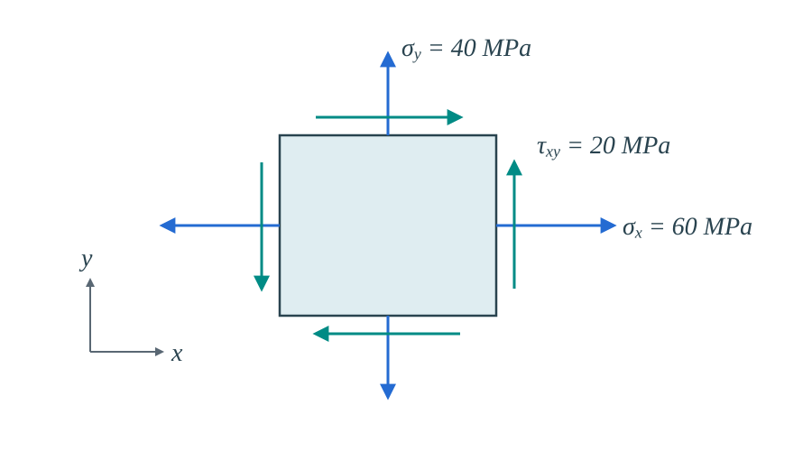<!-- style="width: 85%; display: block; margin: auto;" -->

1. Calculate the two in-plane principal stresses.
2. Determine the two principal orientations, identifying which carries the larger normal stress.
3. Calculate the maximum **in-plane** shear-stress magnitude.
4. Find both orientations of maximum in-plane shear and give the sign of $\tau_{x'y'}$ at each.
5. Sketch the principal element. Subsequently, construct Mohr's circle to check your results.

Measure all physical angles counterclockwise from $x$ to $x'$. Equivalent orientations differing by 180° are acceptable. Why are the two principal planes perpendicular?

@Week09Solution
<details>
<summary><strong>Reveal worked solution</strong></summary>

<details>
<summary>1. Centre, radius and principal stresses</summary>

$$C=\frac{60+40}{2}=50\text{ MPa},\qquad R=\sqrt{\left(\frac{60-40}{2}\right)^2+20^2}=\sqrt{500}=22.3607\text{ MPa}.$$

$$\sigma_1=C+R=\boxed{72.36\text{ MPa}},\qquad \sigma_2=C-R=\boxed{27.64\text{ MPa}}.$$

These labels refer to the two in-plane principal stresses. The third principal stress is zero.

</details>

<details>
<summary>2. Principal orientations</summary>

$$\tan(2\theta_p)=\frac{2\tau_{xy}}{\sigma_x-\sigma_y}=\frac{40}{20}=2.$$

$$\theta_{p1}=\boxed{31.72^\circ},\qquad \theta_{p2}=\theta_{p1}+90^\circ=\boxed{121.72^\circ}.$$

Substitution into the transformation equations gives $\sigma_{x'}=72.36\text{ MPa}$ and $\tau_{x'y'}=0$ at 31.72°. At 121.72°, $\sigma_{x'}=27.64\text{ MPa}$ and the shear stress is again zero. The two perpendicular directions are the principal directions of the same stress state.

</details>

<details>
<summary>3. Maximum in-plane shear and orientations</summary>

$$\left|\tau_{\max,\mathrm{in\text{-}plane}}\right|=R=\boxed{22.36\text{ MPa}}.$$

The maximum-shear orientations are 45° from the principal orientations:

$$\theta_{s+}=\theta_{p1}-45^\circ=\boxed{-13.28^\circ},\qquad \theta_{s-}=\theta_{p1}+45^\circ=\boxed{76.72^\circ}.$$

At −13.28°, $\tau_{x'y'}=+22.36\text{ MPa}$; at 76.72°, $\tau_{x'y'}=-22.36\text{ MPa}$. In both cases $\sigma_{x'}=C=50\text{ MPa}$. An angle of −13.28° means 13.28° clockwise.

The absolute three-dimensional maximum shear is different here: including the third principal stress of zero gives $(72.36-0)/2=36.18\text{ MPa}$. Use the in-plane value for the question asked; include all three principal stresses when applying Tresca later.

</details>

</details>
</div>

## Constructing Mohr's Circle: Which Way Does Shear Plot?

This page and the following two activities share **about 25 minutes**. Follow the guided construction in your notes, then use it on the second problem.

Consider the shear acting on **each individual face**, and its tendency to turn the element about its centre:

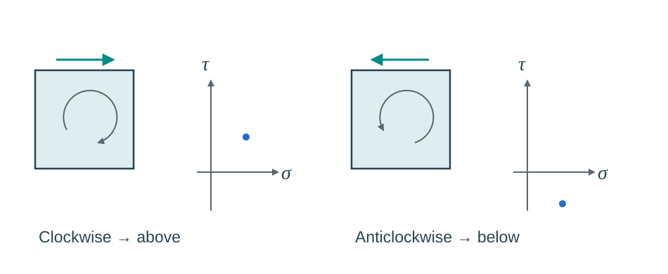<!-- style="width: 100%; display: block; margin: auto;" -->

- Clockwise tendency plots **above** the horizontal axis.
- Anticlockwise tendency plots **below** the horizontal axis.

The vertical plotting axis is labelled $\tau$, positive upwards. For the positive tensor shear $\tau_{xy}$ shown on the problem's element:

$$X=(\sigma_x,-\tau_{xy}),\qquad Y=(\sigma_y,+\tau_{xy}).$$

Do not assign the plotted sign from the arrow's direction alone: a face's position also determines whether its shear tendency is clockwise or anticlockwise.

## Guided Construction: From Face Points to the Circle

Use the **60, 40, 20 MPa** problem. Keep the same scale for normal and plotted shear stress.

{{0-1}}
********************
**1. Draw the axes.** Label normal stress $\sigma$ horizontally and plotted shear $\tau$ vertically. Mark the scale in MPa.

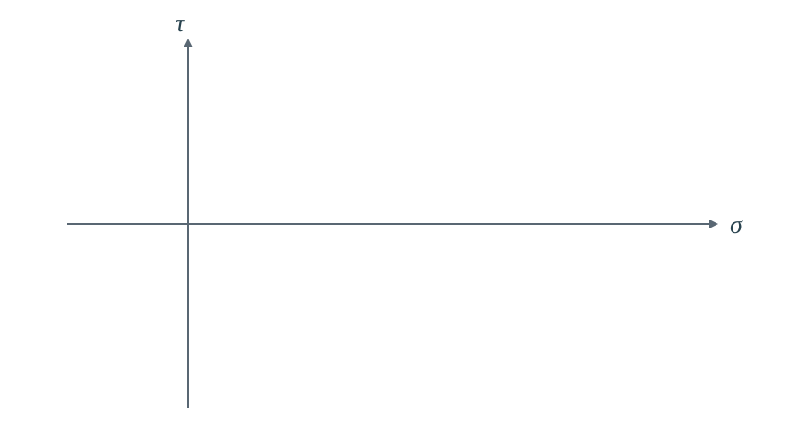<!-- style="width: 80%; display: block; margin: auto;" -->
********************

{{1-2}}
********************
**2. Plot the two face points.** For this problem, $X=(60,-20)$ and $Y=(40,+20)$ MPa. Join them: they are opposite ends of a diameter. Find their midpoint on the normal-stress axis.

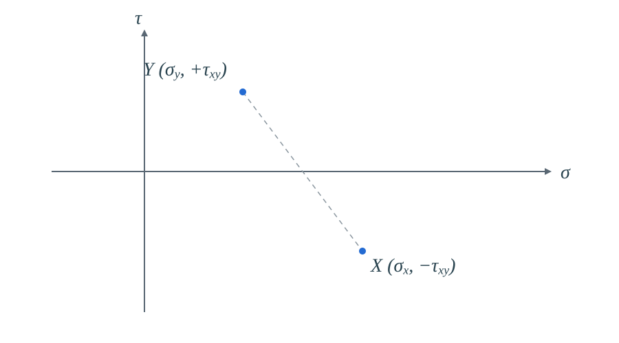<!-- style="width: 80%; display: block; margin: auto;" -->
********************

{{2}}
********************
**3. Draw the circle.** Use the midpoint as centre $C$ and the distance to either face point as radius $R$. Read the principal stresses at the horizontal intercepts and the maximum in-plane shear magnitude at the top and bottom.

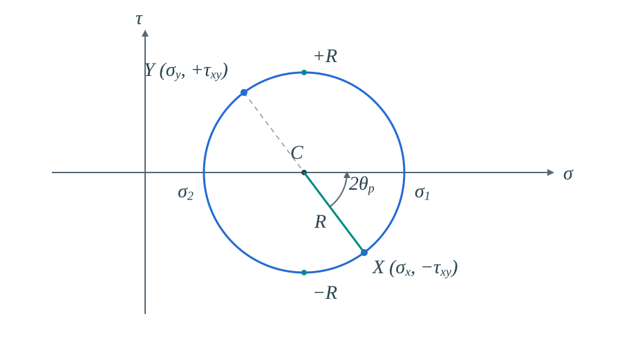<!-- style="width: 80%; display: block; margin: auto;" -->

The top has plotted shear $+R$; for the rotated $x'$ face this corresponds to tensor shear $\tau_{x'y'}=-R$. The bottom corresponds to $\tau_{x'y'}=+R$.

**4. Read the angle.** Move counterclockwise from $X$ to the right-hand intercept through $2\theta_{p1}$. Halve this angle to obtain the physical counterclockwise rotation of the $x'$ axis. Do the same for a shear extremum and check the sign.
********************

@Week09Solution
<details>
<summary><strong>Reveal the numerical construction</strong></summary>

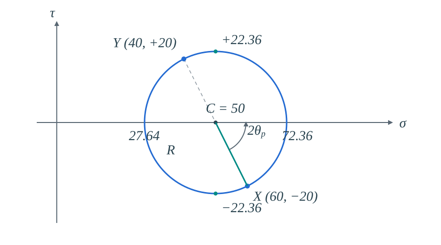<!-- style="width: 85%; display: block; margin: auto;" -->

$C=50\text{ MPa}$, $R=22.36\text{ MPa}$. The intercepts are 27.64 MPa and 72.36 MPa. From $X$ to the right-hand intercept, $2\theta_{p1}=63.43^\circ$, giving $\theta_{p1}=31.72^\circ$ counterclockwise.

From $X$ to the lower shear extremum is a clockwise circle movement of 26.57°, so the physical angle is −13.28° and $\tau_{x'y'}=+22.36\text{ MPa}$. The other shear orientation is 76.72° with $\tau_{x'y'}=-22.36\text{ MPa}$.

</details>
</div>

## Problem: Solve Using Mohr's Circle

Use a **graphical construction first**. Read values and angles from your circle before checking them algebraically.

$$\sigma_x=50\text{ MPa},\qquad \sigma_y=-10\text{ MPa},\qquad \tau_{xy}=40\text{ MPa}.$$

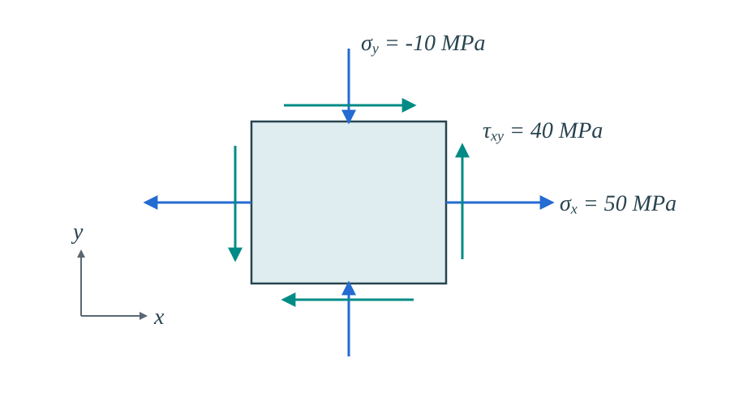<!-- style="width: 85%; display: block; margin: auto;" -->

Determine:

1. The centre and radius of Mohr's circle.
2. Both in-plane principal stresses and their physical orientations.
3. The maximum in-plane shear magnitude and both corresponding orientations, including the shear sign.
4. The normal stress on a maximum-in-plane-shear plane.

Compare your circle with your neighbour's. If your principal angle differs, check the starting face point, plotted shear sign and direction of rotation before changing the calculation.

@Week09Solution
<details>
<summary><strong>Reveal worked solution</strong></summary>

<details>
<summary>1. Face points, centre and radius</summary>

$$X=(50,-40),\qquad Y=(-10,+40)\quad\text{MPa}.$$

$$C=\frac{50-10}{2}=\boxed{20\text{ MPa}},\qquad R=\sqrt{(50-20)^2+40^2}=\boxed{50\text{ MPa}}.$$

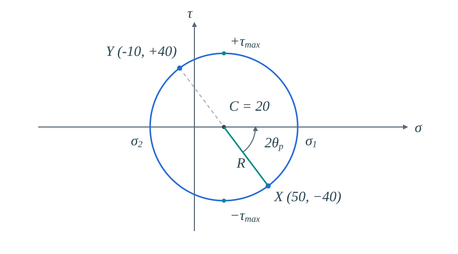<!-- style="width: 85%; display: block; margin: auto;" -->

</details>

<details>
<summary>2. Principal stresses and physical angles</summary>

The horizontal intercepts give:

$$\sigma_1=C+R=\boxed{70\text{ MPa}},\qquad \sigma_2=C-R=\boxed{-30\text{ MPa}}.$$

The radius from $C$ to $X$ has a horizontal offset of 30 MPa and a downward offset of 40 MPa. The counterclockwise circle angle from $X$ to the right-hand intercept is:

$$2\theta_{p1}=\tan^{-1}\left(\frac{40}{30}\right)=53.13^\circ.$$

Thus $\theta_{p1}=\boxed{26.57^\circ}$ carries 70 MPa, and $\theta_{p2}=\boxed{116.57^\circ}$ carries −30 MPa. Both are measured counterclockwise from $x$.

</details>

<details>
<summary>3. Maximum in-plane shear and its orientations</summary>

$$\left|\tau_{\max,\mathrm{in\text{-}plane}}\right|=R=\boxed{50\text{ MPa}}.$$

The lower circle point gives positive tensor shear at $\theta_{s+}=26.565^\circ-45^\circ=\boxed{-18.43^\circ}$. The upper point gives negative tensor shear at $\theta_{s-}=26.565^\circ+45^\circ=\boxed{71.57^\circ}$.

Therefore $\tau_{x'y'}=+50\text{ MPa}$ at −18.43° and −50 MPa at 71.57°. The normal stress on either maximum-in-plane-shear plane is $\boxed{20\text{ MPa}}$.

Here the third principal stress, zero, lies between 70 and −30 MPa. Consequently the absolute three-dimensional maximum shear also equals 50 MPa.

</details>

</details>
</div>

## Break

**10 minutes**

## Failure Criteria: Ductile Yielding and Brittle Fracture

**About 25 minutes across the failure-criteria pages.** Principal stresses tell us the normal stresses on planes without shear. A failure criterion combines the stress state with material strength to predict a limiting condition.

**Ductile materials**, such as many steels, can undergo substantial plastic deformation. We usually check the **onset of yielding**, using Tresca or von Mises.

**Brittle materials** can fracture with little plastic deformation. A normal tensile stress can open cracks; tensile and compressive strengths may differ substantially. A maximum-normal-stress criterion is a simple fracture model.

We will use $\sigma_Y$ for the material's uniaxial tensile yield strength. This is a material property, distinct from the stress component $\sigma_y$.

## Tresca: Maximum Shear Stress Criterion

Tresca predicts yielding when the **absolute maximum shear stress** reaches the maximum shear stress at yield in a uniaxial tensile test, $\sigma_Y/2$.

Include **all three principal stresses**, even for plane stress:

$$\tau_{\max,\mathrm{absolute}}=\frac{\sigma_{\mathrm{largest}}-\sigma_{\mathrm{smallest}}}{2},\qquad \sigma_3=0\text{ for plane stress}.$$

The Tresca equivalent stress is:

$$\sigma_{\mathrm{T}}=\max\left(|\sigma_1-\sigma_2|,|\sigma_2-\sigma_3|,|\sigma_3-\sigma_1|\right).$$

Yielding is predicted when $\boxed{\sigma_{\mathrm{T}}\geq\sigma_Y}$. For plane stress, this is $\max(|\sigma_1-\sigma_2|,|\sigma_1|,|\sigma_2|)\geq\sigma_Y$.

If both in-plane principal stresses are tensile, zero is the smallest principal stress. If both are compressive, zero is the largest. If they have opposite signs, zero lies between them. This is why using only the in-plane circle radius can give the wrong Tresca check.

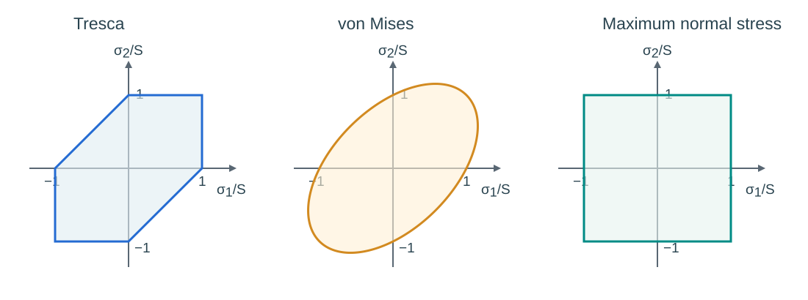<!-- style="width: 100%; display: block; margin: auto;" -->

Read the **left-hand hexagon**: inside is below the Tresca yield limit; the boundary is the predicted onset of yielding. The coordinates are the two in-plane principal stresses divided by $S=\sigma_Y$, with the third principal stress zero.

## Von Mises: Distortion Energy Criterion

Von Mises combines the stress components into an **equivalent stress**. Yielding is associated with the energy of shape change, rather than uniform volume change. Equal hydrostatic normal stresses therefore do not contribute to this equivalent stress.

In principal stresses:

$$\sigma_{\mathrm{VM}}=\sqrt{\frac{(\sigma_1-\sigma_2)^2+(\sigma_2-\sigma_3)^2+(\sigma_3-\sigma_1)^2}{2}}.$$

For general plane stress:

$$\boxed{\sigma_{\mathrm{VM}}=\sqrt{\sigma_x^2-\sigma_x\sigma_y+\sigma_y^2+3\tau_{xy}^2}.}$$

Yielding is predicted when $\boxed{\sigma_{\mathrm{VM}}\geq\sigma_Y}$. The stress and strength must use the same units.

<!-- style="width: 100%; display: block; margin: auto;" -->

The **middle ellipse** is the plane-stress von Mises yield boundary: inside is below yield, on the boundary is the predicted onset of yielding. In in-plane principal coordinates its equation is $\sigma_1^2-\sigma_1\sigma_2+\sigma_2^2=\sigma_Y^2$, with $S=\sigma_Y$ in the diagram.

## Brittle Materials: Maximum Normal Stress Criterion

The maximum-normal-stress criterion compares tensile and compressive principal stresses separately with the material's corresponding fracture strengths. Let $\sigma_{\mathrm{ut}}>0$ and $\sigma_{\mathrm{uc}}>0$ denote those strength magnitudes.

Fracture is predicted if either limit is reached:

$$\boxed{\sigma_{\mathrm{largest}}\geq\sigma_{\mathrm{ut}}\quad\text{or}\quad \sigma_{\mathrm{smallest}}\leq-\sigma_{\mathrm{uc}}.}$$

This is a **fracture** check, rather than a ductile-yield check. It represents crack opening under tensile normal stress and a separate compressive limit; it is a simple approximation whose suitability depends on the material and loading.

<!-- style="width: 100%; display: block; margin: auto;" -->

The **right-hand square** illustrates equal tensile and compressive strength $S$. Different strengths give different positive and negative intercepts; do not assume a real brittle material has equal tensile and compressive strengths.

## Comparing Failure Criteria

Tresca and von Mises agree in uniaxial tension but differ for other combinations of principal stresses. The Tresca boundary lies within or on the von Mises boundary, so Tresca is at least as conservative for the same yield strength. Maximum normal stress is a different model of failure, rather than a substitute chosen because its calculation is shorter.

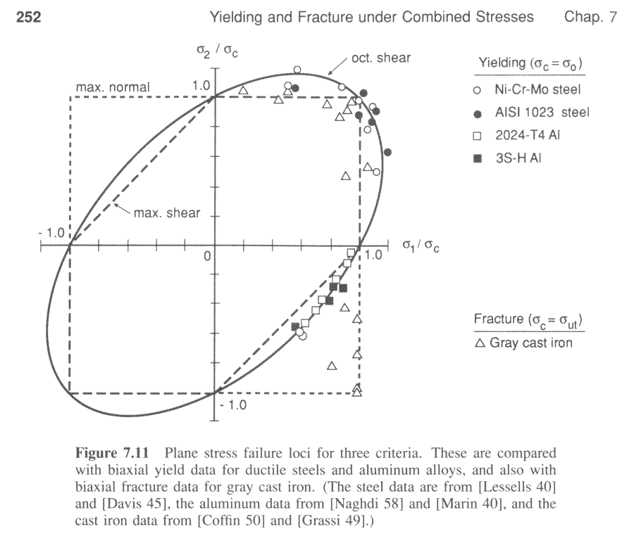<!-- style="width: 75%; display: block; margin: auto;" -->

The original comparison figure shows experimental data against proposed boundaries. Choose a criterion to match **material behaviour and the failure mode**. Source: Dowling, *Mechanical Behavior of Materials* (1993), reproduced in the original Week 9 presentation.

**A ductile steel component is being checked for the onset of yielding under combined stress. Which choice is appropriate? Explain your reasoning before checking.**

<!-- data-solution-button="3" -->
[(X)] Von Mises or Tresca, with a justified choice
[( )] Maximum normal stress, without considering material behaviour
[( )] Compare only the larger in-plane shear component with the tensile strength
****************************************
Von Mises and Tresca are ductile-yield criteria. Von Mises commonly represents ductile-metal yielding well; Tresca provides a more conservative alternative. Use the applicable material evidence or design requirement to justify the choice. Include the third principal stress in a Tresca calculation.
****************************************

## Problem: Von Mises Stress and Factor of Safety

**About 30 minutes, including the Q5 preparation on the following page.** Return to the original stress state:

$$\sigma_x=60\text{ MPa},\qquad\sigma_y=40\text{ MPa},\qquad\tau_{xy}=20\text{ MPa},\qquad\sigma_Y=250\text{ MPa}.$$

<!-- style="width: 80%; display: block; margin: auto;" -->

1. Predict whether yielding is likely, and explain your initial judgement.
2. Calculate $\sigma_{\mathrm{VM}}$ using the plane-stress equation.
3. Determine the factor of safety against first yield, $n=\sigma_Y/\sigma_{\mathrm{VM}}$.
4. State whether yielding is predicted. Explain what the factor of safety means if the stress components all scale proportionally with load.

Compare with a neighbour before looking for feedback. An individual component being below 250 MPa does not by itself establish that the combined stress state is below yield.

@Week09Solution
<details>
<summary><strong>Reveal worked solution</strong></summary>

<details>
<summary>1. Equivalent stress</summary>

$$\sigma_{\mathrm{VM}}=\sqrt{60^2-60(40)+40^2+3(20)^2}=\sqrt{4000}=\boxed{63.25\text{ MPa}}.$$

As an independent check, the principal stresses 72.3607, 27.6393 and 0 MPa give the same equivalent stress in the three-principal-stress equation.

</details>

<details>
<summary>2. Factor of safety and interpretation</summary>

$$n=\frac{\sigma_Y}{\sigma_{\mathrm{VM}}}=\frac{250}{63.2456}=\boxed{3.95}.$$

Since $\sigma_{\mathrm{VM}}<\sigma_Y$, **yielding is not predicted**. Under proportional loading and the same linear-elastic assumptions, the load could be multiplied by about 3.95 before this criterion predicts first yield. This is a margin against yielding, not a prediction of fracture load or a check of every possible failure mode.

</details>

</details>
</div>

## Preparing for Analytical Problem Q5

Q5 asks you to calculate the **von Mises factor of safety** for your own randomised plane-stress state and material yield strength.

Use your current Blackboard question for the values, sign conventions, required precision and deadline. The in-class example practises the same method; its numerical values are not your assessed answer.

Before working independently, identify the supplied $\sigma_x$, $\sigma_y$, $\tau_{xy}$ and $\sigma_Y$. Keep stress and strength in consistent units, retain signed normal stresses in the $-\sigma_x\sigma_y$ term, and record your substitutions before calculating $n$.

Begin the setup in class and ask for help with any sign or unit uncertainty. Keep your own workings for the analytical portfolio. No randomised Q5 values or answer are reproduced here.

## Optional Extension: Adhesive Strength of a Scarf Joint

**About 20 minutes, if time permits.** Two members of cross-section **80 × 10 mm** are glued along an inclined plane and subjected to tensile load $P$.

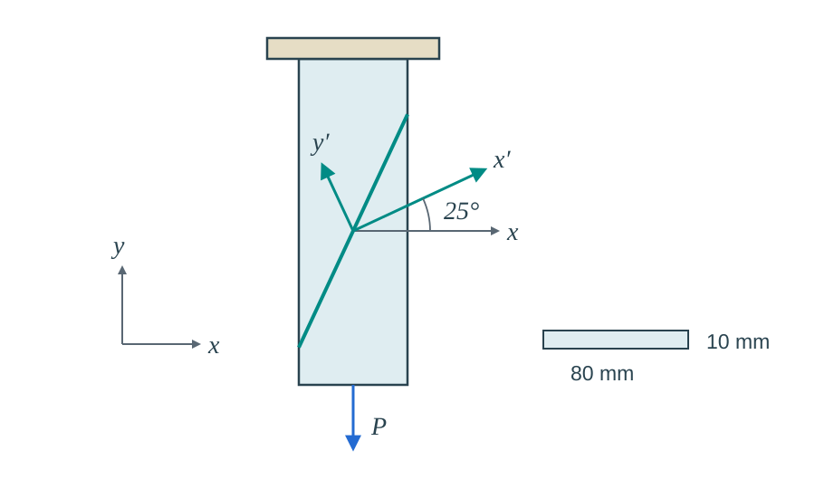<!-- style="width: 80%; display: block; margin: auto;" -->

The angle is **25° from the horizontal $x$ axis to the joint's normal $x'$**. The adhesive plane itself is therefore 65° to horizontal. The member is loaded in $y$; $y'$ is along the adhesive plane.

The allowable adhesive normal stress is **800 kPa**, and the allowable shear-stress magnitude is **600 kPa**.

1. Write the original stress state in $x,y$ using $A=80(10)\text{ mm}^2$.
2. Calculate the transformed normal and shear stresses on the adhesive plane as functions of $P$.
3. Determine the load permitted by each adhesive limit.
4. Select the maximum load satisfying **both** limits and identify which governs.

Treat the stresses as nominal values; neglect local end and joint-edge effects for this exercise.

@Week09Solution
<details>
<summary><strong>Reveal worked solution</strong></summary>

<details>
<summary>1. Stress state and transformation</summary>

With $P$ in N, $A=800\text{ mm}^2$ gives stresses in MPa:

$$\sigma_x=0,\qquad\sigma_y=\frac{P}{800},\qquad\tau_{xy}=0,\qquad\theta=25^\circ.$$

The transformed normal stress is:

$$\sigma_{x'}=\frac{P}{1600}-\frac{P}{1600}\cos50^\circ=\frac{P}{800}\sin^225^\circ.$$

The transformed shear stress is:

$$\tau_{x'y'}=\frac{P}{1600}\sin50^\circ.$$

The normal stress is tensile and this signed shear is positive for the chosen $x',y'$ axes. Check the allowable shear using its magnitude.

</details>

<details>
<summary>2. Separate load limits and governing load</summary>

Convert the allowable stresses: 800 kPa = 0.800 MPa and 600 kPa = 0.600 MPa.

$$P_{\mathrm{normal}}=\frac{0.800(1600)}{1-\cos50^\circ}=3583.30\text{ N}=3.58\text{ kN},$$

$$P_{\mathrm{shear}}=\frac{0.600(1600)}{\sin50^\circ}=1253.19\text{ N}=1.25\text{ kN}.$$

Both limits must hold, so:

$$\boxed{P_{\max}=\min(P_{\mathrm{normal}},P_{\mathrm{shear}})\approx1.25\text{ kN},\quad\text{controlled by shear}.}$$

At the unrounded governing load, $\sigma_{x'}\approx0.280\text{ MPa}<0.800\text{ MPa}$ and $|\tau_{x'y'}|=0.600\text{ MPa}$.

</details>

</details>
</div>

## Week 9 Completion Check

- [ ] I can calculate principal stresses and identify the corresponding physical orientations.
- [ ] I can construct Mohr's circle using individual-face shear tendencies and halve its angles correctly.
- [ ] I can distinguish maximum in-plane shear from absolute maximum three-dimensional shear.
- [ ] I can explain the purpose of Tresca, von Mises and maximum-normal-stress criteria.
- [ ] I can calculate von Mises stress and factor of safety, and interpret the result.
- [ ] I have identified my Q5 values and recorded the remaining work and deadline.

## C. INDEPENDENT STUDY: After class

Complete analytical problem **Q5** using your own Blackboard values. Submit the numerical answer by the published deadline and retain your workings for the final analytical portfolio.

Review the worked solutions when released. Finish the optional scarf-joint extension if you want further practice applying stress transformations to an inclined plane.

Complete the released Week 10 preparation before the next lectorial. The plane-stress finite element formulation and associated modelling activities follow in Week 10.

## Further reading

@FurtherReading

@ReadingBook(@BeerBook,@BeerLibrary,```
- **Chapter 7:** Transformation of plane stress, principal stresses and Mohr's circle.
```)
